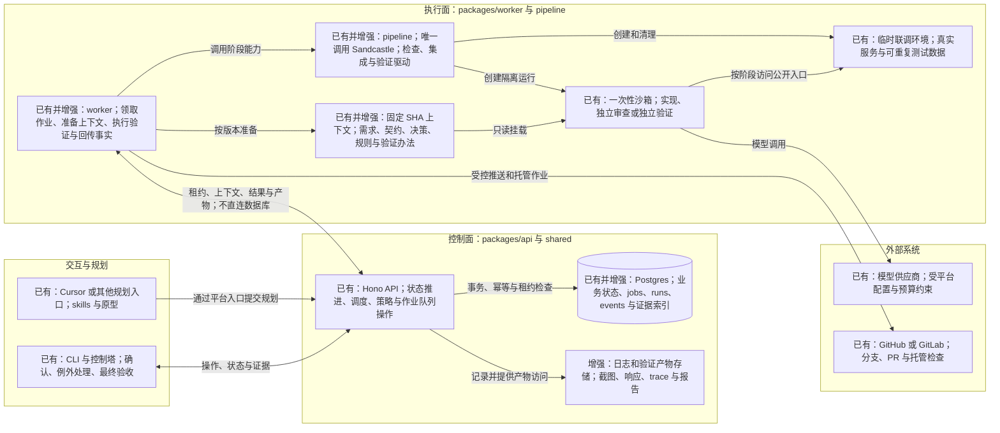
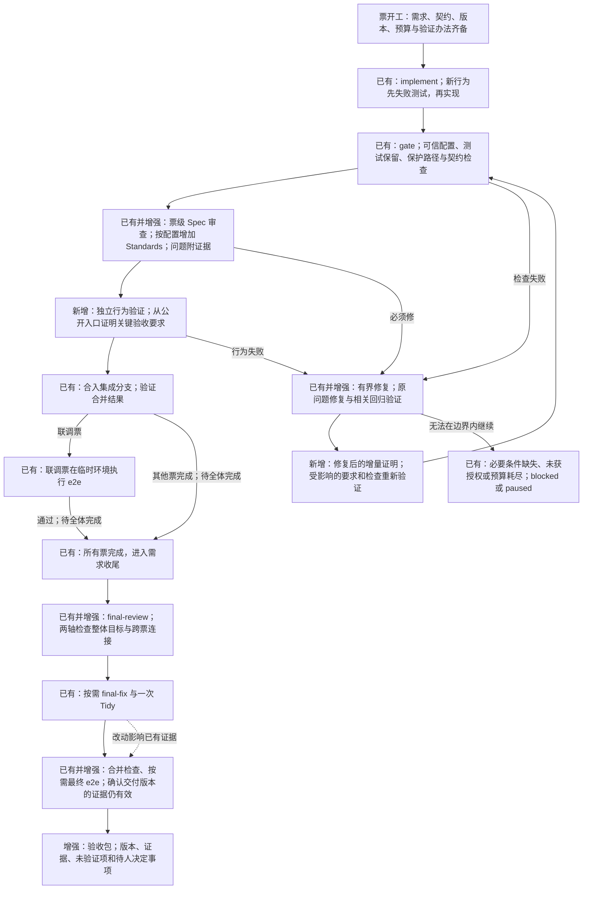

# AFK 目标架构：结合 pstack 与当前平台实现

> 状态：架构建议草案，尚未实施或作为 ADR 批准。
> 基线：2026-11-17 的本仓库工作区；pstack 参考版本为 0.15.43，固定提交 `e1cc03121a0e71129a4fb730d7c5528a0a3e43c8`。

目标效果：人确认需求、取舍和授权后，平台按依赖图推进实现、验证、有限修复和需求收尾；交付结果附带可重放、与实际代码版本一致的证据；重复问题经评测后转成后续运行的结构与检查。最终合并由项目策略决定，人保留裁决与否决入口。

图例：**已有**表示当前实现具备；**增强**表示已有机制需要扩展；**新增**表示建议补齐。节点表示逻辑职责，不表示都要拆成独立服务。

导出图：[总览 PNG](diagrams/afk-target-overview.png) · [总览 SVG](diagrams/afk-target-overview.svg) · [部署关系 SVG](diagrams/afk-target-deployment.svg) · [执行与验证闭环 SVG](diagrams/afk-target-verification.svg)。下方保留可编辑的 Mermaid 定义。

## 1. 目标总览

```mermaid
flowchart LR
    humanScope["人：目标、取舍与授权"]

    subgraph planningLayer ["规划：回答做什么，以及怎样证明做到了"]
        planning["增强：设计与原型比较"]
        specification["增强：需求、契约、依赖与验收"]
        planning --> specification
    end

    subgraph executionLayer ["平台：在授权和预算内无人值守推进"]
        control["已有：确定性调度与状态机"]
        execution["已有：隔离实现与有限修复"]
        validation["增强：独立审查与行为验证"]
        control --> execution
        execution --> validation
        validation -->|"失败事实"| control
    end

    subgraph deliveryLayer ["交付：证明当前版本值得合并"]
        evidence["新增：版本化验证证据"]
        finalization["增强：需求收尾与最终验证"]
        delivery["增强：验收包与合并策略"]
        forge["已有：合入默认分支"]
        evidence --> finalization
        finalization --> delivery
        delivery --> forge
    end

    subgraph improvementLayer ["持续改进：让后续运行减少同类错误"]
        records["增强：运行事实与决策记录"]
        improvement["新增：失败归类与改进 Spec"]
        evaluation["增强：盲测与交付成本评估"]
        capabilities["增强：固定版本的规则与工具"]
        records --> improvement
        improvement -->|"确认后按流程交付"| evaluation
        evaluation -->|"评测通过并获准启用"| capabilities
    end

    humanScope --> planning
    specification --> control
    validation -->|"保存证据"| evidence
    finalization -->|"过期重验"| control
    control -.->|"记录运行事实"| records
    forge -.->|"交付与回归记录"| records
    capabilities -.->|"后续 Run 使用"| execution
    capabilities -.->|"验证与评审方法"| validation

    classDef proposed stroke-dasharray: 5 4
    class evidence,improvement proposed
```

这张图的三条闭环分别是：

- **执行闭环**：实现 → 检查 → 根据失败事实有限修复。
- **证据闭环**：实际版本 → 行为证据 → 收尾变更后重新确认有效性。
- **改进闭环**：真实失败 → 改进 Spec → 评测 → 固定版本供后续运行使用。

人需要决定的 `needs-human`、未完成的 `deferred` 仍在最终验收入口集中呈现。缺少必需条件、未授权保护路径和修复预算耗尽等情况，沿用平台的 blocked / paused 规则。

## 2. 部署与权限关系

保持现有 API、worker、pipeline 与 shared 的职责分工。新增职责先作为现有包内模块实现，无需先拆出额外服务。

权限与事实边界：

1. **状态归平台**。agent 交回结构化事实，状态机决定下一步；模型不直接改票状态或宣布整个需求已交付。
2. **凭据归执行宿主和托管适配层**。沙箱无代码托管凭据，不 push，不自行开 PR 或合并；worker 不引用 API 包，也不直连数据库。
3. **跨仓库输入固定版本**。继续使用 Planning commit、Contract SHA 和只读快照；新增验证证据记录它实际检查的各仓库 SHA。
4. **检查配置来自可信版本**。待检查分支不能通过修改检查配置、验收条件或授权来批准自身。
5. **规则升级影响后续运行**。新规则经过评测和既有授权流程后发布；进行中的 Run 仍使用其已记录的上下文和版本。
6. **方法供平台调用**。吸收 pstack 的设计、验证与评测方法，具体执行纳入平台的 Run、预算、状态和日志管理。无须让沙箱再启动一套独立调度循环。

产物存储表示存储职责，起步可扩展现有日志目录。是否采用对象存储由多 worker、容量和保留期限决定。图中没有要求 worker 直接访问数据库，也没有引入新的基础设施依赖。

## 3. 票与需求收尾的验证关系

以下是建议的职责顺序。图中的“独立行为验证”和“修复验证”尚不是现有 `Stage` / `FinalStep` 的名称；实施时应显式设计状态推进及失败处理。

图中省略了现有 merge-fix 等细分分支，实施仍以状态机为准。联调票 e2e 失败沿用现有 diagnose → 修复票 → 重跑 e2e 路径；不把所有普通检查失败都变成新修复票。

需要同时成立的规则：

- **票级**：review-fix、merge-fix 等改动后，门禁与必要的行为证明对应实际修复版本。
- **需求级**：final-fix、Tidy 和依赖变化后，最终交付证据仍对应实际组合。当前 final-fix / tidy-merge 后触发最终 e2e 的机制保留。
- **Recheck**：继续承担保护已有测试与检查强度的职责；新增的修复验证承担原问题及相关回归的证明，避免把两者混为同一种检查。
- **次数与预算**：沿用有限修复和自动重试边界。检查失败不能靠不断生成新验收条件、放松门禁或无限重审获得通过。
- **无法验证**：如实保留为未验证事项。是否允许交付由项目的可信策略或最终人工裁决定，不能自动当成验证通过。

## 4. 验证证据的最小信息

这是一份建议的信息约束，不是已经新增的数据库表或类型。

| 信息 | 用途 | 谁提供或核实 |
| --- | --- | --- |
| 需求或验收条款 | 指明证据在证明什么 | 规划确认，平台关联 |
| 输入、前置状态与操作 | 使别人能够重放 | 验证办法定义；worker 执行 |
| 预期结果与实际断言 | 防止只检查“命令没报错” | 独立审查确认；运行检查 |
| 本仓库与依赖仓库 SHA | 标明检查了哪个组合 | worker 记录，平台核对 |
| 配置、验证驱动与环境信息 | 判断检查口径能否复用 | 可信配置与 worker 记录 |
| 退出结果、测试结果和产物引用 | 支撑验收包中的结论 | 平台从运行事实生成 |
| 原问题修复前后的结果 | 证明修复解决了原问题 | Bug 修复及修复验证 |
| 适用范围与失效条件 | 避免旧证据被用于新行为 | 项目策略与平台逻辑 |

建议区分“通过”“失败”“无法验证”“已过期”。证据过期后，平台选择相关检查重跑；只有可以证明检查对象、口径和依赖等价时才复用。截图、agent 自述或测试名称本身不自动构成语义上的证明。

## 5. pstack 方法落在什么位置

| 方法 | 在目标架构中的位置 | 采用边界 |
| --- | --- | --- |
| architect 与数据结构先行 | 人参与的规划、Spec 的设计决定 | 状态归属与调用方式明确后再拆票 |
| arena 与竞争原型 | 规划中的高代价设计分歧 | 按需使用；不默认每张票运行多个实现 |
| swarm 与先拆共享状态 | 由平台组织独立验证范围 | worker 沙箱隔离；范围、版本与产物可独立归属 |
| interrogate 与可证实审查 | Spec / Standards 审查及修复验证 | 行为错误给复现；漏做需求和规范违规允许静态证据 |
| prove-it-works 与验证技能 | 项目验证驱动、独立行为验证 | 先实际走通启动、操作、取证和清理，再用于自主运行 |
| show-me-your-work | 现有 Run、Decision log 与 Ruling | 扩展证据关联，保留现有事实来源 |
| benchmark-checklist 与 hillclimb | 性能类需求的验证办法 | 固定负载与脚本，重复测量，一次假设一次检查 |
| correct 与 encode-lessons-in-structure | 失败归类、改进 Spec、检查沉淀 | 改进也经过确认与交付流程；不能直接篡改当前门禁 |
| eval 与 explain-the-number | 现有审查校准及新增对照评测 | 同时看漏报、误报、稳定性和最终交付成本 |
| 形式化验证 | 高风险调度、租约或状态推进逻辑 | 只检查明确性质，写明模型、假设和边界 |

保持按授权范围推进可逆工作的方式。pstack 的工具名、模型默认值、自主外部消息和自动合并示例不直接成为平台权限。

## 6. 与当前实现对应，以及需要补齐的部分

| 职责 | 当前落点 | 目标变化 |
| --- | --- | --- |
| 票阶段、收尾状态推进 | `packages/shared/src/stage-flow.ts`、`finalize-flow.ts` | 保持纯函数；显式加入证据与修复验证相关决定 |
| 调度、预算与持久作业 | `packages/api/src/scheduling/`、`jobs/` | 按已确认依赖和可信验证策略派发；保持幂等与过期持有者隔离 |
| 隔离执行与上下文 | `packages/worker/src/stages/`、`packages/pipeline/src/` | 运行项目验证驱动；执行事实和产物按 Run 回传 |
| 独立审查 | `packages/pipeline/src/review.ts`、`prompts/review-*.md` | 增加可核实的问题证据；保留轴隔离与成本策略 |
| 门禁与 Recheck | `packages/pipeline/src/gate.ts`、`recheck.ts` | 保留可信配置、测试保留和检查强度保护；复用其运行结果 |
| 联调与最终 e2e | `packages/api/src/stages/integration.ts`、`finalize/final-e2e.ts` | 保留真实环境；将跨仓库版本与证据有效性统一呈现 |
| 验收包 | `packages/api/src/acceptance/` | 从测试名与 JUnit 对应，扩展到条款、断言、行为产物和有效版本 |
| 决策与待人事项 | `packages/shared/src/decisions.ts`、`decision-log.ts`、Ruling | 复用现有身份与记录；增加证据关联 |
| 模型和规则版本 | `stage-models.ts`、Skills SHA、Overlay | 固定模型选择与验证驱动版本；升级先校准 |
| 度量与学习 | `packages/api/src/metrics/`、`review-calibration.ts` | 新增重复失败归类；校准补充误报、语义与重复运行评估 |
| 合并策略 | `packages/shared/src/auto-merge.ts`、托管作业 | 保留单一受控出口；扩展自动合并范围须另行批准 |
| 人的验收入口 | `packages/web`、`packages/cli` | 先展示待决定和未验证事项，再按需展开可重放证据 |

当前自动合并仅针对项目明确开启策略且满足条件的单 PR improvement。图中“按策略交付”不表示 feature 或多仓库自动合并已实现。目标交付范围止于默认分支；部署和生产数据操作需另行设计并授权。

## 7. 建议实施顺序

1. **先跑通一个真实需求的证据链**：定义验证办法、独立重放、保存版本与产物，并在验收包展示。先复用现有作业和存储。
2. **补齐证据失效与修复验证**：同时覆盖票流水线和需求收尾；测试新旧版本、依赖变化、无法验证、重试与迟到结果。
3. **形成失败改进闭环**：从历史记录归类，生成改进 Spec，用原失败案例和无缺陷对照验证新增检查。
4. **再扩大验证并行与自主交付范围**：以质量和总交付成本数据为依据；项目授权和保护路径仍生效。

## 8. 一手依据与设计边界

当前能力的依据：

- [票阶段推进](../packages/shared/src/stage-flow.ts)、[需求收尾推进](../packages/shared/src/finalize-flow.ts)、[审查轴](../packages/shared/src/review-axes.ts)
- [作业租约和幂等](../packages/api/src/jobs/queue.ts)、[确定性调度](../packages/api/src/scheduling/scheduler.ts)
- [独立审查运行](../packages/pipeline/src/review.ts)、[门禁](../packages/pipeline/src/gate.ts)、[Recheck](../packages/pipeline/src/recheck.ts)
- [最终 e2e 触发](../packages/api/src/finalize/final-e2e.ts)、[当前验收判定](../packages/api/src/acceptance/pack.ts)
- [Decision log](../packages/shared/src/decision-log.ts)、[Overlay](../packages/pipeline/prompts/overlay.md)、[自动合并策略](../packages/shared/src/auto-merge.ts)
- [审查校准](../packages/pipeline/src/review-calibration.ts)、[度量](../packages/api/src/metrics/metrics.ts)

pstack 方法的依据：

- [主入口及原则](https://github.com/cursor/plugins/blob/e1cc03121a0e71129a4fb730d7c5528a0a3e43c8/pstack/skills/poteto-mode/SKILL.md)
- [设计与多方案探索](https://github.com/cursor/plugins/blob/e1cc03121a0e71129a4fb730d7c5528a0a3e43c8/pstack/docs/guide/04-design.md)
- [验证与交付](https://github.com/cursor/plugins/blob/e1cc03121a0e71129a4fb730d7c5528a0a3e43c8/pstack/docs/guide/06-verify-and-ship.md)
- [纠错与评测](https://github.com/cursor/plugins/blob/e1cc03121a0e71129a4fb730d7c5528a0a3e43c8/pstack/docs/guide/09-make-it-yours.md)

图中所有“新增”“增强”的目标变化，是结合以上资料提出的设计建议，不冒充当前源码已经提供的能力。本文未修改现有状态机、保护路径、平台配置或已批准 ADR。
