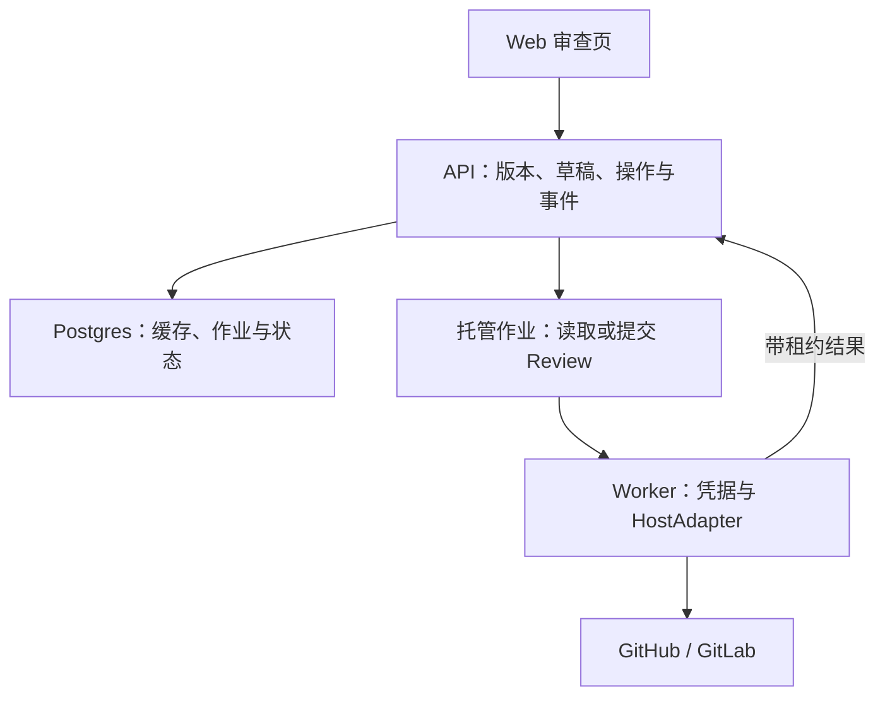

# AFK 内置代码 Review 方案

研究日期：2026-11-26。状态：设计建议，尚未实施。

目标：让人在 AFK 中完成「理解需求 → 阅读代码变更 → 留下意见 → 交给 agent 修改 → 查看修改结果」；PR/MR 及其讨论继续由代码托管维护。

## 1. 建议先做什么

在 Spec 下增加独立的「代码审查」页面，以一个仓库的 PR/MR 为实际审查对象。第一阶段提供 Diff、验收上下文、讨论读取和 AFK 内的反馈草稿；第二阶段接通人工身份和外部 Review 写入；第三阶段接通「按意见追加 Ticket」与审查导读。

最有价值的部分是让代码与 Spec、User Story、Ticket、Finding、门禁、验收包互相定位。AFK 已经有这些上下文，比从零建设一个通用 PR 客户端更有优势。

正式批准、要求修改、合并是三个不同动作。批准不能触发合并。当前 ADR 0011 只允许 `auto-merge` 托管任务调用合并出口；本方案首期仍保留到托管平台合并的入口。以后如需在 AFK 手动合并，需要单独调整该 ADR 和对应守卫约束。

## 2. Linear.app 的实际研究结果

### 2.1 方法和证据边界

通过 REA 对 `/Applications/Linear.app` 做目录检查、ASAR 清单检查、只读提取和选定 JavaScript 的静态分析；没有执行提取出的代码，没有登录、发表评论或修改 Linear 数据。再用 Linear 官方文档核对本地包未包含的产品流程。

本机安装版本为 **1.32.8**。`app.asar` SHA-256：

`5f13f9e9784b1c5a13b761ec50657879408084e8f8ee91fbfb3c6b1aa80b0dd8`

| 观察 | 证据 | 能够得出的结论 |
| --- | --- | --- |
| Electron 桌面客户端，入口 `out/main/index.js` | ASAR 的 `package.json` 与清单 | 可以检查桌面容器、preload 和桥接逻辑 |
| 生产 host 为 `https://linear.app`，入口含 `/auth/desktop`；主进程向该 host 加载页面 | `out/main/chunks/Constants-DFIMYa3N.js`；主进程 `loadURL` 调用 | 本地包不是完整业务前端，不能仅凭包内容还原 Diff 组件或服务端设计 |
| preload 暴露 `updateReviewPreview`、`signInToReviewPreview`、`continueReviewPreviewSignIn`、`onReviewPreviewMessage` | `out/preload/index.js` | 桌面端存在专门的 Review 预览桥接接口 |
| 主进程创建 `WebContentsView`，使用 `persist:linear-review-previews` session，并检查 `review-previews` 功能开关 | `out/main/index.js`，字符偏移约 530000–538500 | 包中有嵌入页面预览和登录续接的实现；不证明当前账号启用了它 |
| 预览协议含 `init`、`ready`、`navigation-command`、`page-change`；携带 version、generation、origin 等 | `out/preload/review-preview.js`，尾部协议定义 | 这是页面预览/导航桥接，不能把它当作 PR 行内评论协议 |

REA 清单发现 3 个解包的原生模块与 ASAR 声明摘要不一致：force-press、haptics、swipe-navigation。本次按 `record-and-continue` 保留差异，没有加载它们，也不依据其内容推导 Review 行为。签名或后处理可能造成这种差异，但本次未验证原因。

静态分析选择了 5 个路径，解析了 4 个 JS 文件、约 959 KB 文本；部分语义关系达到 REA 默认保留上限，9 个清单文件未进入本次源分析。结论不覆盖完整运行行为，也不声称还原了 Linear 的 Diff 渲染引擎、缓存策略、GraphQL 模型或同步后端。

证据索引：

| 操作 | REA Evidence ID |
| --- | --- |
| 桌面目录检查（完整父记录） | `ev_b6e665af0c80034aa77813489c15da0342fa64ba811063cb21dd7abd05a18b16` |
| ASAR 检查（完整父记录） | `ev_d4b1c438bc848e6b0af4291ff912d7cb13517fab83ec4673e37de5f4c29da995` |
| 只读提取 | `ev_23a39b6252c037904f628d2bb6c08e1f1dc067849b5866c05ad81e4eb22ca53e` |
| JavaScript 应用分析（完整父记录） | `ev_42d97bdb43aefac410329254e1dbf3b7349eeac60b199ebeefd5f2a15a3b1b59` |

### 2.2 产品上值得借鉴的能力

下面是官方文档确认的功能，并非全部来自本机静态分析：[Reviews](https://linear.app/docs/diffs)、[Code review should be fast](https://linear.app/now/code-review-should-be-fast)。

| Linear 能力 | 对 AFK 的启发 |
| --- | --- |
| Reviews 集中待审 PR、自己创建的 PR，支持筛选分组 | 后续提供跨 Spec 审查列表；先让 Spec 内的审查闭环可用 |
| Unified / Split Diff、文件分组、已审文件筛选 | 文件导航 + 可切换 Diff；测试、生成文件可折叠，但显示数量 |
| 行内讨论与 GitHub 同步，可提交批准/修改要求 | 外部讨论以托管平台为准；AFK 提供阅读与操作界面 |
| Guide 把变更组织为带目的解释的章节 | 用 AFK 的 User Story、Ticket、契约依赖构造导读 |
| 需求背景与代码相邻 | 右侧直接展示验收标准、门禁、Finding 和对应证据 |
| Review 预览 | 对 AFK 暂缓实施；后续接已有的验证产物或部署预览 |

Linear 文档对代码审查要求工作区 GitHub 代码访问和个人 GitHub 连接。不能据此推断 Linear 在 GitLab 上具有同等能力；AFK 需要自己适配 GitHub 和自建 GitLab。

## 3. AFK 当前可复用什么，缺什么

源码基线为 `62eb1f8f45a4a0182bc3d058556d26fbb936279a` 加当前工作区。已有未提交的前端修改保持原样；本次只新增本方案。

| 位置 | 已有事实 | 扩展方式 |
| --- | --- | --- |
| `packages/web/src/spec-detail/delivery.tsx` | PR/MR 外链、CI/review 汇总、合并顺序、收尾及验收包 | 在 PR/MR 卡片加「审查代码」，保留原链接 |
| `packages/web/src/spec-detail/pack.tsx` | 验收标准、待决定事项、意见等上下文 | 提取可复用的紧凑上下文面板 |
| `packages/api/src/db/schema.ts` 的 `pullRequests` | head SHA、CI、review 汇总、人工评论数量、同步时间等 | 增加不可变审查版本、讨论缓存、草稿、已审标记和操作状态 |
| `packages/host/src/types.ts` | `HostAdapter` 能开 PR/MR、读状态、更新描述、draft/ready、合并、删分支 | 增加 Diff、讨论、Review 的能力接口 |
| `packages/host/src/github.ts`、`gitlab.ts` | 为状态汇总读取 reviews/comments 或 approvals/notes | 将讨论投影为公共数据模型；目前没有向页面提供完整讨论串和 Diff |
| `packages/api/src/host/host-jobs.ts`、`pull-requests.ts` | API 编排、worker 执行、结果入库；host-sync 默认 60 秒 | 增加按需读取/写入作业，不让 API 直接持托管凭据 |
| `packages/worker/src/host.ts` | 唯一凭据执行端；按 `HostTask` 调适配器 | 执行 Review 读取和操作；返回受 schema 约束的数据 |
| `packages/shared/src/stage-flow.ts`、`finalize-flow.ts` | 票级 review 与需求收尾各有既定流程 | 保留自动审查语义，人工 Review 不冒充自动 review/recheck |
| `packages/api/src/planning/planning.ts` | awaiting-review 下追加会进入 reworking、重置收尾、取消自动合并并把 PR 转 draft | 人选中反馈后生成追加 Ticket，复用此路径 |
| `packages/shared/src/auto-merge.ts`、`packages/worker/src/guards.test.ts` | 自动合并策略与唯一合并出口有约束 | 增加本地人工反馈否决；保留现有合并出口 |

一个需随交付入口修正的旧文案：`delivery.tsx` 写着「平台从不合入」，已经与 ADR 0011 的可选自动合并不一致。应根据项目策略显示准确说明。

## 4. 页面与操作流程

### 4.1 入口和布局

建议路由：`/specs/:specId/review/:pullId`。`pullId` 是平台 PR 记录 ID，通过 API 校验它属于该 Spec；不要由浏览器提交任意仓库 URL 给后端抓取。

审查工作区由三个区域组成：

- 左侧约 240px：仓库切换、Merge order、文件树、搜索、变更数量、已审进度。
- 中间自适应：`变更 / 导读 / 讨论` 切换，Unified / Split Diff，展开上下文，行号选择和行内意见。
- 右侧约 320px、可折叠：Spec/User Story、相关 Ticket、验收标准、门禁、自动审查意见、原托管链接。

顶部固定显示 PR/MR 标识、base/head SHA、同步时间、CI、返工或合并状态、提交 Review 按钮。窄屏只用 Unified，背景信息以抽屉打开。

沿用当前 React、TanStack Query、Router、Radix 和现有样式系统，不引入第二套页面框架。代码区保留必要的行号和等宽字体；业务操作使用「标记已审」「提交意见」「批准」「要求修改」「交给 agent 修改」等清楚的名称。

### 4.2 一次审查

1. 从 Spec 的交付页打开 PR/MR，立即显示缓存与其 SHA；同时发起按需刷新。
2. 新快照到达后提示「有新提交」，由人切换版本；不在阅读中悄悄替换行号和内容。
3. 按文件或导读阅读，选择具体行留下草稿。草稿存在 AFK，提交前不写回代码托管。
4. 提交前重新核对 head/版本、行定位、权限和身份。成功后显示托管平台返回的 Review/讨论 ID。
5. 需要修改时，选中意见，补充预期行为与验收标准，查看即将追加的 Ticket，确认后调用现有追加流程。
6. 追加完成后在同一 PR/MR 查看新版本，突出「自上次审查后的变更」并保留旧版本意见。

单纯 Comment 或 Request changes 不应直接启动 agent。只有明确的「交给 agent 修改」才创建追加 Ticket，避免每条讨论都变成流水线工作。

## 5. 后端与托管连接设计

### 5.1 沿用现有凭据边界

Web 不直连托管，不拿 token。API 返回缓存，缺失时返回 `202 + operationId`；worker 完成后通过现有事件/SSE 机制使 Query 失效。API 不依赖 worker 包，worker 不连数据库；沙箱 agent 无托管凭据、无平台连接。

新增读取类托管作业，如 `review-sync`、`review-file`；操作类作业如 `review-submit`、`review-reply`、`review-resolve`。类型放 shared，编排放 api/host，执行放 worker/host，HTTP 映射放 host。它们不是新的 Ticket 阶段，不消耗 implement/review 的修复次数。

打开 PR/MR 时先同步元数据和文件列表；仅按需加载可见文件的 patch/内容。活跃审查按需刷新，非活跃 PR/MR 沿用 host-sync；不要每分钟为所有 PR 全量下载 Diff。为短交互读取保留托管并发，避免被长 agent 作业饿死。

### 5.2 身份必须分清

| 操作 | 建议身份 | 页面语义 |
| --- | --- | --- |
| 读取代码、CI、公开讨论 | 已有仓库连接凭据 | 仓库访问权限不足时说明具体原因 |
| AFK 草稿、已审标记、交给 agent | AFK 当前操作人 | 本地事实，不宣称已在托管平台批准 |
| 批准、要求修改、以本人名义评论 | 个人 GitHub user token / 个人 GitLab OAuth 或 PAT | 明确显示实际托管账号 |
| 可选的 bot 代发普通意见 | 已有 bot 凭据 | 显示为 bot 代发，并保留 AFK 操作人；不能充当本人审批 |

当前 GitHub 用 App installation token、GitLab 用 worker 本机 PAT，没有个人连接层。先开放读取和草稿可以复用现有连接；正式人工 Review 必须补个人连接。首期可在本机显式配置个人审查连接，后续再做 OAuth。密钥仍只留 worker 的凭据存储，API 仅记 opaque connection ID、托管用户 ID、权限和过期状态；不能把 token 放入 job payload、日志或沙箱。

GitHub 的 Review 创建接口支持 user token，动作包括 `APPROVE`、`REQUEST_CHANGES`、`COMMENT`，可指定 `commit_id`；具体写入权限及评论行定位由适配器处理。GitLab 的 discussions 使用 Diff 版本的 `base_sha/start_sha/head_sha` 和路径/行号。GitLab CE 17.3.1 的能力必须在目标实例做兼容验证，不能把最新版文档或 EE 能力当作生产承诺。

参考：[GitHub Reviews API](https://docs.github.com/en/rest/pulls/reviews)、[GitHub 用户身份认证](https://docs.github.com/en/apps/creating-github-apps/authenticating-with-a-github-app/authenticating-with-a-github-app-on-behalf-of-a-user)、[GitLab Discussions API](https://docs.gitlab.com/api/discussions/)、[GitLab Approvals API](https://docs.gitlab.com/api/merge_request_approvals/)。

### 5.3 不把 GitHub 和 GitLab 硬压成相同流程

为适配器增加能力描述，例如 `diff`、`inlineComment`、`reply`、`resolveThread`、`approve`、`requestChanges`、`batchReview`。值应区分 supported / unsupported / unknown，并带原因；权限变化后重新探测。404 可能是无权限、资源不存在或不支持，不能一律当作空数据。

读接口建议：`getReviewRevision`、`listChangedFiles`、`getFileDiff`、`listReviewThreads`。写接口建议：`submitReview`、`replyToThread`、`setThreadResolved`。公共请求与结果 schema 放 shared，适配器接口和托管协议留在 host。

平台草稿允许多条意见一起提交，但只有托管提供原子批量提交时才能显示为原子成功。GitLab 若逐条写入，在 AFK 显示逐条成功/失败，重试只处理已确认未成功的项。

## 6. 数据、版本与一致性

以下均为新增设计，现有表没有这些完整能力。

| 建议实体 | 关键字段与作用 |
| --- | --- |
| `review_revisions` | pullId、base SHA、head SHA、merge-base SHA、host Diff version/refs、文件清单摘要、覆盖情况、同步时间；不可变 |
| `review_files` | revisionId、old/new path、状态、old/new blob SHA、增删行数、patch 可用性、截断原因；内容缓存分开存放 |
| `review_threads` / `review_comments` | host 外部 ID、作者、版本、原始行定位、resolved/outdated、托管更新时间；托管事实的缓存 |
| `review_sessions` / `review_drafts` | 操作人、个人连接、revisionId、正文与行意见、提交结果；用户草稿与外部事实分开 |
| `review_file_views` | 操作人、pullId、path、old/new blob SHA、reviewedAt；文件内容改变才失效 |
| `review_operations` | requestId、sessionId、操作类型、子项状态、host 外部 ID、待核实/失败信息；用于幂等和对账 |
| 合并否决/审查占用记录 | Spec/pull、操作者、状态、开始时间与原因；即使外部评论代发失败也生效 |

Diff 快照以托管平台报告的版本为准。GitHub 的比较基线与 GitLab diff refs 由各自适配器规范化，不能用「当前 main 对当前 head」代替 PR 的实际比较结果。获取文件列表、patch、内容前后核对版本，发现变化就放弃混合结果并重取。

行定位至少包含 `revisionId + old/new path + LEFT/RIGHT + line/range`；适配器保留托管原始 position。删除行、重命名、多行意见不能只用「路径 + 新行号」。历史意见保留原位置并标记过时，只有明确映射成功才展示在新版本代码上；禁止静默改挂。

新 head 到来时，将旧审查结论在 AFK 标成「针对旧版本」，是否撤销托管审批由托管策略决定；AFK 不伪造已撤销状态。Guide 必须携带 revisionId，不能给新代码展示旧版本导读。

缓存可以重建，PR 讨论的权威来源仍是代码托管；AFK 持久化自己产生的草稿、已审进度、操作和追溯关系。仓库文件正文只做受限缓存，不把它们变成第二套规范来源。

### 6.1 写入失败与重试

API 接受操作时生成稳定 requestId；数据库唯一约束阻止同一请求重复建作业。fencing 只保证平台接受哪个结果，不保证第三方写操作只发生一次。

遇到「请求可能成功但返回超时」，标成待核实，先按 host 外部 ID、用户、提交 SHA、关联标记等对账，无法确认时保持不确定并提供核对入口。没有托管幂等保证时不能盲目重发，避免一条意见出现两次。

错误区分无权限、仓库不可达、速率限制、过期版本、行位置无效、能力不支持和远端结果未知。单个文件/讨论加载失败不清空已有审查内容。

### 6.2 自动合并与人工反馈

这是上线前必须处理的正确性要求。

现有适配器的 `humanComments` 排除了 bot 和 token 自己；AFK 用 bot 代发人工意见时，现有规则可能看不到这次人工介入。现有 worker 的 auto-merge 任务又只在合并时传 expected head SHA，不能仅靠上一次 host-sync 判断最新人工状态。

- 接受人工意见或「交给 agent 修改」时，先在 API 事务中记录持久否决，再排外部写入或追加作业。外部失败、删评论、使用 bot 代发都不消除该否决。批准也不自动清除此类否决。
- 显式「开始审查」可申请临时合并占用，避免人在写草稿时自动合并。页面说明其状态；不要仅靠打开页面无限阻塞。占用的释放/过期规则需清楚，已经提交的否决不会随占用过期。
- 人工占用/否决与自动合并获得执行授权必须在同一 Spec/PR 锁与操作状态下串行决定。已经获得并开始远端合并的操作显示「合并进行中」，不能承诺事后阻止。
- 尚未执行的自动合并作业因否决失效；worker 执行前复核授权和最新托管条件。远端调用继续使用 expected head SHA。
- GitHub/GitLab 上最后一瞬间新增评论与合并之间，若托管没有原子条件支持，就仍有竞态。说明保障边界，不能宣称仅凭 SHA 检查消除了评论竞态。

## 7. 人工意见如何进入现有流水线

不把人工意见直接塞进自动审查 Finding 并改它的 fixed/approved 状态。Finding 的现有含义与阶段消费规则保持清楚；PR 讨论通过独立关联指向 Finding、Ticket 或 Spec。

「交给 agent 修改」先生成可检查的 Ticket 内容，包含：原意见及 host 链接、revision/head SHA、文件与行证据、预期行为、验收标准、所属 Repo、必要依赖。人确认后使用现有 tickets import append 公共业务能力，事务内写入关联，防止双击重复追加。

当前追加到 awaiting-review 会进入 reworking，PR 转 draft、自动合并停止；追加 Ticket 走 implement → 门禁/审查 → 合并等既有流程，之后重新收尾、验收包和 PR 描述更新。收尾自己的 final-review/final-fix/Recheck 仍按原规则推进。旧 Ticket 不重开，不重置它的 reviewed/fixCounts 来假装重新实现。

对已经 partially-merged 的 Spec，现有规则拒绝追加；界面应给出创建后续 Spec 的路径。契约改动和跨仓库意见需要先形成符合 contract/blocks 约束的追加计划，不能把多仓库要求交给一个 Ticket。

「agent 报告已修改」只链接修复 Run/提交及门禁结果，不自动等同于「人工已验证」或自动关闭外部讨论。是否 resolve 由人明确选择，或由后续单独制定的验证规则决定。

## 8. Diff 实现与性能边界

先定义稳定的结构化 patch/行锚点模型，再实现 UI。当前 web 已依赖 `diff`，可先验证其 patch 解析能力并制作 renderer 小样；不要仅凭包名就假定它能满足完整 Review UI。Diff renderer 用独立组件封装，便于未来替换。

- 首屏只加载清单与首个文件；长文件按 hunk 懒加载/虚拟化，语法高亮放 worker 或分段计算。
- 支持添加/删除/重命名、无换行结尾、二进制、文件权限变化；二进制先显示元数据与托管入口。
- 生成文件与 lockfile 默认折叠，提供完整数量和展开入口。测试变更与规范变更在 AFK 有门禁意义，不能静默隐藏。
- API 返回 `complete / partial / unavailable` 以及原因；托管截断、超大文件、缺 patch 必须可见，不能显示「全部已审」。
- 超大 Diff 可在 worker 以固定 SHA 获取 Git 对象后生成只读 Diff；新 Git 读取封装仍放 pipeline，worker 调用。禁用 external diff/textconv，不执行仓库脚本，不使用人的脏工作区。
- 对比缓存以 repo + immutable revision + path/blob 为键，限制单文件和总缓存大小。切换显示选项不重复请求全 PR。
- Markdown 及代码按文本安全渲染；预览不执行仓库内容。嵌入外部预览的 session、授权和网络边界留待单独设计。

性能目标作为验收预算：已有缓存时审查框架与文件列表尽量在 1 秒内可用；缓存文件切换尽量在 200ms 内完成。按固定机器、典型 PR 与大 PR 实测，分别报告冷启动、worker 排队、网络和渲染耗时，不能将这些预算当成已达到的指标。

## 9. 分阶段交付和建议拆票

| 阶段 | 可交付行为 | 建议 Ticket 范围 |
| --- | --- | --- |
| P0：版本与边界验证 | GitHub 和目标 GitLab CE 能读出固定版本 Diff/讨论；人工身份与自动合并规则明确 | 适配器能力验证；GitLab 17.3.1 兼容样本；Review 数据契约；合并否决与占用设计 |
| P1：平台内阅读 | 从交付页打开审查；文件树、Unified/Split、上下文、讨论只读、已审标记、草稿、刷新/过期提示 | 读取接口和 host 作业；缓存/版本迁移；Diff renderer；审查路由；验收包关联；本地草稿与进度 |
| P2：平台内正式 Review | 本人身份评论/回复/批准/要求修改；明确成功与未知结果 | 个人连接；写入能力适配；操作幂等/对账；自动合并否决/占用实现；提交/错误 UI |
| P3：反馈闭环 | 选意见追加 Ticket；同一 PR/MR 看修复与新增变更 | 反馈转追加；来源追溯；新旧版本比较；人工验证/resolve |
| P4：提升效率 | 跨 Spec 待审列表、按 User Story 的 Guide | 审查队列；导读生成/缓存/证据定位；风险排序 |

P1 就能显著减少为看代码来回跳转，但正式外部 Review 写入要到 P2；完整「看、评、改」闭环到 P3。先完成 P1–P3，再投入自动导读、结构化语法 Diff、复杂预览和通用 PR 收件箱。

Guide 可先按明确关联生成：Spec → User Story → Ticket → 涉及文件，再按契约依赖给出顺序。文件可能来自多张 Ticket，关联应允许多对多，并通过提交 trailer/Link 与实际最终 Diff 交叉核对。LLM 只生成解释和候选跳转，必须校验路径/行锚点存在、显示来源和未覆盖文件；导读不替代门禁或人工判断。

## 10. 验收与实现门禁

新行为先通过公共接口写红测，再实现；不 mock 自己的 API/数据库模块，托管 HTTP 使用系统边界 fake。

| 场景 | 验收要求 |
| --- | --- |
| 基本阅读 | GitHub PR 和目标 GitLab MR 都能展示真实 Diff、CI、讨论与验收上下文 |
| 版本变化 | 外部 push、update-branch、reworking 后，新版本不会沿用失效行定位、Guide 或内容已变的已审标记 |
| 内容边界 | 删除/重命名/二进制/超大文件/截断/缺 patch 都有正确表现；部分数据不能显示为完整 |
| 提交身份 | 外部记录作者与页面显示一致；无个人连接时不显示为本人已批准 |
| 幂等与故障 | 双击、worker 重领、响应丢失、部分写入成功不会盲目重复发评论；未知状态可核对 |
| 权限与能力 | 401/403/404/429、个人 token 失效和 GitLab 不支持的能力有可理解的状态 |
| 合并交互 | bot 代发人工反馈、写入失败、旧 host-sync、已排队 auto-merge 均不能绕过本地否决；开始远端合并后的边界明确 |
| 反馈闭环 | awaiting-review 追加进入 reworking 并走完整票级和收尾流程；partially-merged 拒绝并引导后续 Spec |
| 安全边界 | Web/job/log 中无 token；worker 不连数据库；agent 不获得凭据；跨 Spec pullId 不能越界 |
| 既有约束 | 自动审查 Finding 状态和 fix 次数不被人工 Review 篡改；唯一合并出口守卫继续通过 |

实施时变更 `schema.ts` 必须生成并提交 SQL；新增/变更 API 路由执行 `pnpm gen:api` 更新 OpenAPI 与客户端。每个阶段提交前运行 `pnpm typecheck`、真 Postgres 的 `pnpm test`、`pnpm lint`，保留既有测试名称和数量约束。

本次只形成方案，没有修改业务代码、数据库、API 或保护路径，也未运行项目门禁。后续若需要修改 `.github/**`、`.sandcastle/**` 等保护路径，仍按仓库规则单独交给人决定。
