# AFK 研发平台设计方案

2026-10-27 · @xuxinghua

修订：2026-10-27 评审后补充单票执行流水线、作业与恢复、Git 操作规范、门禁、上下文注入与结构化输出、`plat` 导入格式、blocked 处理；修正跨 spec 依赖、跨需求冲突、GitHub 权限、追溯链路的写法。

修订：2026-10-28 按 M0 实测结果修订「单票执行流水线」「门禁」「Agent 与 skills 对接」（上下文注入、结构化输出、AFK prompt 写法）和「待验证事项」。实测依据见「参考资料」里的调研文件和原型分支。同日又按「Sandcastle 隔离与并发缺口的 worker 侧对策」改了执行层架构图、「Git 操作规范」（新增“槽位”“取回结果”）、「作业与恢复」的中断恢复；集成分支锁也在同日改成作业上的 `lock_key`（见「Git 操作规范」「作业与恢复」）。

## 背景与目标

目标是让实现阶段无人值守：人只在规划（grill → spec → tickets）和最终合并时出现，中间由平台调度 Sandcastle，在沙箱里逐张票实现。

现在每个需求走 grill-with-docs → to-spec → to-tickets，然后每张票开一个新对话跑 implement。每张票都要人开会话、盯进度、判断下一张能不能开工，所以人必须一直在场。

本期范围：

- 多个项目，前后端分仓，各自独立开发、维护、部署
- 同一项目可以并行开发多个需求
- 平台记录 spec、tickets 和它们的依赖关系，是研发信息的记录系统
- 研发上下文沉淀下来，反哺后续的缺陷修复和优化
- 可扩展，能作为基础平台给更多项目使用

不在本期范围：合并到 main 的自动化。前期由人合并，见「合并到 main 与信任阶梯」。

## 已定决策

以下 8 项决策均于 2026-10-27 确定，是后面所有设计的前提。

| #   | 决策                                                                                   | 对设计的影响                                                                                                                                                                            |
| --- | -------------------------------------------------------------------------------------- | --------------------------------------------------------------------------------------------------------------------------------------------------------------------------------------- |
| 1   | 前后端分仓，不收成 monorepo（项目大，分开开发、维护、部署）                            | 跨仓库需求是主路径，按契约先行拆票                                                                                                                                                      |
| 2   | 平台是研发信息的记录系统，PR 留在代码托管                                              | 平台同步并展示 PR 状态，自己不做合并                                                                                                                                                    |
| 3   | PoC 在自己机器上跑，稳定后上公司服务器                                                 | 同一套代码，迁移只改配置                                                                                                                                                                |
| 4   | 合并到 main 由人做，后续再考虑交给 agent                                               | 在代码托管上用分支保护强制；用指标积累信任。GitHub 免费个人账号的私有仓库用不了分支保护和 ruleset（2026-10-28 实测），PoC 阶段改用“平台自己保证 + 事后检测”，见「平台与代码托管的分工」 |
| 5   | 代码托管：PoC 用 GitHub，生产用自建 GitLab CE 17.3.1                                   | 做代码托管适配器，先 GitHub，后 GitLab                                                                                                                                                  |
| 6   | 契约用 skills 写在后端仓库（主仓库）；规划在 Cursor 里做，后端是主项目，前端加入工作区 | tracker 文档放后端仓库；契约按 commit SHA 引用                                                                                                                                          |
| 7   | PoC 的 AFK agent 用 Cursor Agent CLI，走公网                                           | 不依赖会话续接；prompt 只放指针                                                                                                                                                         |
| 8   | PoC 只有自己用，worker 用本机 Docker                                                   | 不做登录，只监听 localhost；联调用本机 docker 网络                                                                                                                                      |

## 设计原则

七条原则贯穿所有设计，遇到取舍时按它们判断。

1. **调度是确定性的，不交给 LLM。** to-tickets 已经写好票之间的依赖边，平台直接按边算出可以开工的票。skills 仓库的 `docs/engineering/implement-spec.md` 也说：真正 AFK 的场景，确定性循环更快、更便宜、更可靠。
2. **Agent 只写代码和 commit，状态全由平台改。** Agent 不 push、不关票、不改标签、不开 PR，和 Sandcastle 仓库自己的 implement prompt 一致。沙箱不连平台 API，也没有 git 凭据；agent 需要的上下文由 worker 渲染成文件只读挂进去。失败时状态不会乱。
3. **一次运行只往一个仓库提交。** 需要参考另一个仓库时，只读挂载它在固定 SHA 上的快照。
4. **存指针，不复制。** GLOSSARY.md、ADR、契约留在仓库里，平台只存链接和索引；prompt 里也只放指针，让 agent 自己去读。
5. **按“每次全新会话”设计。** 会话续接（resume）只在 agent 支持时当优化用，这样换 agent 只改配置。
6. **人工检查点尽量后移。** 人只出现三次：确认拆分、处理 blocked、最终验收。每次拿到的是整理好的简报，不是原始输出。
7. **不信任 agent 自己的产出，只信任平台验证过的事实。** 门禁配置从基准提交读，不从 agent 分支读；agent 的输出必须是通过 schema 校验的结构化结果；合并后的集成分支要再跑一次门禁才算数。

## 总体架构

平台分三层：交互层（Cursor + skills、平台页面）、控制面（API、调度器、数据）、执行层（worker + Sandcastle + 沙箱）。代码托管在平台外，通过适配器连接。

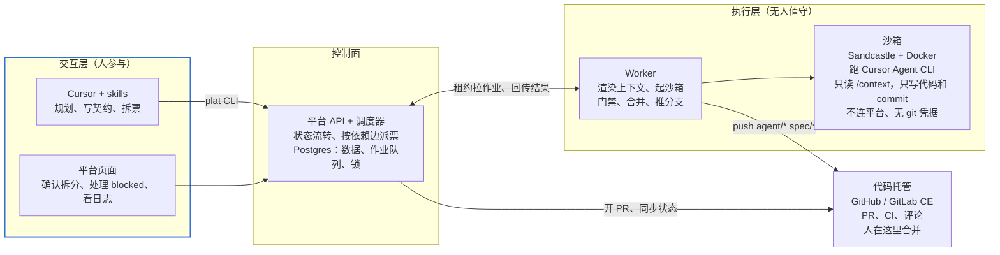

人在交互层规划和确认；调度器把可以开工的票写进队列，worker 以租约方式拉取，在沙箱里跑 agent，再把结果回传平台；PR 在代码托管上由人合并。

| 组件            | 职责                                                                                                        | PoC 形态                               |
| --------------- | ----------------------------------------------------------------------------------------------------------- | -------------------------------------- |
| Cursor + skills | grill、写 spec 和契约、拆票，通过 `plat` CLI 写入平台                                                       | 你的 Cursor 工作区（后端为主项目）     |
| `plat` CLI      | skills 和人操作平台的入口：建 spec、导入票、查票、处理 blocked、查上下文。沙箱里不装                        | 本机安装                               |
| 平台 API        | 领域数据读写、状态流转、发事件、校验作业的 fencing token                                                    | TypeScript 服务                        |
| 调度器          | 按依赖边算可开工的票，控制并发和预算，派发作业                                                              | 在 API 进程内                          |
| 作业队列        | 持久化作业，worker 以租约方式拉取，见「作业与恢复」                                                         | Postgres 表                            |
| Worker          | 拉作业，渲染上下文文件，调 Sandcastle 起沙箱跑 agent，跑门禁，合并集成分支，推分支，回传日志、commits、结果 | 本机进程                               |
| 沙箱            | 隔离运行 agent（Cursor Agent CLI）                                                                          | 本机 Docker                            |
| 代码托管适配器  | 开 PR，同步 PR 状态、CI 和评论                                                                              | GitHub（生产换 GitLab CE）             |
| 页面            | 查看和管理需求、票、运行日志、PR、blocked 队列                                                              | 简单 Web 页面                          |
| 存储            | 业务数据；日志和上下文文件                                                                                  | Postgres；本地目录（服务器上换 MinIO） |

执行层内部：worker 在宿主机上准备好代码、上下文和快照，沙箱只拿到挂载进来的目录。写权限只有一次性的“槽位 clone”一处（见「Git 操作规范」），主 clone 不挂进沙箱，推送凭据只在 worker 手里。

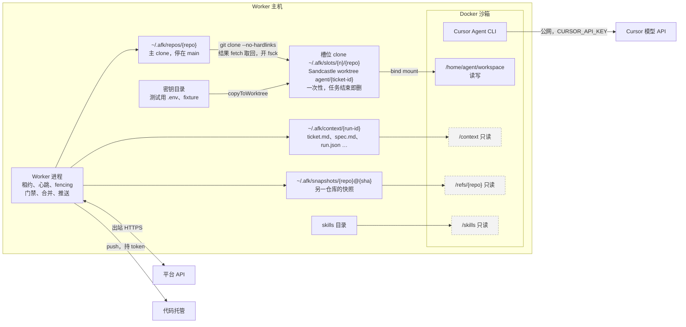

## 领域模型与状态机

核心是 6 个实体：Project、Repo、Spec、Ticket、Edge、Run，另有 Finding、Link 支撑 review 和追溯，Job、GateResult 支撑执行。

| 实体       | 关键字段                                                                                                                                                                                                                                                                                                                                      | 说明                                                                                 |
| ---------- | --------------------------------------------------------------------------------------------------------------------------------------------------------------------------------------------------------------------------------------------------------------------------------------------------------------------------------------------- | ------------------------------------------------------------------------------------ |
| Project    | repos、默认 agent 和模型、契约文件位置、保护路径列表、并发和预算上限、合并策略                                                                                                                                                                                                                                                                | 一个产品                                                                             |
| Repo       | 地址、默认分支、角色（主仓库 / 前端）                                                                                                                                                                                                                                                                                                         | 镜像、setup、门禁命令放在仓库自己的 `.sandcastle/` 里，跟代码一起版本化              |
| Spec       | 类型（feature / bug / improvement）、正文（to-spec 模板）、状态、每个涉及仓库的集成分支、来源（bug 指向原 spec）                                                                                                                                                                                                                              | 一个需求                                                                             |
| Ticket     | 所属 spec、目标仓库、类型（契约 / 实现 / 联调 / 修复 / 系统）、正文、验收标准、会改动的模块（path glob）、状态、blocked 原因码、内容版本号、契约 SHA（契约票完成后写入）                                                                                                                                                                      | 一张票，只对应一个仓库。每次编辑内容版本号加一                                       |
| Edge       | from、to、类型（blocks / contract）                                                                                                                                                                                                                                                                                                           | 依赖图，允许跨 spec，满足条件见下                                                    |
| Run        | spec、repo、ticket（可空）、ticket 内容版本、阶段（implement / gate-fix / review / review-fix / merge-fix / integration / update-branch / final-review / final-fix / rework）、agent、模型、分支、起止 commit、commits、耗时（含 agent 报的 `duration_ms` 和 `duration_api_ms`）、token 用量（可空，Cursor 不报）、结果、结构化输出、日志地址 | 每次尝试新增一条，不覆盖。update-branch、收尾和返工这类运行不属于某张票，ticket 为空 |
| Finding    | 来源 run、类型（review / 门禁 / 人工 / PR 评论）、内容、处理结果（已修复 / 未处理 / 进验收包）                                                                                                                                                                                                                                                | review 意见和门禁失败                                                                |
| Link       | commit SHA ↔ ticket ↔ spec ↔ PR ↔ bug                                                                                                                                                                                                                                                                                                         | 追溯和回流的基础，以 commit trailer 为准，见「上下文沉淀与缺陷回流」                 |
| Job        | 类型、payload、状态、租约持有者、租约到期时间、attempt（fencing token）、幂等键、互斥键（`lock_key`，可空）、需要的 worker 能力                                                                                                                                                                                                               | 见「作业与恢复」                                                                     |
| GateResult | repo、commit SHA、门禁配置来源 SHA、每条命令的退出码、测试总数、跳过数、日志地址                                                                                                                                                                                                                                                              | 按 commit 存，后续检查用它当基线                                                     |

实体关系（只列关键字段）：

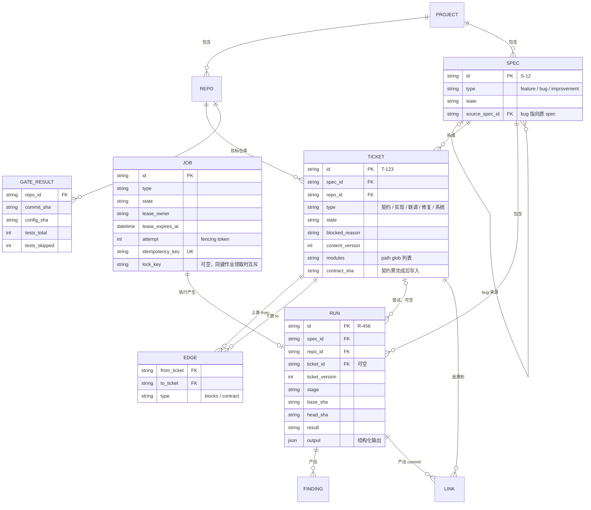

状态机：

- **Spec**：draft → planned（人确认拆分）→ running → finalizing（整体 review 和修复、开 PR）→ awaiting-review（人验收）→ partially-merged（部分仓库的 PR 已合并）→ merged。awaiting-review 收到 PR 评论时进入 reworking，返工完成回到 awaiting-review。任何时候可以 paused 或 cancelled（`plat spec cancel`：没做完的票一并取消、作业停掉，已合并的留着；已 merged 的不能取消；所有票都被取消、没有 done 票时自动 cancelled）；update-branch 失败时自动 paused，并进入 blocked 队列。
- **Ticket**：pending → queued → running → merging → done（已合并进集成分支，且合并后的门禁通过）。任一步失败进 blocked 并附原因码，人处理后回到 pending；也可以 cancelled。running 内部的阶段（implement、门禁、review、fix）记在 Run 上，不拆成票的状态。
- **能不能开工实时计算，不存成状态**：只有 pending 是存下来的状态，“可开工”（runnable）由调度器每次算：票是 pending、所有入边都满足、没超并发和预算上限。这样就不会出现“标了可开工、其实还被挡着”的情况。

Spec 状态机：

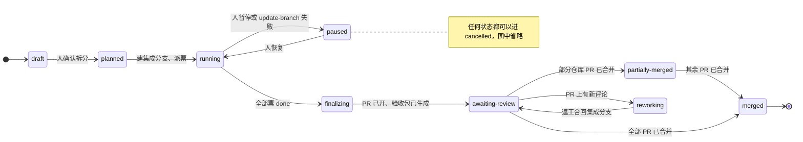

Ticket 状态机（running 里的各个阶段记在 Run 上）：

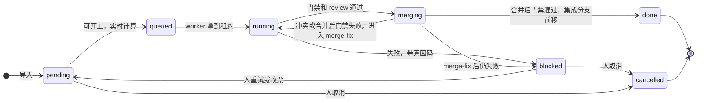

调度器每次计算可开工的票：

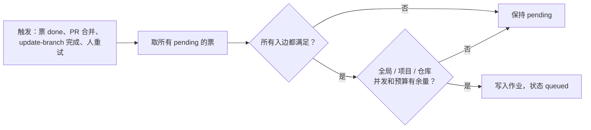

依赖边什么时候算满足：

| 边                  | 满足条件                                                                                                                                                                                                 |
| ------------------- | -------------------------------------------------------------------------------------------------------------------------------------------------------------------------------------------------------- |
| 同 spec 的 blocks   | blocker 是 done                                                                                                                                                                                          |
| 同 spec 的 contract | blocker 是 done，并已记下契约 SHA（契约票合并后集成分支的 head）                                                                                                                                         |
| 跨 spec 的边        | blocker 所在 spec 在这个仓库的 PR 已合并进 main，**并且**本 spec 的集成分支已经包含那个 main 提交（`git merge-base --is-ancestor`）。只到 blocker 自己的集成分支不算，因为本 spec 的分支拿不到那里的代码 |

## 端到端流程

一个需求从规划到合并共六步，人只在第 1、2、6 步出现，外加处理 blocked 的票。

1. **规划（人，Cursor）**：在后端仓库工作区跑 grill-with-docs → to-spec → to-tickets。契约写在后端仓库；to-tickets 产出一个票文件，用 `plat tickets import` 一次性导入，每张票带目标仓库、模块和依赖边（格式见「`plat` CLI 与票的导入」）。
2. **确认拆分（人）**：在平台页面看依赖图和导入时的告警，确认后 Spec 进入 planned。
3. **调度**：平台为每个涉及的仓库从 main 建 `spec/<slug>` 集成分支，把可以开工的票放进队列。
4. **执行（worker，每张票）**：按「单票执行流水线」跑完 implement → 门禁 → review → 合并 → 合并后门禁，票标为 done，重新计算可以开工的票。
5. **收尾**：全部票 done 后，对每个仓库的集成分支跑一次整体 code-review 和一次修复（final-review / final-fix，各只跑一次），修复后再过门禁。然后为每个仓库开 PR（`spec/<slug>` → main），生成验收包。
6. **验收（人）**：看验收包，在代码托管上按建议顺序合并 PR。PR 上的评论可以拉回平台，生成返工运行（rework）。

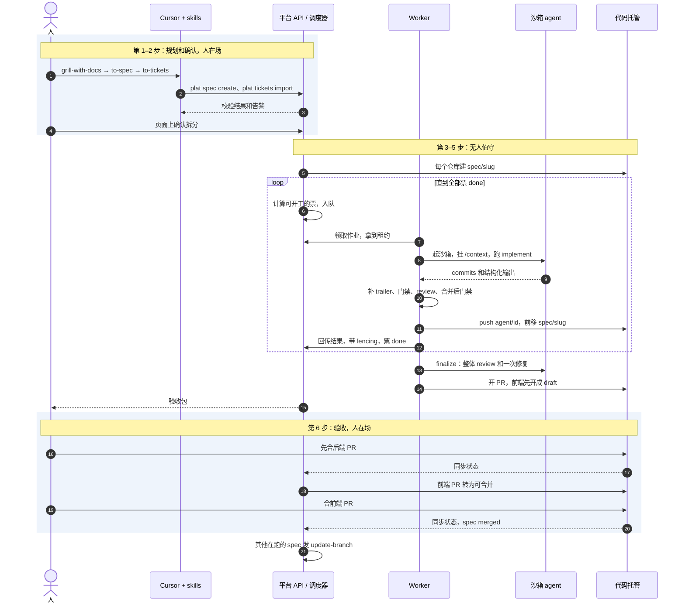

## 单票执行流水线

每张票的执行拆成若干阶段，每个阶段是一个独立、可重跑的作业。每个 agent 运行都是全新会话，靠分支上已有的 commits 和 `/context` 里的文件接上前一步。


蓝色是 agent 运行（全新会话），其余都是 worker 的确定性步骤。

| #   | 阶段       | 做什么                                                                                                                                                                                                                | 成功                                                  | 失败                                                                                                                                                                                                                        |
| --- | ---------- | --------------------------------------------------------------------------------------------------------------------------------------------------------------------------------------------------------------------- | ----------------------------------------------------- | --------------------------------------------------------------------------------------------------------------------------------------------------------------------------------------------------------------------------- |
| 1   | 准备       | 取一个空闲槽位并克隆主 clone（见「Git 操作规范」的“槽位”），在槽位里从分支 `agent/<ticket-id>`（不存在则从集成分支切出，即 Sandcastle 的 `baseBranch`）建 worktree；渲染 `/context`。是否回收僵尸槽位见「作业与恢复」 | → 2                                                   | —                                                                                                                                                                                                                           |
| 2   | implement  | agent 按 `afk-implement.md` 实现并 commit，最后输出 implement 结构化结果                                                                                                                                              | → 3                                                   | 输出不合法 → `invalid-output`；`cannot-proceed` 时按结构化输出里的 `blockedReason` 枚举直接映射为 `agent-gave-up` 或 `contract-change-needed`，不解析自由文本；0 个 commit → `no-commits`；超时 → `timeout`。都直接 blocked |
| 3   | 盖章并推送 | worker 给本次新增的 commits 补 trailer（见「Git 操作规范」），把 `agent/<ticket-id>` 推到 origin                                                                                                                      | → 4                                                   | 推送失败重试，仍失败则作业失败、等重派                                                                                                                                                                                      |
| 4   | 门禁       | 先查保护路径（已批准的除外），再跑门禁命令，见「门禁」                                                                                                                                                                | → 5                                                   | 碰到未批准的保护路径 → `protected-path-changed`，直接 blocked；门禁失败且还没 fix 过 → gate-fix 运行（prompt 指向失败日志）→ 3 → 4；再失败 → `gate-failed`                                                                  |
| 5   | review     | 新会话按 `afk-review.md` 审查 `merge-base..HEAD`，输出 review 结构化结果                                                                                                                                              | verdict 为 pass → 6                                   | verdict 为 fix → review-fix 运行处理 mustFix → 3 → 4 → 6。不再跑第二次 review，修复情况记进 Finding 和验收包                                                                                                                |
| 6   | 合并       | 这一步起是独立的 `merge` 阶段作业，带 `lock_key`（见「作业与恢复」），领取时与同一集成分支上的其他合并类作业互斥：用 `git merge-tree --write-tree` 生成候选合并提交                                                   | 无冲突 → 7                                            | 有冲突 → 释放锁，跑 merge-fix 运行（把集成分支合进 agent 分支并解决冲突）→ 3 → 4 → 6；再冲突 → `merge-conflict`                                                                                                             |
| 7   | 合并后门禁 | 仍在锁内：在候选提交上跑门禁                                                                                                                                                                                          | 通过 → 用 `--force-with-lease` 前移并推送集成分支 → 8 | 不前移集成分支，释放锁，跑 merge-fix 运行（把集成分支合进 agent 分支后修复）→ 3 → 4 → 6；再失败 → `post-merge-gate-failed`                                                                                                  |
| 8   | 完成       | 票标 done；契约票记下契约 SHA；写 Link；重新计算可开工的票                                                                                                                                                            | —                                                     | —                                                                                                                                                                                                                           |

上限：

- 每张票每种 fix（gate-fix、review-fix、merge-fix）最多一次，所以一张票最多 5 次 agent 运行。
- 每次运行设 `idleTimeoutSeconds`（默认 600），再用 `AbortSignal` 设墙钟上限（默认 60 分钟）；每张票另设总墙钟上限。
- 集成分支锁就是 `merge` 作业的租约：从领取到结束（“生成候选 → 候选门禁 → 前移分支”），agent 运行时不持锁。有冲突或候选门禁失败时 `merge` 作业结束，锁随之释放，merge-fix 作为不带键的 agent 作业去跑，之后再排一个新的 `merge` 作业。

M0 实测（2026-10-28，试点仓库的小票，Cursor `auto` 模型，Mac + Docker Desktop）：

- 正常路径（implement → 门禁 → review → 合并 → 候选门禁）约 5.5 分钟，2 次 agent 运行；插入一次 gate-fix 约 8 分钟，3 次。典型耗时：implement 146–156 秒，review 117–188 秒，gate-fix 79 秒，每次门禁和基线门禁 14–20 秒，补 trailer 和推送各 0–2 秒。空闲超时（默认 600 秒）和墙钟上限（60 分钟）都没有碰到，默认值保留。
- 补 trailer 用一个临时 worktree 做 `git rebase --exec 'git commit --amend --no-edit --trailer …'`，之后 Sandcastle 在改写后的分支上跑 review、门禁和 gate-fix 都正常。Cursor 会自带 `Co-authored-by: Cursor <cursoragent@cursor.com>` trailer，与我们的 `Spec`、`Ticket`、`Run` 共存，保留，不影响追溯（追溯只认我们的三个 trailer）。
- 实测 review 不修改代码、不产生 commit；它的 `suggestions` 要记成 Finding（处理结果为“进验收包”），不触发修复。
- 没有实测的：merge-fix、`timeout`、`invalid-output`、`no-commits` 这几条 blocked 路径，中断后丢弃未提交改动，同一台 worker 上多张票并发。M1 的中断测试要补上。

worktree 的语义（2026-10-28 修订）：Sandcastle 在运行结束时会删除干净的 worktree，只有留下未提交改动的才保留，而且不会替你丢弃。所以连续性的单位是**分支和上面的 commits**，不是 worktree：每次运行都从分支重新建 worktree，worktree 可随时丢弃。运行结束时若 worktree 里还有未提交改动（比如 agent 忘了提交），diff 存进运行日志后丢弃，这个阶段按 `no-commits` 处理。“接着重试”保留的是分支和 commits。

合并阶段（第 6–7 步）的时序：

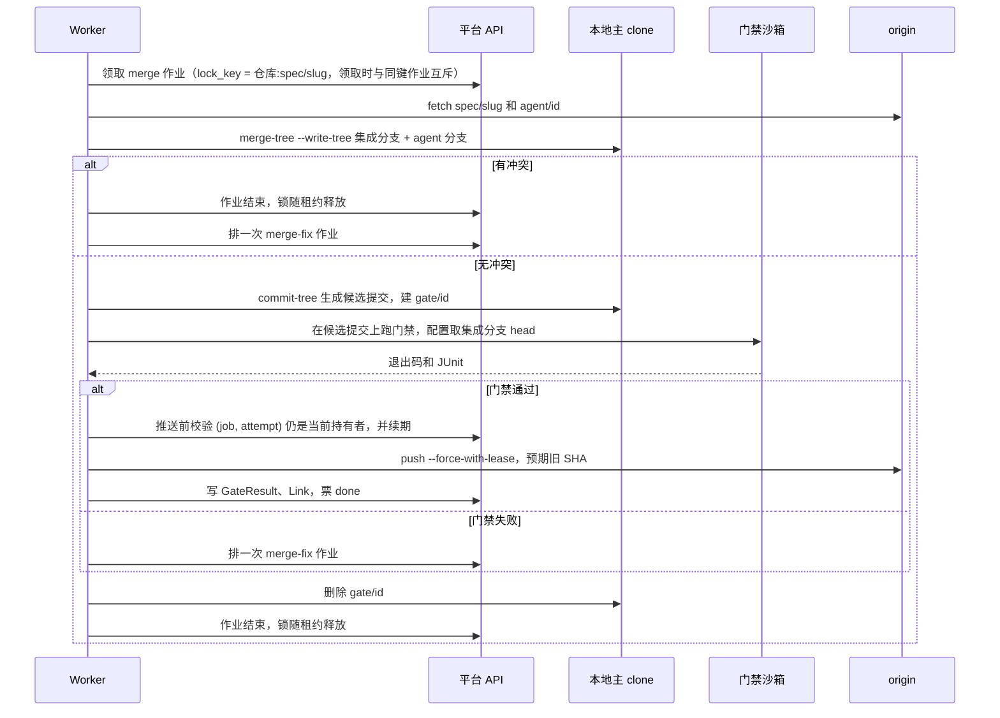

## blocked 处理

票进 blocked 时带一个原因码和一份简报（失败步骤、相关日志指针、agent 的结构化输出）。人在页面或用 `plat` 选择处理动作。

| 原因码                                     | 含义                                                       |
| ------------------------------------------ | ---------------------------------------------------------- |
| `gate-failed`                              | 门禁 fix 一次后仍失败                                      |
| `post-merge-gate-failed`                   | 单票通过，合进集成分支后失败（多张票的改动合在一起出问题） |
| `merge-conflict`                           | merge-fix 后仍冲突                                         |
| `protected-path-changed`                   | 改了保护路径（门禁配置、CI、测试配置、契约文件等）         |
| `no-commits`                               | 运行结束但没有 commit，通常是 agent 卡在提问上             |
| `agent-gave-up` / `contract-change-needed` | agent 在结构化输出里声明做不下去，或认为契约要改           |
| `invalid-output`                           | 结构化输出缺失或不符合 schema                              |
| `timeout`                                  | 超过空闲或墙钟上限                                         |
| `integration-loop-exceeded`                | 联调修复轮数超过上限                                       |
| `upstream-cancelled`                       | 上游票被取消                                               |

| 动作             | 效果                                                     |
| ---------------- | -------------------------------------------------------- |
| 接着重试         | 保留分支和 commits，回到 pending，fix 次数清零           |
| 从头重试         | 删除 `agent/<ticket-id>` 分支和 worktree，回到 pending   |
| 改票后重试       | 编辑票，内容版本号加一，再按上面两种方式之一重试         |
| 批准保护路径改动 | 只用于 `protected-path-changed`，跳过这一项检查继续门禁  |
| 拆票             | 用 `plat tickets import` 导入新票，原票取消              |
| 取消             | 下游票进 blocked（`upstream-cancelled`），或选择一并取消 |

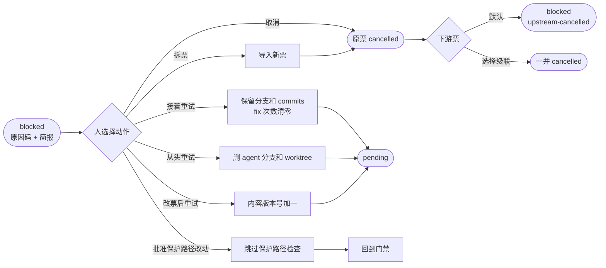

## 作业与恢复

一次 agent 运行要十几分钟到一小时，PoC 的电脑还会休眠。作业层要保证：同一阶段不会被两个进程同时执行，任何一步中断后重跑都得到同样的结果。

作业协议：

- **租约**：worker 用 `SELECT … FOR UPDATE SKIP LOCKED` 取作业，拿到 2 分钟租约，每 30 秒心跳续期。租约过期的作业回到队列，attempt 加一。
- **fencing**：worker 回传结果和推送集成分支前都带上 (job id, attempt)。API 只接受当前 attempt 的写入。所以电脑睡醒后，旧进程的写入会被拒绝，旧进程收到拒绝后自行退出。
- **幂等键**：每个阶段的幂等键是 `(ticket, 内容版本, 阶段, 序号)`。重跑时先查这个阶段有没有已记录的结果，有就跳过。合并阶段额外检查：agent 分支的 head 已经是集成分支的祖先，就当作已合并。
- **能力标签**：作业声明需要的能力（docker、能访问哪些仓库），worker 只拉自己能做的。
- **互斥键**：作业可带 `lock_key`，领取时 API 排除“同键已有未过期租约”的作业，持有期等于租约期，过期自动释放。僵尸 worker 的防护：推送集成分支前先调 API 校验 (作业号, attempt) 仍是当前持有者并续期；推送本身用 `--force-with-lease`；若僵尸抢先推送成功，新持有者靠“agent 分支的 head 已是集成分支的祖先”的幂等检查当作已合并。校验和推送之间有一个很窄的时间窗，由后两层兜住。
- 队列库用 graphile-worker、pg-boss，或者直接在 Postgres 表上自己实现都行，前提是满足上面的语义；选型时先确认租约续期和 attempt 是否可用。

作业类型：

| 作业            | 粒度        | 说明                                                                    |
| --------------- | ----------- | ----------------------------------------------------------------------- |
| `ticket-stage`  | 票 × 阶段   | 单票执行流水线的各阶段；第 6–7 步的 `merge` 阶段带 `lock_key`，其余不带 |
| `update-branch` | spec × 仓库 | 把 main 合进集成分支，见「多需求并行」                                  |
| `finalize`      | spec × 仓库 | 整体 review、一次修复、门禁                                             |
| `open-pr`       | spec × 仓库 | 开 PR、写描述                                                           |
| `rework`        | spec × 仓库 | 处理 PR 评论                                                            |
| `trial-merge`   | 仓库        | 检测在跑的集成分支之间的潜在冲突                                        |
| `host-sync`     | 项目        | 轮询或处理 webhook，同步 PR、CI、评论                                   |

中断恢复：

- 中断发生在 agent 运行中，下一个作业回收这个僵尸槽位时按顺序做三件事：(1) 槽位里的 `agent/<ticket-id>` 比主 clone 多出 commit 时，先按「Git 操作规范」的取回规则取回（保留 commits）；(2) 把槽位里 `.sandcastle/worktrees/<分支名里的 / 换成 ->/` 的未提交改动存成 diff，写进运行日志；(3) 整个槽位删掉重建。这个阶段从头跑：新会话不知道半成品的意图，所以不接着用它。
- 中断发生在门禁或合并：这两步没有副作用，直接重跑。集成分支只在门禁通过后前移，而且是用 `--force-with-lease` 一次完成的，所以不会出现“分支前移了，状态却没写回”的情况；就算真的出现，幂等检查也会把它识别成已合并。
- 心跳被拒绝时，worker 用 `AbortSignal` 立刻中止本地运行。同一台机器上，槽位锁（见「Git 操作规范」）保证新旧进程不会同时用同一个槽位。Sandcastle 的 worktree 锁（ADR 0007）在 0.12.0 里没有发布，这把槽位锁取代它；新作业拿到别的空闲槽位，没有空闲槽位就退回队列稍后重试。

电脑休眠时租约和 fencing 怎么起作用：

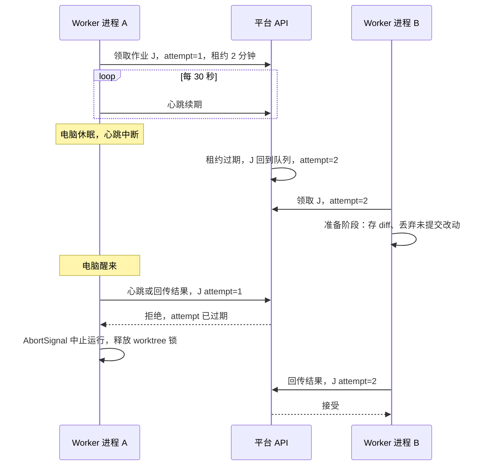

## Git 操作规范

| 项             | 规范                                                                                                                                                                                                                                                                                                                                                                                                                                                                                                                                                                                                                                                                                                                                                                        |
| -------------- | --------------------------------------------------------------------------------------------------------------------------------------------------------------------------------------------------------------------------------------------------------------------------------------------------------------------------------------------------------------------------------------------------------------------------------------------------------------------------------------------------------------------------------------------------------------------------------------------------------------------------------------------------------------------------------------------------------------------------------------------------------------------------- |
| 本地布局       | 每台 worker 上每个仓库一个主 clone：`~/.afk/repos/<repo>/`，停在 main 的 detached HEAD，不 checkout 任何 spec 或 agent 分支。**主 clone 只给 worker 自己用，不挂进沙箱**；Sandcastle 的 worktree 建在槽位 clone 里，不建在主 clone 里                                                                                                                                                                                                                                                                                                                                                                                                                                                                                                                                       |
| 槽位           | 槽位数等于这台 worker 的并发上限。槽位是 `~/.afk/slots/<槽位号>/<repo>/`，一个任务（一个 `ticket-stage` 作业，agent 运行和它后面的门禁都算）占一个槽位。**生命周期**：任务开始时 `git clone --no-hardlinks` 主 clone（不用硬链接，免得 agent 通过硬链接改到主 clone 的对象文件），按需把 `agent/<ticket-id>`、`gate/<ticket-id>` 建成槽位里的本地分支，用 Sandcastle 的 `cwd` 选项指向它；任务**成功**结束整个删掉，**失败**则保留，到下一个任务占用该槽位时再重建，方便事后看现场。**槽位锁**：槽位上用 `O_EXCL` 创建的锁文件，内容是 (作业号, attempt, 进程号)；进程已死，或 API 说这个 (作业号, attempt) 已过期，就算僵尸，按「作业与恢复」回收。同一张票同一时刻只有一个活跃作业由作业队列的幂等键保证，槽位锁只防同一台机器上的僵尸进程                                |
| 取回结果       | agent 或门禁跑完后，worker 在宿主机上执行 `git -c transfer.fsckObjects=true fetch <槽位 clone> refs/heads/agent/<ticket-id>:refs/heads/agent/<ticket-id>`，**只接受这一个 ref**（review 运行不应产生 commit，有就当告警）。槽位里多出来的其他 ref 一律不取，写进 Run 日志。取回之后，补 trailer、门禁、`merge-tree`、前移集成分支都在主 clone 里做，不再碰槽位                                                                                                                                                                                                                                                                                                                                                                                                              |
| 集成分支       | `spec/<slug>` 从 main 切出。只用 ref 操作（`git merge-tree --write-tree` 生成候选、`git commit-tree`、`git update-ref`），不 checkout，所以不会和 worktree 冲突。需要 git ≥ 2.38                                                                                                                                                                                                                                                                                                                                                                                                                                                                                                                                                                                            |
| 集成分支锁     | 不用 Postgres advisory lock（session 级锁绑在数据库会话上，worker 不连库时只能让 API 长期占一条连接，API 重启锁就丢，PgBouncer 事务模式也不支持）。改成作业上的 `lock_key`（`integration:<仓库>:<spec/slug>`）：API 在 worker 领取作业的那条查询里，排除“同一个 `lock_key` 已有未过期租约”的作业。锁的持有期就是作业的租约期，租约过期锁自动释放，复用作业已有的心跳和 fencing。带键的作业：`merge` 阶段（票合并进集成分支，第 6–7 步和最后前移分支）、`update-branch`、`finalize` 里会改集成分支的部分、`rework` 合回集成分支那一步；不带键：implement、gate-fix、review、review-fix、merge-fix 这些 agent 运行，`open-pr`、`trial-merge`、`host-sync`。不同仓库、不同 spec 的键不同，可以并行；同一台 worker 的多个槽位也走同一套互斥。同键按入队顺序先进先出，不设优先级 |
| 推送           | 集成分支用 `--force-with-lease=spec/<slug>:<预期旧 SHA>`，被拒绝就重新 fetch 后重来。agent 分支在每个 agent 运行后由 worker 推送，用于备份和展示                                                                                                                                                                                                                                                                                                                                                                                                                                                                                                                                                                                                                            |
| 票分支         | `agent/<ticket-id>` 从集成分支切出（Sandcastle 的 `baseBranch`）。分支名固定，重试时从这个分支重新建 worktree，之前的 commits 不丢（分支是连续性的单位，不是 worktree）                                                                                                                                                                                                                                                                                                                                                                                                                                                                                                                                                                                                     |
| 候选门禁       | 在临时分支 `gate/<ticket-id>` 上起沙箱跑，跑完删除                                                                                                                                                                                                                                                                                                                                                                                                                                                                                                                                                                                                                                                                                                                          |
| commit trailer | 每次 agent 运行后，worker 给本次新增的 commits 补上 `Spec: S-12`、`Ticket: T-123`、`Run: R-456`（M1 实现改用 plumbing：对 `before..分支` 中不属于集成分支的 commits 逐个 `commit-tree` 重写，保留树、作者和 merge 结构；最初的 M0 做法是 `git rebase --exec 'git commit --amend --no-edit --trailer …'`，但 `--rebase-merges` 重建 merge 时会丢掉冲突解决）。分支此时还没推送、只有 worker 在用，改写是安全的。Link 记改写后的 SHA，不记 Sandcastle 返回的原始 SHA                                                                                                                                                                                                                                                                                                          |
| 清理           | 任务结束时按“槽位”一行处理槽位和 worktree；票 done 后分支保留；spec merged 或 cancelled 后删除远端和本地的 `spec/*`、`agent/*`                                                                                                                                                                                                                                                                                                                                                                                                                                                                                                                                                                                                                                              |
| 凭据           | git token 只在 worker 进程里，沙箱里的仓库没有可用的推送凭据                                                                                                                                                                                                                                                                                                                                                                                                                                                                                                                                                                                                                                                                                                                |

一个需求在一个仓库里的分支变化（T1、T2 是两张票，中途 main 被别的需求前移过一次）：

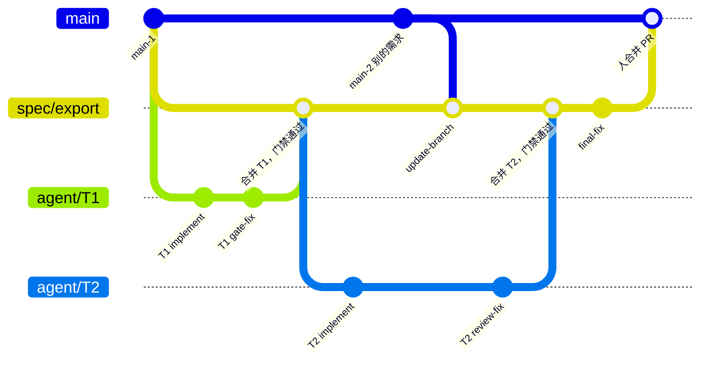

## 门禁

门禁回答一个问题：这次改动在不信任 agent 的前提下是否可接受。

- **配置位置**：仓库的 `.sandcastle/gates.yaml`，列出命令（typecheck、test、lint、e2e…）和每条命令输出 JUnit XML 的路径。M0 用的草案格式：`version`、`setup`（每次新沙箱先跑，如 `npm ci`）、`commands`（每条有 `name`、`run`、`timeoutSeconds`，输出 JUnit 的命令另有 `junit` 路径）。
- **配置从基准提交读**：单票门禁用 `merge-base(agent/<id>, spec/<slug>)` 上的配置（`git show <base>:.sandcastle/gates.yaml`），候选门禁用集成分支当前 head 上的配置。agent 改了配置也不影响本次门禁。
- **门禁在全新沙箱里跑，不复用 agent 的沙箱**：agent 运行可能改过容器里的文件（全局包、`~/.npmrc` 等），影响门禁结果。命令用 `timeout` 包住，因为 `sandbox.exec` 没有超时。门禁结束后，JUnit 从宿主机上 worktree 的路径直接读取（bind mount，不需要拷贝）。
- **命令按顺序跑，第一个失败就停**：这时后面的命令没跑，也就没有 JUnit。失败命令输出的最后 200 行写进 `/context/failure/gate.log`，给 gate-fix 或 merge-fix 读。
- **保护路径**：项目配置列出保护路径，默认包括 `.sandcastle/**`、`.github/**`、`.gitlab-ci.yml`、测试框架配置（`vitest.config.*`、`jest.config.*`、`playwright.config.*`）、`tsconfig.json`、契约文件。改这些文件的票，在拆票时用 `protected_paths_ok` 标明具体路径，人在确认拆分时提前批准。判定分两层：
  - **第一道防线是 agent 自己**：`/context/run.json` 里的 `allowedProtectedPaths` 列出这张票已批准的保护路径，prompt 要求“保护路径一律不改，`allowedProtectedPaths` 里的除外”。没批准却必须改时，agent 输出 `cannot-proceed`（`blockedReason` 为 `contract-change-needed` 或 `agent-gave-up`）。M0 实测 agent 会照此拒绝。
  - **兜底是 worker 的检查**：`merge-base..HEAD` 的 diff 碰到的保护路径，减去 `allowedProtectedPaths`，非空就判 `protected-path-changed`，由人批准或驳回。M0 里这条兜底只在本机用造出来的 commit 验证过，没有在真实运行里被触发过。
- **跳过的测试**：从 JUnit XML 里取测试总数和跳过数。和基准提交的 GateResult 比，跳过数增加或总数减少都判失败。这同时覆盖了“缺 fixture 或 .env，测试悄悄跳过”的情况。**只在所有命令都跑完、拿到 JUnit 时才比较**；前面的命令已经失败时，只报告失败的那一条。
- **0 个 commit**：implement 和 fix 运行结束时没有新 commit，判失败。
- **结果存档和缓存**：每次门禁按 commit SHA 存一条 GateResult，后续的基线比较和验收包都用它。集成分支 head 的基线门禁直接复用已存的 GateResult，没有就跑一次（M0 实测一次约 15 秒），不在每张票上重跑。

## 跨仓库需求

跨仓库需求按契约先行拆票，每张票只动一个仓库，前后端可以并行开发。

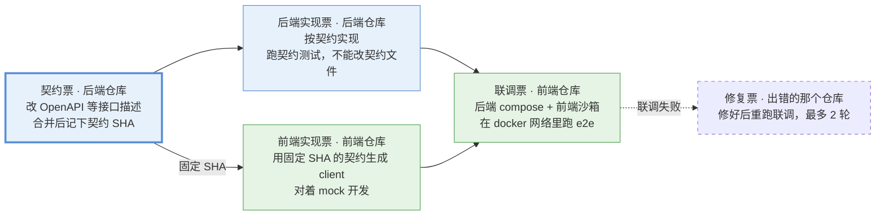

契约票是唯一的起点；它完成后前后端实现票同时开工，两者都完成才进入联调。

- **拆票**：契约票 → 后端实现票和前端实现票（并行）→ 联调票。
- **契约**：用 skills 写在后端仓库，项目配置里声明文件位置（例如 `backend:openapi/openapi.yaml`）。契约票合并进集成分支后，平台把当时集成分支的 head 记为契约 SHA。下游所有票只用这个 SHA 上的契约：worker 用 `git show <SHA>:<path>` 导出到 `/context/contract/`，开发期间契约不会悄悄变化。
- **契约变更**：后端实现票的门禁把契约文件列为保护路径。agent 认为契约要改时，输出 `cannot-proceed`，原因写 `contract-change-needed`，不自己改。人新建一张契约票，并把它设为原票和前端票的上游；新契约 SHA 产生后，已经基于旧 SHA 做完的前端票回到 pending 重做。
- **后端票的验证**：在后端仓库里跑契约测试，确认实现和契约一致。
- **前端票的验证**：用契约生成 client 和 mock，在前端仓库里对着 mock 开发和测试。
- **参考另一个仓库**：worker 用 `git archive <SHA>` 导出另一个仓库的快照，只读挂到 `/refs/<repo>/`（Sandcastle 的 `mounts` 支持 `readonly: true`）。SHA 是这张票开工时那个仓库集成分支的 head，记在 Run 上。
- **联调环境**：后端仓库提供 `.sandcastle/integration/compose.yaml`，包含后端服务（从集成分支构建）、数据库、缓存等依赖，以及一个 seed 作业。worker 用 `docker compose -p afk-<run-id> up` 起环境，前端沙箱通过 `docker({ network })` 加入这个 compose 网络，agent 对着后端地址跑 e2e。compose 网络不能设成 `internal`，否则沙箱连不到模型 API。不把 docker socket 挂进沙箱，那等于交出宿主机 root 权限。
- **联调失败**：联调 agent 输出 integration 结构化结果（`failingSide`、证据、失败用例）。平台按 `failingSide` 建修复票，指向对应仓库；`failingSide` 是 `unknown` 时直接 blocked。修复 → 重跑联调最多 2 轮，超过就判 `integration-loop-exceeded`。
- **合并顺序**：前后端分开部署，所以后端改动必须向后兼容。默认先合并、部署后端，再合并、部署前端。平台把前端 PR 先开成 draft，后端 PR 合并后再转成可合并，用这种方式在代码托管上体现顺序。破坏性变更拆成“先加新的、再迁移、最后删旧的”几个 spec，跨版本完成。

契约 SHA 的流转，以及契约要改时怎么办：

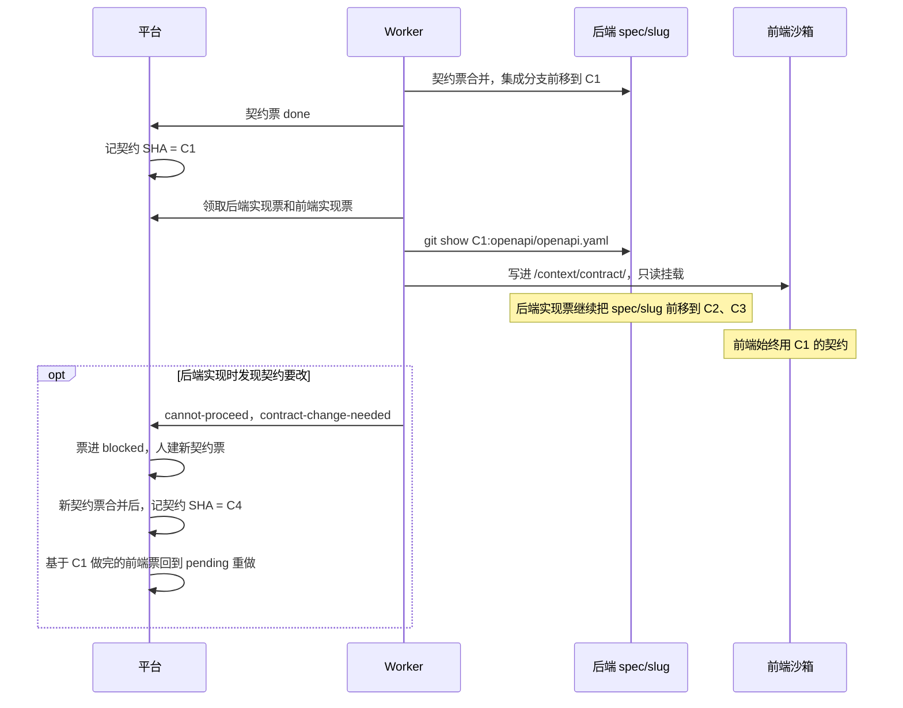

联调环境：

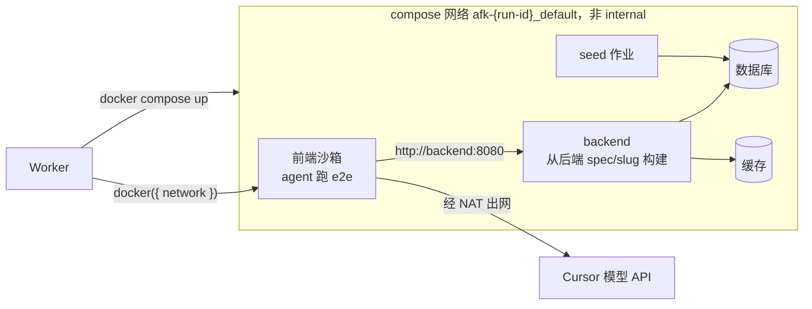

联调失败时的处理：

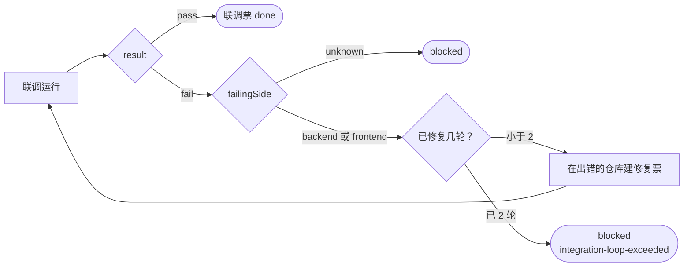

## 多需求并行

每个需求在它涉及的每个仓库里都有自己的集成分支，需求之间互不阻塞。

- **分支**：集成分支 `spec/<slug>` 从 main 切出；票分支 `agent/<ticket-id>` 从集成分支切出。细节见「Git 操作规范」。
- **同一需求内的冲突**：to-tickets 阶段给会改同一文件的票加依赖边；共享的名字在 spec 里写死。导入时平台做一次确定性检查：同一 spec、同一仓库里，模块 glob 有重叠、但依赖图里没有路径相连的票，给出告警，人在确认拆分时决定加边还是放行。合并冲突由流水线的 merge-fix 处理。
- **不同需求之间的冲突**：
  - 不同需求的票在各自的集成分支上跑，串行执行并不能避免冲突，所以不按模块串行。
  - 集成分支每前移一次，平台就对同一仓库里其他在跑的集成分支做一次试合并（`git merge-tree`），在页面上显示“潜在冲突”和冲突文件，不阻塞执行。冲突在先合进 main 的一方合并后，由另一方的 update-branch 处理。
  - main 一前进，调度器就给所有在跑的集成分支发 update-branch 作业：作业带集成分支的 `lock_key`，把 main 合进候选、跑候选门禁、通过才前移。有冲突时开 merge agent 运行（ticket 为空的 Run）解决后再过门禁。仍失败则 spec 自动 paused 并进入 blocked 队列，暂停派发新票，已经在跑的票继续。
- **合并到 main**：由人做，平台给出建议顺序；一个需求合并后，其他需求自动 update-branch。
- **并发和预算**：全局、每项目、每仓库、每台 worker 各设并发上限。Cursor 不报 token 用量，PoC 先按运行时长和次数设上限。

两个需求在同一个仓库里并行，A 先合进 main，B 随后 update-branch：

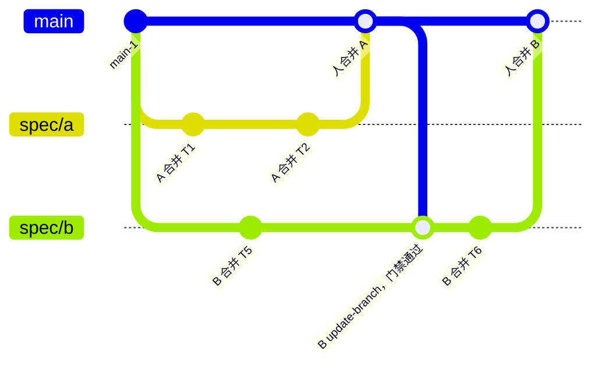

集成分支每前移一次就做一次试合并，提前发现潜在冲突，不阻塞执行：

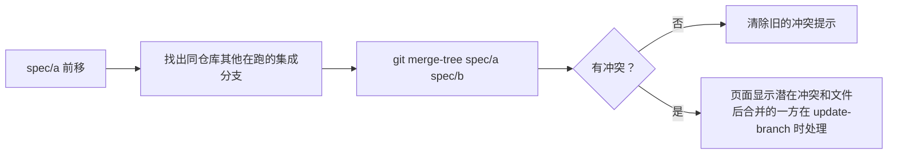

## 平台与代码托管的分工

平台管研发信息，代码托管管代码和 PR。两边通过适配器连接，先接 GitHub，再接 GitLab CE 17.3.1。

|        | 平台负责                                                                                                  | 代码托管负责                              |
| ------ | --------------------------------------------------------------------------------------------------------- | ----------------------------------------- |
| 内容   | spec、tickets、依赖图、运行记录和日志、agent 的 review 意见、验收结论、追溯链接                           | 代码、分支、PR/MR、人写的 review 评论、CI |
| 能看到 | 每个需求下：各仓库 PR 的状态（CI、review、是否已合并）、票的进度、运行日志、待处理的 blocked 票、潜在冲突 | 代码差异和评论                            |
| 能操作 | 确认拆分、编辑 / 重试 / 取消票、处理 blocked、触发最终 review、开 PR、跳转到 PR                           | 合并（由人做）                            |

适配器的差异：

|              | GitHub（PoC）                                                                                                                                                                                                                                                                                                                                                                                                                                                                                                                                                                                                                                                                                                                                                                                                                                                                                                                                                                                                                                                 | GitLab CE 17.3.1（生产）                                                              |
| ------------ | ------------------------------------------------------------------------------------------------------------------------------------------------------------------------------------------------------------------------------------------------------------------------------------------------------------------------------------------------------------------------------------------------------------------------------------------------------------------------------------------------------------------------------------------------------------------------------------------------------------------------------------------------------------------------------------------------------------------------------------------------------------------------------------------------------------------------------------------------------------------------------------------------------------------------------------------------------------------------------------------------------------------------------------------------------------- | ------------------------------------------------------------------------------------- |
| 变更请求     | PR                                                                                                                                                                                                                                                                                                                                                                                                                                                                                                                                                                                                                                                                                                                                                                                                                                                                                                                                                                                                                                                            | MR                                                                                    |
| 状态同步     | 轮询，每分钟一次，不用把本机暴露到公网                                                                                                                                                                                                                                                                                                                                                                                                                                                                                                                                                                                                                                                                                                                                                                                                                                                                                                                                                                                                                        | webhook：Merge request、Comments、Pipeline 事件                                       |
| CI           | GitHub Actions                                                                                                                                                                                                                                                                                                                                                                                                                                                                                                                                                                                                                                                                                                                                                                                                                                                                                                                                                                                                                                                | GitLab CI                                                                             |
| bot 账号     | **GitHub App**，装在个人账号上，只勾选需要的仓库（PoC 先只装 `afk-pilot-backend`）。权限：Contents 读写、Pull requests 读写、Checks 只读、Commit statuses 只读；**不给** Workflows、Administration、Actions 写、Issues、Secrets。不订阅 webhook，状态靠轮询。PR 作者显示为 `<app>[bot]`，与你本人是不同身份。不用机器账号：仓库属于个人账号，fine-grained token 一个只能访问一个所有者的资源，不支持协作者身份，只能退到范围很大的 classic token。凭据（App ID、安装 ID、私钥 PEM）放 `~/.afk/secrets/github-app/`（权限 600，不放 `~/.afk/env`）；worker 用私钥换 installation token（每小时过期），换的时候限定本次任务需要的仓库和权限，缓存到过期前 5 分钟；推送仍通过 `http.extraHeader` 传，M0 用的个人 `GITHUB_TOKEN` 在 App 跑通后废掉。token 不能按分支限权，bot 只写 `agent/*`、`spec/*` 由平台保证                                                                                                                                                                                                                                                 | 项目或组 access token，Developer 角色                                                 |
| 强制由人合并 | **PoC（GitHub 免费个人账号，私有仓库）用不了 ruleset 和分支保护，也没有 bypass 名单**（2026-10-28 对试点仓库实测：接口返回 `Upgrade to GitHub Pro or make this repository public`）。所以改成三层，GitHub 不强制，平台自己保证，已知缺口：(1) worker 里所有 `git push` 走同一个函数，只放行 `refs/heads/agent/*` 和 `refs/heads/spec/*`，其余拒绝；平台代码里不调用任何合并 PR 的接口；两个测试：给这个函数传 `main` 必须报错，代码里搜不到合并接口的调用。(2) 每个仓库放一个检测用的 Actions 工作流，监听 `push` 到 `main`，用 `GET /commits/{sha}/pulls` 查这次提交有没有对应的已合并 PR，没有、或推送者是 bot，就失败并在仓库里开一个 issue；只做事后检测，不阻止，出事后人工回滚。免费个人账号的私有仓库每月 2000 分钟 Actions 额度，这个工作流每次几秒，用不到六分之一；额度用完又没绑支付方式时它会静默不跑，需留意邮件提醒。(3) App 不给 Workflows 权限，据说这样改不了 `.github/workflows/`，bot 出 bug 也关不掉第 2 层（待验证）。以后要 GitHub 真强制，升级 Pro 后加 ruleset：要求经 PR 合并且至少 1 个 approve，bot 不在 bypass 列表，前三层不用改 | 受保护分支：允许 push 设为“无”，允许合并设为 Maintainer。bot 只是 Developer，合不进去 |

GitLab 免费版的 MR 审批是可选的，没有审批也能合并；“必须几人审批”的规则是 Premium 功能。所以在 CE 上靠角色限制来保证由人合并（[受保护分支](https://docs.gitlab.com/user/project/repository/branches/protected/)、[MR 审批](https://docs.gitlab.com/user/project/merge_requests/approvals/)）。Developer 能写所有未受保护的分支，同样由平台保证只写 `agent/*`、`spec/*`。

PoC 阶段不依赖 GitHub 特有的东西，迁移到 GitLab 时才不痛：

- 不用 Actions 做编排，编排是平台调度器的事
- 不用 sub-issue 和原生依赖关系，票都在平台里
- 不依赖 `Closes #N` 自动关票

PR 上人写的评论可以拉回来返工：平台读取评论，spec 进入 reworking，在集成分支锁外开一次 rework 运行（分支 `rework/<slug>-<n>`，从集成分支切出），过门禁后按合并流程合回集成分支，spec 回到 awaiting-review。Sandcastle 自己的 `.sandcastle/agent-workflows/implement-pr` 就是这么做的（读 PR 评论、改代码、逐条回复），可以直接参考；回复评论由平台通过适配器发，不由 agent 发。

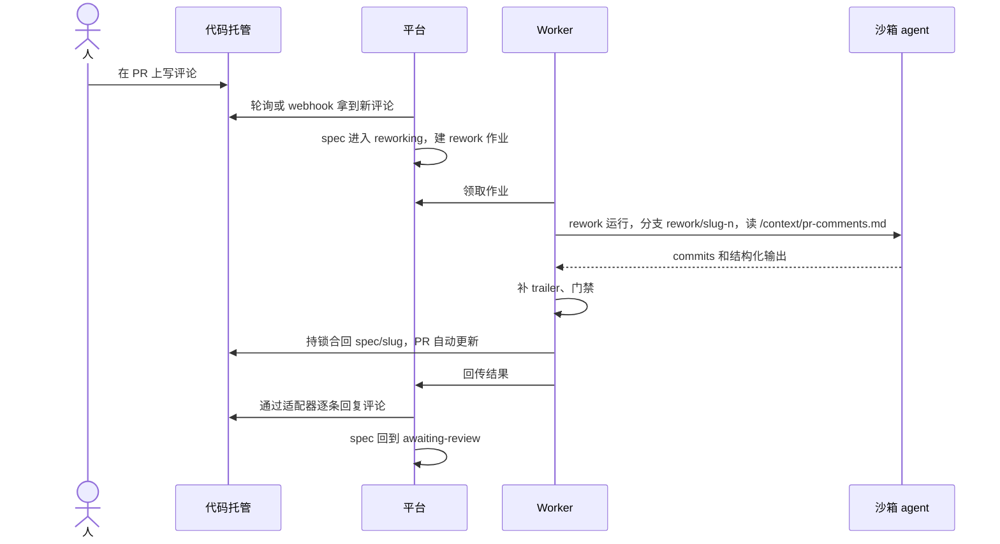

## 合并到 main 与信任阶梯

前期合并到 main 全部由人做，在代码托管上强制（见上一节）。平台用验收包缩短人的验收时间，用指标决定什么时候放权。

验收包在每个需求收尾时生成，人看完就能决定合不合：

- 各仓库的 PR 和合并顺序
- 每条验收标准对应哪个测试。来自 agent 的结构化输出，平台再对照 JUnit 结果核验：测试存在且通过的标“已验证”，否则标“未验证”
- agent review 提了什么意见、怎么处理的（Finding 及处理结果）
- agent 自己标出的不确定点
- 门禁和 CI 结果、耗时、被人批准过的保护路径改动

每个需求记录四个指标：人合并前又改了多少（返工率）、PR 上人提了多少意见、合并后 N 天内追溯到它的缺陷数、门禁失败率。合并策略按项目和 spec 类型可配，默认人工。

| 级别       | 谁合进 main                                                              | 进入条件                |
| ---------- | ------------------------------------------------------------------------ | ----------------------- |
| L0（现在） | 全部由人合并                                                             | 无                      |
| L1         | 低风险类型（文档、测试、门禁全过的小 bug 修复）由 agent 合并，人事后抽查 | 阈值待 PoC 跑出数据后定 |
| L2         | 指标长期达标的项目放开到 feature                                         | 阈值待定                |

升级到 L1 时 bot 需要 main 的合并权限。GitLab CE 只能按角色授权，没法按 PR 类型区分，所以"只合并低风险类型"这条限制只能靠平台的合并策略保证。

## 上下文沉淀与缺陷回流

平台存指针和索引，不复制仓库里已有的内容。目标是从任意一行代码都能确定地追溯到原需求和当时的决策，不靠向量检索去猜。

| 层       | 存什么                                                | 来源                         |
| -------- | ----------------------------------------------------- | ---------------------------- |
| 意图     | spec 正文、关键决策、明确不做的范围                   | to-spec                      |
| 计划     | tickets、依赖边、验收标准                             | to-tickets                   |
| 执行     | Run 记录、实时日志、门禁结果、review 意见、结构化输出 | worker                       |
| 结果     | commit ↔ ticket 映射、PR、验收意见                    | commit trailer、代码托管同步 |
| 复盘     | retro 产出、缺陷到原 spec 的“由谁引起”链接            | retro skill、人              |
| 领域知识 | GLOSSARY.md、ADR、契约（只建索引，原文留在仓库）      | domain-modeling skill        |

Cursor provider 不采集会话记录（`captureSessions: false`），所以执行层只有 Sandcastle 推出的实时日志（`onAgentStreamEvent`）。以后换成 Claude Code 等支持采集的 agent，再把会话记录存入对象存储。

**追溯链路**：

- 每个 agent commit 都带 `Spec`、`Ticket`、`Run` trailer（见「Git 操作规范」），追溯以 trailer 为准，不依赖 SHA。平台按正则从 commit 消息里取，不依赖 git 的 trailer 解析，所以 trailer 被挪到消息正文中间也能取到。
- 用 merge commit 或 rebase 合并时，每个 commit 和它的 trailer 都保留，git blame 能定位到票。
- 用 squash 合并时，一个 PR 的所有票被压成一个 commit，blame 只能定位到 spec。squash 提交消息要设成包含所有 commit 的消息（GitHub：PR 标题加 commit 详情；GitLab：squash 模板里用 `%{all_commits}`），这样至少能从 squash commit 列出它包含的票。PR 描述里也写上 `Spec: S-12` 和票列表。
- Link 表记录改写后的 SHA，供快速查询；trailer 是兜底。

从一行代码追溯到原需求，再进入新的修复流程：

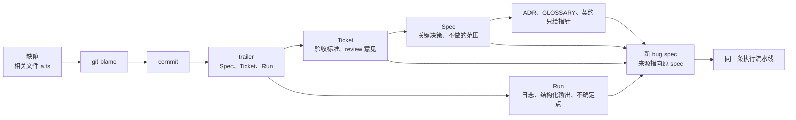

**缺陷回流流程**：

1. 缺陷进来。人指出相关文件，或者 agent 先用 diagnosing-bugs 复现、定位。
2. `plat context --files a.ts b.ts`：git blame → commit → trailer → ticket → spec，返回相关的决策、review 意见、ADR，以及当初明确不做的范围，全部以指针形式给出。
3. 新建一个 bug 类型的 spec，来源指向原 spec，预先填好这些指针。由人在 Cursor 里跑 triage skill 写 agent brief（triage 设了 `disable-model-invocation`，只能由人调用）。
4. 走同一条执行流水线。
5. 平台级复盘：统计哪类 spec 缺陷多、哪类验收标准老是漏，反过来改 to-spec 和 to-tickets 的模板。

向量检索（pgvector）只做补充，回答“做过类似需求吗”“这个 bug 像哪个 spec”这类问题。

## Agent 与 skills 对接

PoC 的 AFK agent 是 Cursor Agent CLI。它在 Sandcastle 里有三个确定的限制，平台按“每次全新会话”设计来绕开（来源：Sandcastle `src/AgentProvider.ts` 的 cursor provider）。

| 限制                                | 影响                                                             | 对策                                                                                                                                                                                                     |
| ----------------------------------- | ---------------------------------------------------------------- | -------------------------------------------------------------------------------------------------------------------------------------------------------------------------------------------------------- |
| 不能 resume / fork 会话             | 门禁失败后接着改、带 PR 评论返工、从原会话 fork 修 bug，都做不了 | 每次新开一个运行，靠分支上已有的 commits 和 `/context` 里的文件接上。丢的只是对话，代码不丢                                                                                                              |
| prompt 通过命令行参数传，上限 120KB | 不能把整个 spec 塞进 prompt                                      | prompt 只放指针，票、spec、失败日志都在 `/context` 里                                                                                                                                                    |
| 不报 token 用量                     | 平台算不了成本                                                   | Run 先记运行时长和次数，token 用量字段留空。stream-json 的 `result` 事件里有 `duration_ms` 和 `duration_api_ms`，worker 从原始行里取出来记在 Run 上（Sandcastle 不解析，`IterationResult.usage` 总是空） |

Cursor CLI 无头模式在 2026 年 2 月被报告不加载 skills，Cursor 于 2026-03-09 推送修复，报告人 03-11 确认可用（[论坛帖](https://forum.cursor.com/t/cursor-cli-headless-mode-doesnt-load-skills-from-known-locations/152476)）。在你的环境里还没验证过，所以 prompt 仍然按路径读 SKILL.md 兜底。

**上下文注入**：worker 为每次运行渲染一个目录，只读挂到沙箱的 `/context`。沙箱不调 `plat`、不连平台 API。

| 路径                          | 内容                                                                                                                                                                                 | 何时有              |
| ----------------------------- | ------------------------------------------------------------------------------------------------------------------------------------------------------------------------------------ | ------------------- |
| `/context/ticket.md`          | 票正文、验收标准、模块、目标仓库、内容版本                                                                                                                                           | 总是                |
| `/context/spec.md`            | spec 正文，包括已确认的 seams 和共享名字                                                                                                                                             | 总是                |
| `/context/run.json`           | 阶段、基准提交（fixed point）、分支名、集成分支名、上限、`allowedProtectedPaths`（这张票已批准可以改的保护路径，没有则为空数组）                                                     | 总是                |
| `/context/contract/`          | 固定 SHA 上的契约文件                                                                                                                                                                | 有契约边时          |
| `/context/failure/gate.log`   | 上一次门禁失败命令输出的最后 200 行，加门禁结论；merge-fix 时是 `merge-tree` 的冲突说明或候选门禁的失败日志                                                                          | gate-fix、merge-fix |
| `/context/review.json`        | review 的 mustFix 列表                                                                                                                                                               | review-fix          |
| `/context/pr-comments.md`     | PR 上人写的评论                                                                                                                                                                      | rework              |
| `/refs/<repo>/`               | 另一个仓库的只读快照                                                                                                                                                                 | 跨仓库参考时        |
| `/home/agent/.cursor/skills/` | skills，只读。源是 [mattpocock/skills](https://github.com/mattpocock/skills) 固定 commit `59db609eb1e18aaf59b63284d0e52255aff0c63c` 的 `skills/engineering` 目录；Run 上记下这个 SHA | 总是                |

skills 挂在 Cursor CLI 的用户级 skills 目录（官方文档列出的自动发现位置），不再用 `/skills`。M0 实测：agent 不读文件就能列出挂进去的技能，按绝对路径读 `SKILL.md` 也能照做。prompt 里仍写明绝对路径作为兜底。

**结构化输出**：每次 agent 运行用 Sandcastle 顶层 `run()` 的 `Output.object` 要求 agent 最后输出一段 `<result>` 标签包着的 JSON，Sandcastle 取最后一个标签并用 zod 校验，不合法就判 `invalid-output`。这样每次 agent 运行用 `run()`，门禁另起新沙箱用 `sandbox.exec`，因为 `Output.object` 只有顶层 `run()` 支持，`sandbox.run()` 没有。M0 实测三种 prompt（implement、fix、review）都稳定拿到合法 JSON。备选：由 worker 自己从 `stdout` 取最后一个 `<result>` 再用 zod 校验（M0 也实测可用），只在 Sandcastle 以后行为变化时启用。注意：prompt 里必须原样出现 `<result>`；cursor provider 下不能设 `maxRetries`，格式错了不自动重试，直接 `invalid-output`。

| 运行                     | 字段                                                                                                                                                                                                                                            |
| ------------------------ | ----------------------------------------------------------------------------------------------------------------------------------------------------------------------------------------------------------------------------------------------- |
| implement / fix / rework | `status`（done / cannot-proceed）、`blockedReason`（cannot-proceed 时必填，枚举：`agent-gave-up` / `contract-change-needed`）、`detail`（cannot-proceed 时的说明，自由文本）、`summary`、`acceptance`（验收标准 → 测试名列表）、`uncertainties` |
| review / final-review    | `verdict`（pass / fix）、`mustFix`（文件、行、问题）、`suggestions`、`uncertainties`                                                                                                                                                            |
| integration              | `result`（pass / fail）、`failingSide`（backend / frontend / unknown）、`evidence`、`failingTests`                                                                                                                                              |

`cannot-proceed` 给 agent 一个正当的出口：遇到需要人回答的问题时，输出原因然后结束，而不是停下来等提问被回答。

**AFK prompt 的写法**：

- prompt 文件：`afk-implement.md`、`afk-fix.md`、`afk-review.md`、`afk-integration.md`，只放指针，控制在 120KB 以内。M0 已有 implement、fix（用 `run.json` 里的 `stage` 区分 gate-fix / review-fix / merge-fix）、review 三份可用的初稿，在原型分支 `prototype/m0-pipeline` 的 `m0/prompts/` 下，M1 直接拿来用。
- prompt 里直接写“先读 `/context/ticket.md`、`/context/spec.md`、`/context/run.json` 和仓库的 `AGENTS.md`，再读 `/home/agent/.cursor/skills/tdd/SKILL.md`，按它做”。
- 写明“spec 里的 seams 已经确认，不要提问；遇到必须由人决定的问题，输出 `cannot-proceed` 并结束”。tdd skill 要求先和用户确认 seams，AFK 时没人回答，不写就会卡住。
- 写明“保护路径一律不改，`/context/run.json` 的 `allowedProtectedPaths` 里列出的除外”；没批准却必须改，或契约有问题时，输出 `cannot-proceed`，`blockedReason` 写 `contract-change-needed`。契约票和普通票用同一份 prompt，靠 `allowedProtectedPaths` 区分。
- 写明不要 push、不要切换或新建分支、不要自己加 `Spec` / `Ticket` / `Run` trailer（worker 事后补）。
- review 只审查不改代码，不提交；code-review 直接给出对比的基准提交（来自 `/context/run.json`），否则它会反问。
- 不依赖 implement skill：它只能由人调用（`disable-model-invocation: true`），步骤直接写进 AFK prompt。

**密钥**：

- Cursor API key 放在 worker 的环境文件里，通过 `cursor(model, { env })` 注入沙箱。这是沙箱里唯一的密钥。
- GitHub / GitLab token 只在 worker 进程里，不进沙箱。
- 测试需要的 `.env` 和 fixture 放在 worker 本机的密钥目录，只放测试用的值，通过 `copyToWorktree` 带进去。

**skills 侧的对接**：

- 在后端仓库跑 `setup-matt-pocock-skills`，tracker 选“其他”。生成的 `docs/agents/issue-tracker.md` 里写清 `plat` 怎么用。
- 平台特有的规则也写进这份文档，不用 fork skills：to-tickets 输出 `plat tickets import` 的格式；每张票必须带目标仓库和模块 glob；跨仓库切片按契约先行拆；seams 和共享的名字要写死；会改保护路径的票要标明。
- `plat` CLI 装在本机，Cursor 的 agent 直接调用。
- 前端仓库不用装 tracker 文档，但需要自己的 AGENTS.md 和编码规范，给 AFK 运行时读。

以后换 agent（Claude Code、Codex、pi 等）只改项目配置。对支持会话续接的 agent，平台在 `result.resume` 存在时把它当优化用。

## `plat` CLI 与票的导入

`plat` 是人和 Cursor 里的 skills 操作平台的唯一入口，和页面共用同一套 REST API。

| 命令                                               | 用途                                        |
| -------------------------------------------------- | ------------------------------------------- |
| `plat spec create --type feature --file spec.md`   | 建 spec，返回 `S-12`                        |
| `plat tickets import S-12 tickets.yaml`            | 一次性导入整张依赖图，校验通过才写入        |
| `plat spec confirm S-12`                           | 确认拆分，spec 进入 planned（页面上也能做） |
| `plat spec show S-12` / `plat ticket view T-123`   | 查看                                        |
| `plat ticket edit T-123 --file t.md`               | 编辑票，内容版本号加一                      |
| `plat ticket retry T-123 --mode continue\|restart` | 处理 blocked                                |
| `plat ticket approve-protected T-123`              | 批准保护路径改动                            |
| `plat ticket allow-path T-123 <path>...`           | 给已阻塞的票追加批准的保护路径（再 retry）  |
| `plat ticket cancel T-123 [--cascade]`             | 取消，可选一并取消下游                      |
| `plat spec cancel S-12`                            | 取消整个 spec（没做完的票、作业一并停掉）   |
| `plat blocked`                                     | 列出待处理的 blocked 票和 paused 的 spec    |
| `plat context --files a.ts b.ts`                   | 缺陷回流时查上下文                          |

导入格式（to-tickets 产出）：

```yaml
spec: S-12
tickets:
  - key: contract # 文件内的局部 id，导入后换成 T-xxx
    repo: backend
    type: contract
    title: 定义订单导出接口
    modules: ["openapi/**"]
    protected_paths_ok: ["openapi/openapi.yaml"]
    acceptance:
      - openapi.yaml 中有 GET /orders/export，返回 CSV
    body: |
      …
  - key: be-export
    repo: backend
    type: implementation
    modules: ["src/orders/**"]
    blocked_by: [contract]
    acceptance: […]
  - key: fe-export
    repo: frontend
    type: implementation
    modules: ["src/pages/orders/**"]
    contract: contract # contract 类型的边
    acceptance: […]
  - key: e2e
    repo: frontend
    type: integration
    blocked_by: [be-export, fe-export]
external_blocked_by: [] # 跨 spec 的边，写 T-xxx
```

导入校验：

- 依赖图无环；`repo` 都属于这个项目；每张票都有验收标准和非空的模块 glob。
- contract 边的上游必须是契约类型的票。
- 同一仓库里，模块 glob 有重叠、但依赖图里没有路径相连的票：告警（不阻止导入），在确认拆分页面上显示。
- 跨 spec 的边：提示它要等上游 spec 合进 main 才满足。

## 扩展点与技术选型

核心只发事件，插件订阅事件，新增能力不改核心代码。事件包括 `spec.planned`、`ticket.ready`、`run.finished`、`ticket.blocked`、`spec.paused`、`spec.merged`、`bug.reported`。

| 扩展点                               | 例子                                                                                                                                    |
| ------------------------------------ | --------------------------------------------------------------------------------------------------------------------------------------- |
| 工作流（用代码定义，按 spec 类型选） | feature：implement → 门禁 → review；bug：复现 → 回归测试 → 修复；大重构：先加新的 → 分批迁移 → 删旧的                                   |
| 门禁                                 | typecheck、test、lint、e2e、安全扫描                                                                                                    |
| Agent、模型、沙箱                    | 直接用 Sandcastle 的 provider：agent 有 claudeCode / codex / pi / cursor / opencode / copilot，沙箱有 docker / podman / vercel / 自定义 |
| 代码托管                             | GitHub、GitLab 适配器                                                                                                                   |
| 外部 tracker 同步                    | 飞书项目、Jira、Linear                                                                                                                  |
| 通知                                 | 飞书、钉钉、企业微信、Slack                                                                                                             |
| 上下文来源                           | 仓库文档、线上日志、用户反馈的索引插件                                                                                                  |

技术选型：

- **语言**：全栈 TypeScript，和 Sandcastle 同语言，worker 直接 import 它当库用。
- **数据**：Postgres 一个库做业务数据、作业队列（集成分支锁也是作业上的 `lock_key`，不用 advisory lock），后期加 pgvector。队列的语义要求见「作业与恢复」。
- **Git**：worker 上 git ≥ 2.38（`merge-tree --write-tree`）。
- **文件**：日志和上下文目录先放本地，服务器上换 MinIO。
- **接口**：REST + OpenAPI，CLI 和页面共用。M1 的具体选型（Hono、Drizzle、自己实现的作业队列、React Flow 等）和依据见 [`docs/m1-tech-stack.md`](m1-tech-stack.md)。
- **页面**：React，依赖图用 `@xyflow/react`（React Flow）画。
- **长任务**：一次 agent 运行要十几分钟到一小时，每一步都要能安全重跑（租约、fencing、幂等键）。MVP 用 Postgres 队列就够；等流程里出现跨天的人工审批等待，再考虑 Temporal 这类工作流引擎。

注意：Sandcastle 的隔离型沙箱（如 vercel）用 `format-patch` / `git am` 把 commits 带回宿主机，SHA 会变（ADR 0017）。docker 是 bind mount，不受影响；以后换隔离型沙箱时，追溯仍然靠 trailer，不受 SHA 变化影响。

为什么自建核心域：Plane 能当存储和 UI，但调度、执行、追溯链路都要自己做；Paperclip 偏“把 agent 组织成公司”，没有 spec → 依赖图 → 分支合并这套工程流程；Linear 和 Vibe Kanban 用的是自己的 agent 运行时，不走 skills 和 Sandcastle。依赖图、Run、追溯链接是差异点，所以自建。

## 部署：本机 PoC 到公司服务器

PoC 和生产跑同一套代码，迁移只改配置。

| 组件                  | PoC（你的机器）                         | 稳定期（公司服务器）           |
| --------------------- | --------------------------------------- | ------------------------------ |
| API + 页面 + Postgres | docker compose 一起起，只监听 localhost | 单独一台服务器，加登录和权限   |
| Worker                | 同一台机器                              | 一台或多台装 Docker 的构建机   |
| 代码托管              | GitHub，状态轮询，单独的 bot 账号       | 自建 GitLab CE 17.3.1，webhook |
| Agent                 | Cursor Agent CLI，走公网                | 按合规结论定                   |
| 日志、上下文目录      | 本地目录                                | MinIO                          |
| 仓库缓存              | 本地 clone                              | 每台 worker 上各仓库一个镜像   |
| 密钥                  | worker 的环境文件                       | 按公司方案定                   |

```mermaid
flowchart LR
    subgraph poc["PoC · 你的机器"]
        direction TB
        p1["docker compose<br/>API + 页面 + Postgres<br/>只监听 localhost"]
        p2["Worker 进程"]
        p3["Docker 沙箱"]
        p4["本地目录<br/>日志、上下文"]
        p2 --> p1
        p2 --> p3
        p2 --> p4
    end
    gh["GitHub"]
    cur["Cursor API"]
    p2 -->|push、轮询| gh
    p3 -->|公网| cur

    subgraph prod["稳定期 · 公司内网"]
        direction TB
        s1["平台服务器<br/>API + 页面 + Postgres<br/>登录、权限"]
        s2["构建机 1..n<br/>Worker + Docker"]
        s3[("MinIO<br/>日志、上下文")]
        s2 -->|出站拉作业| s1
        s2 --> s3
    end
    gl["GitLab CE 17.3.1"]
    model["模型 API<br/>按合规结论定"]
    s2 -->|push| gl
    gl -->|webhook| s1
    s2 -->|出网白名单| model

    poc -.->|同一套代码，只改配置| prod
```

- **Worker 主动拉取作业**，只需要出站连接，放在公司防火墙后面也能用。多台 worker 注册时带上能力标签（有没有 Docker、能访问哪些仓库）。
- **PoC 阶段电脑会休眠，运行会中断。** 靠租约过期重派、fencing 拒绝旧进程的写入、阶段幂等来恢复，见「作业与恢复」。

上服务器前的检查项：

- [ ] 公司代码能不能发到外部模型 API（合规确认）
- [ ] 服务器上用哪个 agent、怎么接入模型
- [ ] GitLab bot 账号最小权限：Developer 角色，只写 `agent/*`、`spec/*`（由平台保证）
- [ ] 每个仓库的 main 设为受保护分支：允许 push 为“无”，允许合并为 Maintainer
- [ ] 密钥怎么管（agent key、GitLab token），token 不进沙箱
- [ ] 沙箱出网白名单：只放行模型 API、npm 源、GitLab
- [ ] 容器加固：去掉多余 capability、限制进程数和内存（Sandcastle 0.12.0 的 docker 选项只有 `cpus`、`network`、`mounts`、`groups`、`devices`，其余要打补丁或换自定义 provider）
- [ ] 每个并发沙箱占多少磁盘和 CPU，定出每台 worker 的并发上限
- [ ] worker 上 git 版本 ≥ 2.38
- [ ] GitLab webhook 指向平台 API
- [ ] GitLab squash 提交消息模板包含 `%{all_commits}`（如果用 squash 合并）

## 已知风险和坑

下面的坑大多已经记录在 skills 和 Sandcastle 两个仓库的文档里，或者是评审时发现的，对策已经写进前面的设计。

| 坑                                                                                               | 对策                                                                                                                                                          |
| ------------------------------------------------------------------------------------------------ | ------------------------------------------------------------------------------------------------------------------------------------------------------------- |
| tdd 要求先和用户确认 seams，AFK 时没人回答，agent 卡在提问上，最后没有 commit                    | to-spec 里写清 seams；AFK prompt 声明“已确认，不要提问”，并给出 `cannot-proceed` 出口；0 个 commit 判失败                                                     |
| implement、triage 等 skill 只能由人调用                                                          | 步骤直接写进专用的 AFK prompt；triage 由人在 Cursor 里跑                                                                                                      |
| to-spec 给父 spec 也打了 `ready-for-agent`，按标签取活的 runner 会把整个 spec 当成一张票         | 平台里 spec 和票是不同实体，只调度票                                                                                                                          |
| 代码托管的 blocked_by 只在 blocker 关闭时更新，合并到集成分支时下游一直显示被挡                  | 平台自己记录哪些票已合并进集成分支，自己算                                                                                                                    |
| 缺“已实现、待验收”状态，做完的票被重新排队                                                       | 状态机里有 done 和 awaiting-review                                                                                                                            |
| 并行的票改同一个文件，或给同一个东西起两个名字（真实案例：`blockedSince` 和 `blockedOn`）        | to-tickets 时加依赖边；共享名字在 spec 里写死；导入时按模块 glob 重叠告警                                                                                     |
| 单票各自全绿，合在一起是红的；merge agent 解冲突的结果没人验证                                   | 合并后门禁：候选提交通过门禁才前移集成分支                                                                                                                    |
| worktree 里没有被 gitignore 的 fixture 或 .env，测试悄悄跳过还显示通过                           | 用 `copyToWorktree` 或 `mounts` 带进去；门禁按 JUnit 比较跳过数和测试总数                                                                                     |
| agent 改门禁配置、删测试、加 skip 让门禁通过                                                     | 门禁配置从基准提交读；保护路径检查；跳过数和总数不能比基线差                                                                                                  |
| 最后的 review → fix 循环失控（有用户跑了 4 小时）                                                | 每种 fix 只跑一次，review 不重跑，设墙钟上限                                                                                                                  |
| skills 用 symlink 装在本机，容器里是断链                                                         | skills 目录只读挂载进沙箱                                                                                                                                     |
| agent 卡死或跑飞                                                                                 | `idleTimeoutSeconds` 加 `AbortSignal` 墙钟上限；一张票失败不影响其他票                                                                                        |
| 电脑休眠后旧进程醒来，和重派的作业同时跑                                                         | 租约加 fencing token，API 拒绝旧 attempt 的写入                                                                                                               |
| 中断后 Sandcastle 带着未提交的改动复用 worktree（ADR 0003），而且不会替你丢弃                    | 回收僵尸槽位：先取回多出的 commits，再把未提交改动存成 diff，然后整个槽位重建                                                                                 |
| worktree 锁（ADR 0007）在 0.12.0 里没有发布，同一分支名的两个运行会悄悄共用一个 worktree         | 槽位锁取代它，一个任务独占一个槽位                                                                                                                            |
| 同一个 clone 上并发创建沙箱会互相删 worktree（上游 #849，起因是 `pruneStale()`）                 | 每个并发任务一个槽位 clone，不再共用                                                                                                                          |
| 多个作业同时写集成分支                                                                           | 每个集成分支一把锁，用 `--force-with-lease` 推送                                                                                                              |
| 沙箱连不到 localhost 上的平台 API；agent 用 `plat` 改了状态                                      | 沙箱不连平台，上下文渲染成文件只读挂载                                                                                                                        |
| 用自己账号的 token 开 PR，自己批不了                                                             | 单独的 bot 账号或 GitHub App                                                                                                                                  |
| squash 合并后 blame 定位不到票                                                                   | commit trailer；要按行定位到票就用 merge commit 或 rebase 合并                                                                                                |
| Cursor 无头模式不加载 skills（2026-03 已修复）                                                   | 已在 M0 实测：skills 挂到 `/home/agent/.cursor/skills` 后能被自动发现；prompt 里仍按绝对路径读 SKILL.md 兜底                                                  |
| Cursor 无头运行可能卡在工作区信任提示上                                                          | 已在 M0 实测：只带 Sandcastle 默认的 `--force` 就没被挡住；如果以后版本变化，在镜像里放一个 `agent` 包装脚本补 `--trust`                                      |
| 沙箱里挂进去的 `.git` 整个可写（M0 实测：能建分支、改 `config`、往 `hooks/` 写文件、改任意 ref） | 沙箱只挂一次性的槽位 clone，不挂主 clone；取回只接受 `agent/<ticket-id>` 一个 ref，开 `transfer.fsckObjects`；取回前比对槽位里多出的 ref，有异常写进 Run 日志 |

## 落地路线

分六个阶段：M0 不建平台，只验证单票链路；M1 和 M2 在本机完成 PoC；M3 起搬到公司服务器。PoC 的真正验收在 M2：一个真实的前后端需求，人只在开头和结尾出现。

```mermaid
flowchart TB
    subgraph POC["PoC · 本机、GitHub"]
        direction LR
        M0["M0<br/>单票脚本，不建平台<br/>Sandcastle + Cursor<br/>跑完整条单票流水线"]
        G0{{"验收：一张真实的票<br/>自动走到合并进集成分支"}}
        M1["M1<br/>单仓库流水线<br/>最小平台 + plat CLI<br/>作业租约、门禁"]
        G1{{"验收：后端小需求<br/>无人值守跑完"}}
        M2["M2<br/>前端仓库、契约先行<br/>docker 网络联调<br/>PR 同步、验收包"]
        G2{{"PoC 验收：真实前后端需求<br/>人只在首尾出现"}}
        M0 --> G0 --> M1 --> G1 --> M2 --> G2
    end
    subgraph SRV["稳定期 · 公司服务器、GitLab CE"]
        direction LR
        M3["M3<br/>迁到公司服务器<br/>GitLab CE 适配器<br/>多 worker 并行"]
        G3{{"验收：两个需求<br/>同时跑完"}}
        M4["M4<br/>追溯链接<br/>plat context<br/>bug 关联原需求"]
        G4{{"验收：bug 一步定位<br/>到原需求"}}
        M5["M5<br/>事件与插件<br/>工作流按类型配置<br/>信任阶梯、权限"]
        G5{{"验收：加工作流<br/>不改核心代码"}}
        M3 --> G3 --> M4 --> G4 --> M5 --> G5
    end
    POC --> SRV
    style G2 stroke:#2f6fd6,stroke-width:2px
```

每个阶段过了验收才进入下一个。

**M0 的范围**（一个 TypeScript 脚本，约 200 行，不建数据库和 API）：

- 输入：一张票的 markdown、后端仓库路径、集成分支名。
- 按「单票执行流水线」跑：准备 → implement → 补 trailer → 门禁（含保护路径和跳过数检查）→ review → 合并候选 → 合并后门禁 → 前移集成分支。
- 用 `Output.object` 拿结构化输出；用 `/context` 目录注入上下文。
- 跑通后，「单票执行流水线」「门禁」「上下文注入」三节按实测结果修订，再开始 M1。

M0 第一天先做这几个验证，任何一个不通都要先换方案：

- [x] Cursor 无头模式在 Sandcastle 的 docker 里能跑完并提交，不卡在信任提示上
- [x] agent 能加载或按路径读到 SKILL.md 并按它做
- [x] cursor provider 下 `Output.object` 能取到结构化输出
- [x] 门禁命令能在沙箱里跑，JUnit 结果能拿回来

**M1 的详细范围**（本机、GitHub、Cursor agent、单人）：

| 部件        | 内容                                                                                                                |
| ----------- | ------------------------------------------------------------------------------------------------------------------- |
| 平台        | Postgres（docker）+ API（TypeScript）+ `plat` CLI + 一个页面：需求列表 → 票的状态和依赖图 → 运行日志 → blocked 队列 |
| 数据        | Project、Repo、Spec、Ticket、Edge、Run、Finding、Job、GateResult；第一周先交付建表迁移                              |
| skills 对接 | 后端仓库的 `docs/agents/issue-tracker.md` 指向 `plat`，写清导入格式                                                 |
| Worker      | 租约拉作业 → 把 M0 脚本拆成 `ticket-stage` 作业 → 回传结果（带 fencing）→ 推分支                                    |
| 收尾        | 全部票完成后跑 finalize，用 GitHub API（bot 账号）开 PR，轮询状态显示在页面上，由人合并                             |
| Prompts     | `afk-implement.md`、`afk-fix.md`、`afk-review.md`，只放指针，按路径读 SKILL.md                                      |
| 中断测试    | 在 implement、门禁、合并三个阶段各手动杀一次 worker，确认重启后结果一致                                             |

## 待验证事项与开放问题

下面是设计里还没有实测过的假设，和需要再拍板的问题。

待验证（实测后勾掉）：

- [x] Cursor 无头模式在 Sandcastle docker 里不卡在信任提示上（M0）
- [x] Cursor CLI 在沙箱里能加载 skills，或按路径读 SKILL.md 有效（M0）
- [x] cursor provider 的 stream-json 输出能被 `Output.object` 正确提取（M0）
- [x] 容器内访问 Cursor 公网 API 稳定（M0）。实测可用（Docker Desktop、Apple Silicon）；“稳定”只跑了十几次，限流和断网时的行为没测
- [x] `git rebase --exec` 补 trailer 后 Sandcastle 复用 worktree 正常（M0）。注意 Sandcastle 对干净的 worktree 不是“复用”而是重建，见「单票执行流水线」的 worktree 语义
- [x] 没有 `workflows` 权限的 GitHub App 推不了对 `.github/workflows/` 的改动（M1 第一周用真实的 App 验证；方案“平台自己保证 + 事后检测”第 3 层的前提）
- [x] GitHub App 开的 PR，本人可以直接合并（免费版没有 approve 要求，预计没问题；M1 第一周验证）
- [x] 检测工作流能区分“经 PR 合并”和“直接推送”（M1 第一周验证）
- [ ] 槽位方案可行：用 Sandcastle 的 `cwd` 选项指向 `~/.afk/slots/<n>/<repo>` 跑通 agent 运行和门禁，`git fetch` 只取回一个 ref 并开 `transfer.fsckObjects`，`--no-hardlinks` 克隆的耗时可接受（M1 第一周在 M0 脚本里验证；M0 实测都是在主 clone 上跑的）
- [ ] 选定的队列库支持租约续期和 attempt（M1）。调研结论：graphile-worker 不满足，pg-boss 基本满足，自己在 Postgres 表上实现完全满足，选型待定
- [ ] 另一仓库只读快照挂载 + compose 网络联调的原型可行（M2）
- [ ] Cursor 侧能否拿到每次运行的 token 用量，用于成本统计（M2）。M0 结论：stream-json 里没有 token 字段，只有 `duration_ms` / `duration_api_ms`，先按时长记

开放问题：

- 契约文件的具体格式和路径（OpenAPI？放在后端仓库哪个目录？），以及 client 生成器、mock server、契约测试工具选哪个
- 信任阶梯各级的进入阈值（PoC 跑出数据后定）
- 生产环境用哪个 agent（取决于合规结论）
- 人合并时用 merge commit 还是 squash：追溯都靠 trailer，区别在于 squash 后 blame 只能定位到 spec
- 合并后门禁在集成分支锁内串行跑，单个 spec 的合并吞吐受门禁时长限制；是否需要像合并队列那样批量合并
- 保护路径的默认列表是否够用，各项目要不要加自己的路径

## 参考资料

skills 仓库固定 `59db609eb1e18aaf59b63284d0e52255aff0c63c`；Sandcastle 固定 `0.12.0`。

[mattpocock/skills](https://github.com/mattpocock/skills) @ `59db609eb1e18aaf59b63284d0e52255aff0c63c`：

- `skills/engineering/to-spec/SKILL.md`、`to-tickets/SKILL.md`、`implement/SKILL.md`、`implement-spec/SKILL.md`、`tdd/SKILL.md`、`triage/SKILL.md`
- `skills/engineering/setup-matt-pocock-skills/issue-tracker-github.md`、`issue-tracker-gitlab.md`、`issue-tracker-local.md`
- `docs/engineering/implement-spec.md`、`implement.md`、`to-spec.md`、`triage.md`（已知问题和用户反馈）

[mattpocock/sandcastle](https://github.com/mattpocock/sandcastle)：

- `README.md`（`run`、`createSandbox`、`createWorktree`、分支策略、会话续接、结构化输出、`sandbox.exec`）
- `src/AgentProvider.ts`（cursor provider 的限制）、`src/createSandbox.ts`（`baseBranch`）、`src/MountConfig.ts`（只读挂载）、`src/DockerLifecycle.ts`（`network`）
- `src/templates/parallel-planner-with-review/`（并行规划模板）
- `.sandcastle/agent-workflows/implement/`、`implement-pr/`，`.github/workflows/agent-*.yml`（Sandcastle 自己的 AFK 工作流）
- `docs/agents/adding-an-issue-tracker.md`、`docs/adr/0002-cwd-option.md`、`docs/adr/0003-reuse-worktree-by-default.md`、`0004-abort-signal-on-run-and-interactive.md`、`0007-worktree-locking.md`、`0010-structured-output.md`、`0017-sandbox-owned-sync-base-ref.md`

M0 阶段的调研和原型（都在一次性分支上，不合并）：

- 调研：[Sandcastle 0.12.0 的 API](https://github.com/xxh171015/afk-platform/blob/research/sandcastle-0.12-api/docs/research/sandcastle-0.12-api.md)、[Cursor CLI 无头模式](https://github.com/xxh171015/afk-platform/blob/research/cursor-cli-headless/docs/research/cursor-cli-headless.md)、[Postgres 作业队列选型](https://github.com/xxh171015/afk-platform/blob/research/postgres-job-queue/docs/research/postgres-job-queue.md)
- 原型：[`prototype/m0-day-one`](https://github.com/xxh171015/afk-platform/tree/prototype/m0-day-one/m0)（第一天四项验证）、[`prototype/m0-pipeline`](https://github.com/xxh171015/afk-platform/tree/prototype/m0-pipeline/m0)（完整单票流水线，含 implement / fix / review 三份 prompt 初稿）
- 试点仓库：`xxh171015/afk-pilot-backend`（私有）

外部文档：

- [GitLab：受保护分支](https://docs.gitlab.com/user/project/repository/branches/protected/)
- [GitLab：MR 审批](https://docs.gitlab.com/user/project/merge_requests/approvals/)
- [Cursor 论坛：CLI 无头模式不加载 skills](https://forum.cursor.com/t/cursor-cli-headless-mode-doesnt-load-skills-from-known-locations/152476)
