# AFK 研发平台设计方案

2026-10-27 · @xuxinghua

修订：2026-10-27 评审后补充单票执行流水线、作业与恢复、Git 操作规范、门禁、上下文注入与结构化输出、`plat` 导入格式、blocked 处理；修正跨 spec 依赖、跨需求冲突、GitHub 权限、追溯链路的写法。

修订：2026-10-28 按 M0 实测结果修订「单票执行流水线」「门禁」「Agent 与 skills 对接」（上下文注入、结构化输出、AFK prompt 写法）和「待验证事项」。实测依据见「参考资料」里的调研文件和原型分支。同日又按「Sandcastle 隔离与并发缺口的 worker 侧对策」改了执行层架构图、「Git 操作规范」（新增“槽位”“取回结果”）、「作业与恢复」的中断恢复；集成分支锁也在同日改成作业上的 `lock_key`（见「Git 操作规范」「作业与恢复」）。

修订：2026-10-30 按 M2 地图（#62）修订：仓库不再分前后端、契约属于提供接口的仓库、一个需求可以改任意几个仓库（「领域模型与状态机」「跨仓库需求」重写）；联调票由平台在联调环境里验证、失败自动建修复票；合并顺序由契约关系推出，`partially-merged` 和新的取消规则；需求确认后可以追加票、改票，做完的票不重开（「blocked 处理」「`plat` CLI 与票的导入」）；上下文注入按仓库放契约、`/refs` 快照的 SHA 规则；新原因码。M2 的详细设计见 [M2 spec](specs/m2-platform.md)。

修订：2026-11-01 按操作体验地图（#125）修订：原则第 4 条改表述不改精神（规划提交、`/context/domain/`）；上下文表补 domain 和 Retry note；确认拆分登记规划 SHA；retry 可带说明。详细设计见 [操作体验 spec](specs/experience-platform.md)。

修订：2026-11-01 在「总体架构」加两张架构图：一张按现有代码（M0–M2），一张叠加 M3–M5。
修订：2026-11-09 M3 改为先在 Mac 本机用起来（GitLab、多需求并行、基础度量），迁服务器挪到 M4；日志不再换 MinIO。
修订：2026-11-10 写清项目并发（同时跑 agent 的票数，merging 不计入）和 worker 槽位（合并、联调的开销；领取按项目轮流）各管什么。
修订：2026-11-11 M4 改为继续在 Mac 本机：飞书通知、事件驱动的通知/SSE/时间线、容器加固、Link 与 `plat bug` 定位；迁服务器、登录、多 worker、出网白名单、pgvector 挪到以后。见 [M4 spec](specs/m4-plan.md)。

## 背景与目标

目标是让实现阶段无人值守：人只在规划（grill → spec → tickets）和最终合并时出现，中间由平台调度 Sandcastle，在沙箱里逐张票实现。

现在每个需求走 grill-with-docs → to-spec → to-tickets，然后每张票开一个新对话跑 implement。每张票都要人开会话、盯进度、判断下一张能不能开工，所以人必须一直在场。

本期范围：

- 多个项目，前后端分仓，各自独立开发、维护、部署
- 同一项目可以并行开发多个需求
- 平台记录 spec、tickets 和它们的依赖关系，是研发信息的记录系统
- 研发上下文沉淀下来，反哺后续的缺陷修复和优化
- 可扩展，能作为基础平台给更多项目使用

不在本期范围：合并到 main 的自动化。前期由人合并，见「合并到 main 与信任阶梯」。

## 已定决策

以下 8 项决策均于 2026-10-27 确定，是后面所有设计的前提。

| #   | 决策                                                                                                                                                              | 对设计的影响                                                                                                                                                                            |
| --- | ----------------------------------------------------------------------------------------------------------------------------------------------------------------- | --------------------------------------------------------------------------------------------------------------------------------------------------------------------------------------- |
| 1   | 前后端分仓，不收成 monorepo（项目大，分开开发、维护、部署）                                                                                                       | 跨仓库需求是主路径，按契约先行拆票                                                                                                                                                      |
| 2   | 平台是研发信息的记录系统，PR 留在代码托管                                                                                                                         | 平台同步并展示 PR 状态，自己不做合并                                                                                                                                                    |
| 3   | PoC 在自己机器上跑，稳定后上公司服务器                                                                                                                            | 同一套代码，迁移只改配置                                                                                                                                                                |
| 4   | 合并到 main 由人做，后续再考虑交给 agent                                                                                                                          | 在代码托管上用分支保护强制；用指标积累信任。GitHub 免费个人账号的私有仓库用不了分支保护和 ruleset（2026-10-28 实测），PoC 阶段改用“平台自己保证 + 事后检测”，见「平台与代码托管的分工」 |
| 5   | 代码托管：PoC 用 GitHub，生产用自建 GitLab CE 17.3.1                                                                                                              | 做代码托管适配器，先 GitHub，后 GitLab                                                                                                                                                  |
| 6   | 契约用 skills 写在后端仓库（主仓库）；规划在 Cursor 里做，后端是主项目，前端加入工作区（2026-10-30 推广：契约属于提供接口的仓库，不再有主仓库，见「跨仓库需求」） | tracker 文档放后端仓库；契约按 commit SHA 引用                                                                                                                                          |
| 7   | PoC 的 AFK agent 用 Cursor Agent CLI，走公网                                                                                                                      | 不依赖会话续接；prompt 只放指针                                                                                                                                                         |
| 8   | PoC 只有自己用，worker 用本机 Docker                                                                                                                              | 不做登录，只监听 localhost；联调用本机 docker 网络                                                                                                                                      |

## 设计原则

七条原则贯穿所有设计，遇到取舍时按它们判断。

1. **调度是确定性的，不交给 LLM。** to-tickets 已经写好票之间的依赖边，平台直接按边算出可以开工的票。skills 仓库的 `docs/engineering/implement-spec.md` 也说：真正 AFK 的场景，确定性循环更快、更便宜、更可靠。
2. **Agent 只写代码和 commit，状态全由平台改。** Agent 不 push、不关票、不改标签、不开 PR，和 Sandcastle 仓库自己的 implement prompt 一致。沙箱不连平台 API，也没有 git 凭据；agent 需要的上下文由 worker 渲染成文件只读挂进去。失败时状态不会乱。
3. **一次运行只往一个仓库提交。** 需要参考另一个仓库时，只读挂载它在固定 SHA 上的快照。
4. **存指针，不复制。** 原文只在仓库里（GLOSSARY.md、ADR、契约）。平台只存链接、索引和 SHA；prompt 只放路径。agent 读到的 `/context/contract/` 和 `/context/domain/` 是该指针在沙箱里按 SHA 的只读挂载，不是平台库里的第二份正文。规划阶段的术语和 ADR（规划文档）由 `plat spec confirm` 带给平台、由平台提交成规划仓库集成分支的第一个提交（规划提交），随需求的 PR 进 main，人不提交也不推送（ADR 0005）。
5. **按“每次全新会话”设计。** 会话续接（resume）只在 agent 支持时当优化用，这样换 agent 只改配置。
6. **人工检查点尽量后移。** 人只出现三次：确认拆分、处理 blocked、最终验收。每次拿到的是整理好的简报，不是原始输出。
7. **不信任 agent 自己的产出，只信任平台验证过的事实。** 门禁配置从基准提交读，不从 agent 分支读；agent 的输出必须是通过 schema 校验的结构化结果；合并后的集成分支要再跑一次门禁才算数。

## 总体架构

平台分三层：交互层（Cursor + skills、平台页面）、控制面（API、调度器、数据）、执行层（worker + Sandcastle + 沙箱）。代码托管在平台外，通过适配器连接。

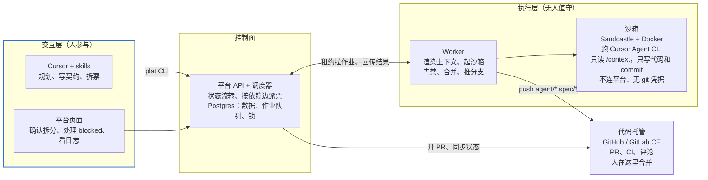

人在交互层规划和确认；调度器把可以开工的票写进队列，worker 以租约方式拉取，在沙箱里跑 agent，再把结果回传平台；PR 在代码托管上由人合并。

| 组件            | 职责                                                                                                        | PoC 形态                           |
| --------------- | ----------------------------------------------------------------------------------------------------------- | ---------------------------------- |
| Cursor + skills | grill、写 spec 和契约、拆票，通过 `plat` CLI 写入平台                                                       | 你的 Cursor 工作区（后端为主项目） |
| `plat` CLI      | skills 和人操作平台的入口：建 spec、导入票、查票、处理 blocked、查上下文。沙箱里不装                        | 本机安装                           |
| 平台 API        | 领域数据读写、状态流转、发事件、校验作业的 fencing token                                                    | TypeScript 服务                    |
| 调度器          | 按依赖边算可开工的票，控制并发和预算，派发作业                                                              | 在 API 进程内                      |
| 作业队列        | 持久化作业，worker 以租约方式拉取，见「作业与恢复」                                                         | Postgres 表                        |
| Worker          | 拉作业，渲染上下文文件，调 Sandcastle 起沙箱跑 agent，跑门禁，合并集成分支，推分支，回传日志、commits、结果 | 本机进程                           |
| 沙箱            | 隔离运行 agent（Cursor Agent CLI）                                                                          | 本机 Docker                        |
| 代码托管适配器  | 开 PR，同步 PR 状态、CI 和评论                                                                              | GitHub（生产换 GitLab CE）         |
| 页面            | 查看和管理需求、票、运行日志、PR、blocked 队列                                                              | 简单 Web 页面                      |
| 存储            | 业务数据；日志和上下文文件                                                                                  | Postgres；API 所在机器的磁盘       |

执行层内部：worker 在宿主机上准备好代码、上下文和快照，沙箱只拿到挂载进来的目录。写权限只有一次性的“槽位 clone”一处（见「Git 操作规范」），主 clone 不挂进沙箱，推送凭据只在 worker 手里。

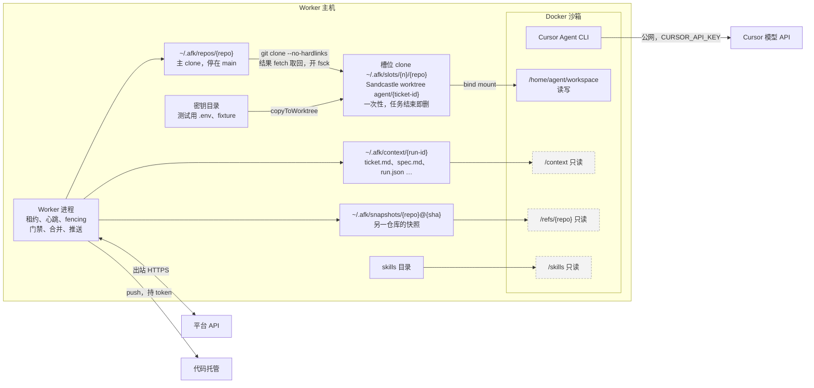

### 按现有代码的架构（M0–M2）

下图按 `main` 上的代码画，节点后面是包名或目录，都在 `packages/` 下。只画已经实现的部分：update-branch、trial-merge、rework、GitLab 适配器（目前只登记 host kind）、webhook、多 worker、Link 表、`plat context`、事件与插件、信任阶梯、登录与权限都还没有，不在图里。

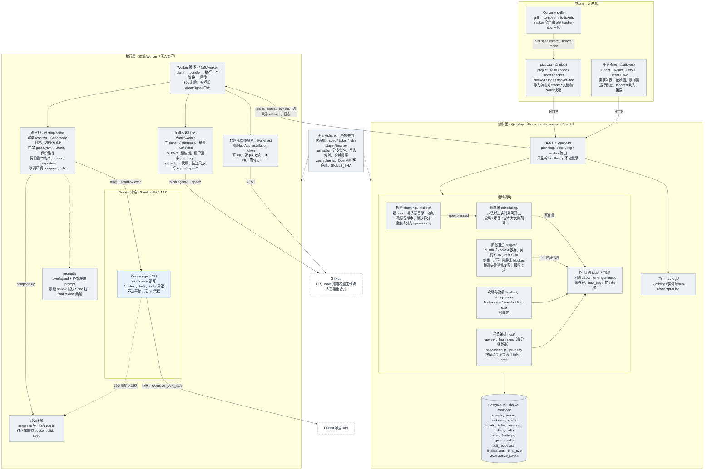

| 包              | 层     | 在图里对应                                                                                                                                              |
| --------------- | ------ | ------------------------------------------------------------------------------------------------------------------------------------------------------- |
| `@afk/cli`      | 交互层 | `plat` 命令；`planning-checks.ts` 在建 spec、导入前核对 tracker 文档和 skills 快照                                                                      |
| `@afk/web`      | 交互层 | `SpecList`、`SpecDetail`（React Flow 依赖图）、`TicketDetail`、`RunLog`、`BlockedQueue`、`SearchBox`                                                    |
| `@afk/api`      | 控制面 | `http/` 四组路由；`planning/`、`tickets/`、`scheduling/`、`jobs/`、`stages/`、`finalize/`、`host/`、`acceptance/`、`logs/`；`db/schema.ts` 15 张表      |
| `@afk/shared`   | 共用   | 状态机和流转（`spec-state`、`ticket-state`、`stage-flow`、`finalize-flow`）、`runnable`、`branches`、`ticket-import`、OpenAPI 客户端                    |
| `@afk/worker`   | 执行层 | 循环 `worker.ts`、`executor.ts`；`slots`、`repos`、`snapshots`、`contracts`、`environments`、`push`、`host`                                             |
| `@afk/pipeline` | 执行层 | `sandcastle`、`agent`、`context`、`gate`、`protected-paths`、`contract-copy`、`trailers`、`merge`、`integration-env`、`e2e`；`prompts/` 里 12 份 prompt |
| `@afk/host`     | 执行层 | `github-app.ts` 换 installation token，`github.ts` 实现 `types.ts` 里的托管接口                                                                         |

### 加上 M3–M5 的目标架构

在上图的基础上叠加「落地路线」的 M3、M4、M5（2026-11-09 按 M3 先在 Mac 本机用起来调整）。灰色是已有、不变的；灰底蓝色虚线框是已有、要扩展的，扩展项用“＋（Mx）”标出；蓝、绿、橙分别是 M3、M4、M5 新增的。

```mermaid
flowchart TB
    subgraph L1["交互层 · 人参与"]
        direction LR
        cursor["Cursor + skills<br/>规划：grill → to-spec → to-tickets<br/>缺陷：plat bug → Locate（M4）"]
        cli["plat CLI<br/>规划、处理 blocked、看日志<br/>＋ plat context --files、plat bug、plat feishu test（M4）"]
        web["平台页面<br/>需求、依赖图、日志、blocked<br/>＋ 潜在冲突、PR / MR 状态、度量（M3）<br/>＋ 飞书项目设置、追溯视图（M4）"]
        feishu["飞书通知（M4）<br/>按项目群，macOS 并存<br/>从事件表派发"]
        im["其它 IM 与外部 tracker（以后）<br/>钉钉、企微、Slack<br/>飞书项目、Jira、Linear"]
    end

    subgraph SRV["控制面 · M3–M4 在 Mac 本机，迁服务器以后"]
        auth["登录与权限（以后）"]
        rest["REST + OpenAPI<br/>CLI、页面、worker 共用<br/>＋ GitLab webhook 入口（以后）"]
        subgraph core["领域核心"]
            plan["规划<br/>导入、追加、改票、确认<br/>＋ 跨 spec 依赖边（以后）<br/>＋ bug spec 指向原 spec（M4）"]
            sched["调度器<br/>可开工实时计算、并发和预算"]
            queue["作业队列<br/>租约、fencing、幂等、lock_key<br/>＋ 按仓库的能力标签、多 worker（以后）"]
            stages["阶段推进<br/>单票流水线、联调修复票"]
            fin["收尾与验收<br/>final-review / fix / e2e、验收包"]
            hostjobs["托管编排<br/>open-pr、host-sync、spec-cleanup、pr-ready"]
            par["多需求并行（M3）<br/>main 前进 → 冲突或落后才 update-branch<br/>集成分支前移 → trial-merge 报潜在冲突<br/>update-branch 失败 → spec paused"]
            rework["PR 评论返工（以后）<br/>awaiting-review → reworking<br/>rework 作业，适配器逐条回复"]
        end
        subgraph trace["追溯与上下文（M4）"]
            link["Link 索引<br/>commit ↔ ticket ↔ spec ↔ PR<br/>bug 是 type=bug 的 Spec<br/>以 commit trailer 为准"]
            ctxq["上下文查询<br/>blame → trailer → ticket → spec<br/>决策、不做的范围；网页按需求展示"]
            know["领域知识索引（以后）<br/>GLOSSARY、ADR、契约，只存指针<br/>pgvector 补充检索"]
            metric["指标与复盘（以后）<br/>返工率、PR 意见数<br/>合并后缺陷数、门禁失败率"]
        end
        subgraph ext["事件与插件（M5）"]
            bus["事件总线<br/>spec.planned、ticket.ready、run.finished<br/>ticket.blocked、spec.paused<br/>spec.merged、bug.reported"]
            wf["工作流注册表<br/>按 spec 类型选流程<br/>feature / bug / 大重构"]
            plug["插件<br/>通知、外部 tracker 同步<br/>门禁扩展（安全扫描）、上下文来源"]
            trust["信任阶梯与合并策略<br/>L0 人合并 → L1 低风险 bot 合并 → L2"]
        end
        pg[("Postgres<br/>现有表<br/>＋ 事件表（M3）<br/>＋ links（M4）<br/>＋ pgvector、用户、角色、插件配置（以后）")]
    end

    shared["@afk/shared<br/>状态机、分支命名、校验、schema<br/>＋ 阶段流转改由工作流定义（M5）"]
    logs[("日志目录（M3 加保留期）<br/>API 写本机磁盘，服务器上是具名卷<br/>需要对象存储时换 SeaweedFS")]

    subgraph WK["Worker + Docker · M3–M4 在 Mac 本机，构建机以后"]
        wloop["Worker 循环<br/>claim → bundle → 执行 → 回传<br/>＋ 注册时带能力标签（以后）"]
        wgit["Git 与本地目录<br/>主 clone、槽位、快照、受限推送<br/>＋ update-branch、trial-merge（M3）"]
        pipe["流水线 @afk/pipeline<br/>context、门禁、保护路径、trailer<br/>merge-tree、联调环境、e2e<br/>＋ 按工作流组装阶段（M5）"]
        hostpkg["代码托管适配器 @afk/host<br/>GitHub<br/>＋ GitLab CE 适配器（M3）"]
        subgraph box["Docker 沙箱 · ＋ 容器加固（M4）；出网白名单以后"]
            agent["AFK agent · Cursor Agent CLI<br/>＋ 按项目换 provider：Claude Code、Codex…（M5）"]
        end
        env["联调环境 compose"]
    end

    gl["GitLab CE 17.3.1（M3）<br/>受保护分支：bot 只有 Developer<br/>MR、Pipeline、approvals，每分钟轮询"]
    gh["GitHub<br/>PoC 仓库"]
    model["模型 API<br/>按合规结论定"]

    cursor --> cli
    cli --> auth
    web --> auth
    auth --> rest
    rest --> core
    rest --> trace
    core --> pg
    trace --> pg
    core -->|事件表| feishu
    feishu --> web
    core -->|发事件| bus
    bus --> plug
    plug --> im
    wf -.->|定义阶段| stages
    trust -.->|决定谁合进 main| fin
    hostjobs -->|同步到的合并提交| link
    link --> ctxq
    know --> ctxq
    ctxq -->|bug spec 预填指针| plan
    link --> metric
    wloop <-->|出站 HTTPS| rest
    wloop --> wgit
    wloop --> pipe
    wloop --> hostpkg
    rest -->|运行日志| logs
    pipe --> agent
    pipe --> env
    agent -->|出网白名单| model
    wgit -->|"push agent/*、spec/*"| gl
    wgit --> gh
    hostpkg --> gl
    hostpkg --> gh
    shared -.-> SRV
    shared -.-> WK

    classDef done fill:#eef2f6,stroke:#7d8b99,color:#18212b
    classDef grown fill:#eef2f6,stroke:#2f6fd6,color:#18212b,stroke-width:2px,stroke-dasharray:5 3
    classDef m3 fill:#d9e7fb,stroke:#2f6fd6,color:#18212b
    classDef m4 fill:#d9f0dc,stroke:#3d8b4a,color:#18212b
    classDef m5 fill:#fbe8c6,stroke:#b7791f,color:#18212b
    classDef outside fill:#ffffff,stroke:#7d8b99,color:#18212b,stroke-dasharray:4 3
    class sched,stages,fin,env done
    class cursor,cli,web,rest,plan,queue,hostjobs,wloop,wgit,pipe,hostpkg,agent,shared,pg grown
    class par,logs,gl m3
    class feishu,link,ctxq m4
    class rework,know,metric,auth,im,bus,wf,plug,trust m5
    class gh,model outside
```

- **M3**（验收：两个项目的需求在 Mac 上同时跑完，一个在 GitLab、一个在 GitHub，见 [M3 spec](specs/m3-platform.md)）：仍在用户的 Mac 本机；`@afk/host` 加 GitLab CE 适配器，状态每分钟轮询；update-branch、trial-merge，页面显示潜在冲突，需求暂停；事件表和基础度量（失败归因、工期四段）；日志保留和磁盘告警。
- **M4**（验收：飞书能把人从群里叫回来、加固下跑通门禁、`plat bug` 定位到原需求，见平台上本里程碑的 Spec）：仍在用户的 Mac 本机。飞书按项目发到群，macOS 横幅保留；通知、SSE、时间线改读事件表（ADR 0009）；Sandcastle 容器加固（不含出网白名单）；Link 表、`plat context --files`、bug 类型 Spec 指向原 Spec、`plat bug` 跑 Locate 后预填草稿。
- **以后（原 M4 迁服务器等）**：公司服务器 compose 部署、构建机 1..n，worker 只出站、带能力标签和协议版本；页面登录和 CLI / worker 凭证；沙箱出网白名单；GitLab webhook；跨 spec 依赖边；PR 评论返工；GLOSSARY / ADR / 契约的 pgvector 索引；返工率等四个指标。
- **M5**（验收：加工作流不改核心代码）：事件总线和插件（其它 IM、外部 tracker 同步、门禁扩展、上下文来源）；工作流按 spec 类型配置，取代写死的阶段流转；agent、模型、沙箱按项目换 provider；信任阶梯；登录与权限。

M2 spec 的 Out of Scope 把 rework、update-branch、trial-merge、多需求并行、跨 spec 边写成“M3 / M4”：update-branch、trial-merge、多需求并行进 M3；跨 spec 边和 rework 仍在以后。2026-11-09 为了尽快用起来，M3 只在 Mac 本机跑通；2026-11-11 定 M4 继续本机做飞书、加固和追溯，迁服务器、登录、出网白名单再往后挪。

## 领域模型与状态机

核心是 6 个实体：Project、Repo、Spec、Ticket、Edge、Run，另有 Finding、Link 支撑 review 和追溯，Job、GateResult 支撑执行。

| 实体       | 关键字段                                                                                                                                                                                                                                                                                                                                                                                                                              | 说明                                                                                          |
| ---------- | ------------------------------------------------------------------------------------------------------------------------------------------------------------------------------------------------------------------------------------------------------------------------------------------------------------------------------------------------------------------------------------------------------------------------------------- | --------------------------------------------------------------------------------------------- |
| Project    | repos、默认 agent 和模型、保护路径列表、并发和预算上限、合并策略、飞书群 chat_id（M4，可空）                                                                                                                                                                                                                                                                                                                                          | 一个产品                                                                                      |
| Repo       | 名字（项目内唯一）、地址、默认分支、契约路径（可空）                                                                                                                                                                                                                                                                                                                                                                                  | 镜像、setup、门禁命令放在仓库自己的 `.sandcastle/` 里，跟代码一起版本化                       |
| Spec       | 类型（feature / bug / improvement）、正文（to-spec 模板）、状态、每个涉及仓库的集成分支、来源（bug 指向原 spec）                                                                                                                                                                                                                                                                                                                      | 一个需求                                                                                      |
| Ticket     | 所属 spec、目标仓库、类型（契约 / 实现 / 联调 / 修复 / 系统）、正文、验收标准、会改动的模块（path glob）、状态、blocked 原因码、内容版本号（每版留快照）、契约 SHA（契约票完成后写入）、参考的仓库（`refs`）、联调环境的仓库（`environment`，只有联调票有）                                                                                                                                                                           | 一张票，只对应一个仓库。每次编辑内容版本号加一                                                |
| Edge       | from、to、类型（blocks / contract）                                                                                                                                                                                                                                                                                                                                                                                                   | 依赖图，允许跨 spec，满足条件见下                                                             |
| Run        | spec、repo、ticket（可空）、ticket 内容版本、阶段（implement / gate-fix / review / review-fix / merge-fix / e2e / diagnose / update-branch / final-review / final-fix / final-e2e / locate-bug / rework）、用到的契约 SHA（按仓库）、参考快照和联调环境里各仓库的 SHA、agent、模型、分支、起止 commit、commits、耗时（含 agent 报的 `duration_ms` 和 `duration_api_ms`）、token 用量（可空，Cursor 不报）、结果、结构化输出、日志地址 | 每次尝试新增一条，不覆盖。update-branch、收尾、Locate 和返工这类运行不属于某张票，ticket 为空 |
| Finding    | 来源 run、类型（review / 门禁 / 人工 / PR 评论）、内容、处理结果（已修复 / 未处理 / 进验收包）                                                                                                                                                                                                                                                                                                                                        | review 意见和门禁失败                                                                         |
| Link       | commit SHA ↔ ticket（可空）↔ spec ↔ PR；kind 为 ticket（集成分支）或 pr（默认分支合并）；bug 是 type=bug 的 Spec                                                                                                                                                                                                                                                                                                                      | 追溯和回流的基础，以 commit trailer 为准，见「上下文沉淀与缺陷回流」                          |
| Job        | 类型、payload、状态、租约持有者、租约到期时间、attempt（fencing token）、幂等键、互斥键（`lock_key`，可空）、需要的 worker 能力                                                                                                                                                                                                                                                                                                       | 见「作业与恢复」                                                                              |
| GateResult | repo、commit SHA、门禁配置来源 SHA、每条命令的退出码、测试总数、跳过数、日志地址                                                                                                                                                                                                                                                                                                                                                      | 按 commit 存，后续检查用它当基线                                                              |

实体关系（只列关键字段）：

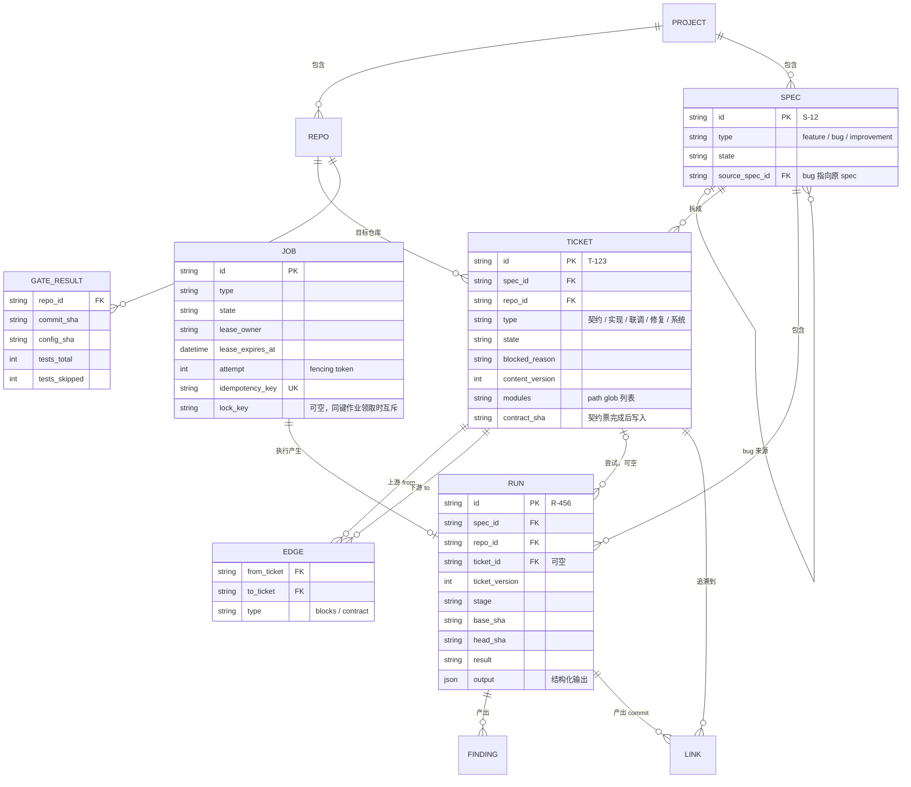

状态机：

- **Spec**：draft → planned（人确认拆分）→ running → finalizing（整体 review 和修复、开 PR）→ awaiting-review（人验收）→ partially-merged（部分仓库的 PR 已合并）→ merged。awaiting-review 收到 PR 评论时进入 reworking，返工完成回到 awaiting-review。任何时候可以 paused 或 cancelled（`plat spec cancel`：没做完的票一并取消、作业停掉，已合并的票留着，随后由 worker 关掉它还开着的 PR、删掉它的分支；已 merged 的，以及有 PR 已被合并、又还有开着的 PR 的 spec 不能取消，因为合并的东西取消收不回（部分 PR 已合并、其余都已关闭的可以取消，已合并的部分留在 main 上）；所有票都被取消、没有 done 票时自动 cancelled）；update-branch 失败时自动 paused，并进入 blocked 队列。
- **Ticket**：pending → queued → running → merging → done（已合并进集成分支，且合并后的门禁通过）。任一步失败进 blocked 并附原因码，人处理后回到 pending；也可以 cancelled。人可以从 pending / queued / running / merging / blocked 接手，票进 taken-over，调度停派作业；交回回到 pending。running 内部的阶段（implement、门禁、review、fix，联调票还有 e2e、diagnose）记在 Run 上，不拆成票的状态。done 是终态：做完的票不重开，要改就追加新票。联调票的 e2e 失败、平台建了修复票后，联调票回到 pending，等修复票 done 再从 e2e 阶段开始。
- **能不能开工实时计算，不存成状态**：只有 pending 是存下来的状态，“可开工”（runnable）由调度器每次算：票是 pending、所有入边都满足、没超并发和预算上限。这样就不会出现“标了可开工、其实还被挡着”的情况。

Spec 状态机：


Ticket 状态机（running 里的各个阶段记在 Run 上）：

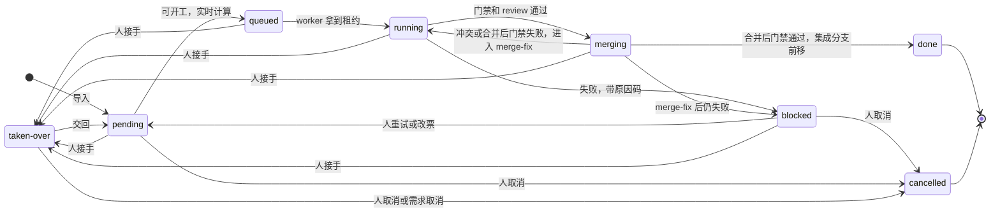

人接手（`taken-over`）：`plat ticket takeover T-n`（或 HTTP）停掉该票 queued/running 的作业，进行中的 Run 记为 cancelled，票不是 `job-failed`。从 merging 接手会放开集成分支的锁，同仓库下一张票可以进合并。接手中的票不派作业、不占并发、不进待处理队列；可以改正文、可以取消；重试拒绝并提示 `plat ticket handback`；追加不能让新票挡住它。交回取远端 tip、不改写人的提交：没有票分支从 implement 起；有集成分支没有的提交从门禁起（清 `reviewed`，fix 次数不变）；联调票已经在集成分支上且没有新提交从 e2e 起。接手和交回各记一条人的操作事件，接手不加 Content version。

调度器每次计算可开工的票：

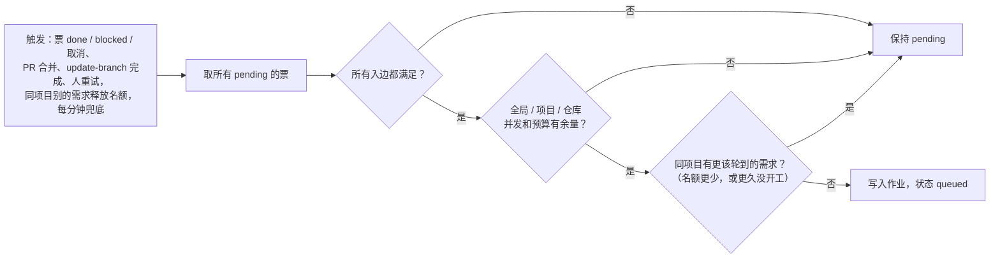

依赖边什么时候算满足：

| 边                  | 满足条件                                                                                                                                                                                                 |
| ------------------- | -------------------------------------------------------------------------------------------------------------------------------------------------------------------------------------------------------- |
| 同 spec 的 blocks   | blocker 是 done                                                                                                                                                                                          |
| 同 spec 的 contract | blocker 是 done，并已记下契约 SHA（契约票合并后集成分支的 head）                                                                                                                                         |
| 跨 spec 的边        | blocker 所在 spec 在这个仓库的 PR 已合并进 main，**并且**本 spec 的集成分支已经包含那个 main 提交（`git merge-base --is-ancestor`）。只到 blocker 自己的集成分支不算，因为本 spec 的分支拿不到那里的代码 |

## 端到端流程

一个需求从规划到合并共六步，人只在第 1、2、6 步出现，外加处理 blocked 的票。

1. **规划（人，Cursor）**：在后端仓库工作区跑 grill-with-docs → to-spec → to-tickets。契约写在后端仓库；to-tickets 产出一个票文件，用 `plat tickets import` 一次性导入，每张票带目标仓库、模块和依赖边（格式见「`plat` CLI 与票的导入」）。
2. **确认拆分（人）**：在平台页面看依赖图和导入时的告警，确认后 Spec 进入 planned。
3. **调度**：平台为每个涉及的仓库从 main 建 `spec/<id>/<slug>` 集成分支，把可以开工的票放进队列。
4. **执行（worker，每张票）**：按「单票执行流水线」跑完 implement → 门禁 → review → 合并 → 合并后门禁，票标为 done，重新计算可以开工的票。
5. **收尾**：全部票 done 后，对每个仓库的集成分支跑一次整体 code-review 和一次修复（final-review / final-fix，各只跑一次），修复后再过门禁。然后为每个仓库开 PR（`spec/<slug>` → main），生成验收包。
6. **验收（人）**：看验收包，在代码托管上按建议顺序合并 PR。PR 上的评论可以拉回平台，生成返工运行（rework）。

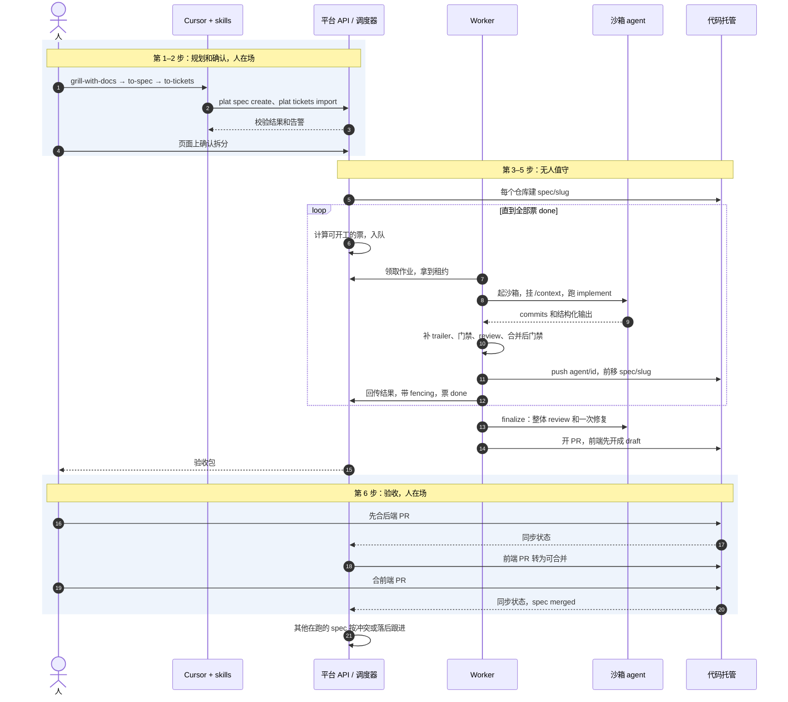

## 单票执行流水线

每张票的执行拆成若干阶段，每个阶段是一个独立、可重跑的作业。每个 agent 运行都是全新会话，靠分支上已有的 commits 和 `/context` 里的文件接上前一步。

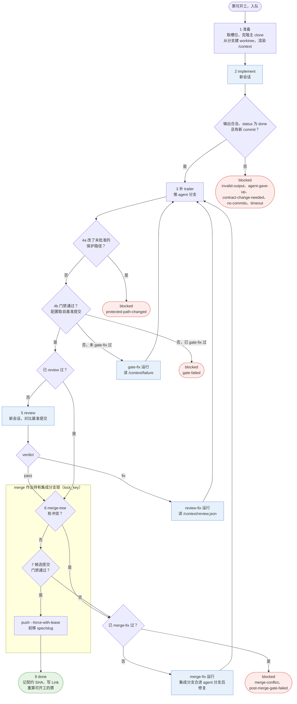

蓝色是 agent 运行（全新会话），其余都是 worker 的确定性步骤。

| #   | 阶段       | 做什么                                                                                                                                                                                                                | 成功                                                  | 失败                                                                                                                                                                                                                        |
| --- | ---------- | --------------------------------------------------------------------------------------------------------------------------------------------------------------------------------------------------------------------- | ----------------------------------------------------- | --------------------------------------------------------------------------------------------------------------------------------------------------------------------------------------------------------------------------- |
| 1   | 准备       | 取一个空闲槽位并克隆主 clone（见「Git 操作规范」的“槽位”），在槽位里从分支 `agent/<ticket-id>`（不存在则从集成分支切出，即 Sandcastle 的 `baseBranch`）建 worktree；渲染 `/context`。是否回收僵尸槽位见「作业与恢复」 | → 2                                                   | —                                                                                                                                                                                                                           |
| 2   | implement  | agent 按 `implement.md`（加公共覆盖层）实现并 commit，最后输出 implement 结构化结果                                                                                                                                   | → 3                                                   | 输出不合法 → `invalid-output`；`cannot-proceed` 时按结构化输出里的 `blockedReason` 枚举直接映射为 `agent-gave-up` 或 `contract-change-needed`，不解析自由文本；0 个 commit → `no-commits`；超时 → `timeout`。都直接 blocked |
| 3   | 盖章并推送 | worker 给本次新增的 commits 补 trailer（见「Git 操作规范」），把 `agent/<ticket-id>` 推到 origin                                                                                                                      | → 4                                                   | 推送失败重试，仍失败则作业失败、等重派                                                                                                                                                                                      |
| 4   | 门禁       | 先查保护路径（已批准的除外），再跑门禁命令，见「门禁」                                                                                                                                                                | → 5                                                   | 碰到未批准的保护路径 → `protected-path-changed`，直接 blocked；门禁失败且还没 fix 过 → gate-fix 运行（prompt 指向失败日志）→ 3 → 4；再失败 → `gate-failed`                                                                  |
| 5   | review     | 新会话按 `review.md`（加公共覆盖层）审查 `merge-base..HEAD`。票级默认只跑 Spec 轴（项目设置 `ticketReview: spec`）；`both` 时两轴并行。输出 review 结构化结果                                                          | verdict 为 pass → 6                                   | verdict 为 fix → review-fix 运行处理 mustFix → 3 → 4 → 6。不再跑第二次 review，修复情况记进 Finding 和验收包                                                                                                                |
| 6   | 合并       | 这一步起是独立的 `merge` 阶段作业，带 `lock_key`（见「作业与恢复」），领取时与同一集成分支上的其他合并类作业互斥：用 `git merge-tree --write-tree` 生成候选合并提交                                                   | 无冲突 → 7                                            | 有冲突 → 释放锁，跑 merge-fix 运行（把集成分支合进 agent 分支并解决冲突）→ 3 → 4 → 6；再冲突 → `merge-conflict`                                                                                                             |
| 7   | 合并后门禁 | 仍在锁内：在候选提交上跑门禁                                                                                                                                                                                          | 通过 → 用 `--force-with-lease` 前移并推送集成分支 → 8 | 不前移集成分支，释放锁，跑 merge-fix 运行（把集成分支合进 agent 分支后修复）→ 3 → 4 → 6；再失败 → `post-merge-gate-failed`                                                                                                  |
| 8   | 完成       | 票标 done；契约票记下契约 SHA；写 Link；重新计算可开工的票                                                                                                                                                            | —                                                     | —                                                                                                                                                                                                                           |

上限：

- 每张票每种 fix（gate-fix、review-fix、merge-fix）最多一次，所以一张票最多 5 次 agent 运行。
- 每次运行设 `idleTimeoutSeconds`（默认 600），再用 `AbortSignal` 设墙钟上限（默认 60 分钟）；每张票另设总墙钟上限。
- 集成分支锁就是 `merge` 作业的租约：从领取到结束（“生成候选 → 候选门禁 → 前移分支”），agent 运行时不持锁。有冲突或候选门禁失败时 `merge` 作业结束，锁随之释放，merge-fix 作为不带键的 agent 作业去跑，之后再排一个新的 `merge` 作业。

M0 实测（2026-10-28，试点仓库的小票，Cursor `auto` 模型，Mac + Docker Desktop）：

- 正常路径（implement → 门禁 → review → 合并 → 候选门禁）约 5.5 分钟，2 次 agent 运行；插入一次 gate-fix 约 8 分钟，3 次。典型耗时：implement 146–156 秒，review 117–188 秒，gate-fix 79 秒，每次门禁和基线门禁 14–20 秒，补 trailer 和推送各 0–2 秒。空闲超时（默认 600 秒）和墙钟上限（60 分钟）都没有碰到，默认值保留。
- 补 trailer 用一个临时 worktree 做 `git rebase --exec 'git commit --amend --no-edit --trailer …'`，之后 Sandcastle 在改写后的分支上跑 review、门禁和 gate-fix 都正常。Cursor 会自带 `Co-authored-by: Cursor <cursoragent@cursor.com>` trailer，与我们的 `Spec`、`Ticket`、`Run` 共存，保留，不影响追溯（追溯只认我们的三个 trailer）。
- 实测 review 不修改代码、不产生 commit；它的 `suggestions` 要记成 Finding（处理结果为“进验收包”），不触发修复。
- 没有实测的：merge-fix、`timeout`、`invalid-output`、`no-commits` 这几条 blocked 路径，中断后丢弃未提交改动，同一台 worker 上多张票并发。M1 的中断测试要补上。

worktree 的语义（2026-10-28 修订）：Sandcastle 在运行结束时会删除干净的 worktree，只有留下未提交改动的才保留，而且不会替你丢弃。所以连续性的单位是**分支和上面的 commits**，不是 worktree：每次运行都从分支重新建 worktree，worktree 可随时丢弃。运行结束时若 worktree 里还有未提交改动（比如 agent 忘了提交），diff 存进运行日志后丢弃，这个阶段按 `no-commits` 处理。“接着重试”保留的是分支和 commits。

合并阶段（第 6–7 步）的时序：

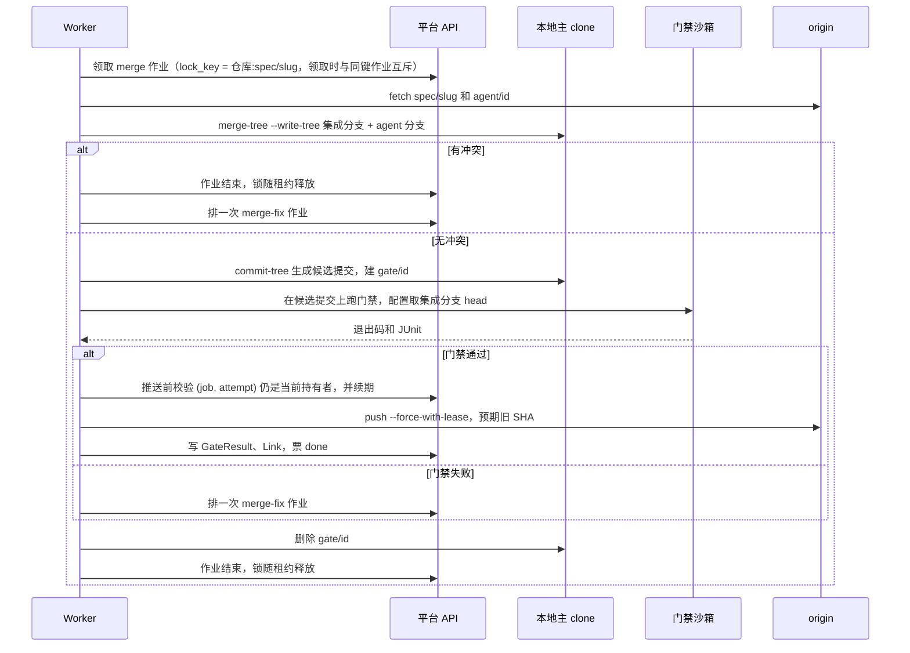

## blocked 处理

票进 blocked 时带一个原因码和一份简报（失败步骤、相关日志指针、agent 的结构化输出）。人在页面或用 `plat` 选择处理动作。人也可以在票还没 blocked 时接手（`plat ticket takeover`）：停作业、票进 taken-over。接手中改正文或取消，不走下面的重试；交回（`plat ticket handback`）才回到 pending。

| 原因码                                     | 含义                                                       |
| ------------------------------------------ | ---------------------------------------------------------- |
| `gate-failed`                              | 门禁 fix 一次后仍失败                                      |
| `post-merge-gate-failed`                   | 单票通过，合进集成分支后失败（多张票的改动合在一起出问题） |
| `merge-conflict`                           | merge-fix 后仍冲突                                         |
| `protected-path-changed`                   | 改了保护路径（门禁配置、CI、测试配置、契约文件等）         |
| `no-commits`                               | 运行结束但没有 commit，通常是 agent 卡在提问上             |
| `agent-gave-up` / `contract-change-needed` | agent 在结构化输出里声明做不下去，或认为契约要改           |
| `invalid-output`                           | 结构化输出缺失或不符合 schema                              |
| `timeout`                                  | 超过空闲或墙钟上限                                         |
| `integration-loop-exceeded`                | 联调修复轮数超过上限                                       |
| `integration-unknown-side`                 | 联调失败，诊断判断不出是哪个仓库的问题                     |
| `integration-environment-failed`           | 联调环境起不来（构建失败、健康检查不过、服务名冲突），三次 |
| `contract-copy-mismatch`                   | 使用方仓库的契约副本和这张票的契约 SHA 上的契约不一致      |
| `upstream-cancelled`                       | 上游票被取消                                               |

| 动作             | 效果                                                                                                                                                                                   |
| ---------------- | -------------------------------------------------------------------------------------------------------------------------------------------------------------------------------------- |
| 接着重试         | 保留分支和 commits，回到 pending，fix 次数清零。不带说明、且 agent 已经做完并推送过分支时，从门禁接着跑（门禁结果复用，随后照常 review）；带说明则从 implement 开始，让 agent 按说明改 |
| 从头重试         | 删除 `agent/<ticket-id>` 分支和 worktree，回到 pending                                                                                                                                 |
| 改票后重试       | `plat ticket edit`：内容版本号加一，再按上面两种方式之一重试                                                                                                                           |
| 人接手           | 停掉该票作业，进 taken-over。不占并发、不进待处理队列。从 merging 接手会放开集成分支的锁                                                                                                 |
| 交回             | 只对 taken-over：回到 pending。没有票分支从 implement 起；有人推过的提交从门禁起；联调票已合入且没有新提交从 e2e 起                                                                       |
| 批准保护路径改动 | 只用于 `protected-path-changed`，跳过这一项检查继续门禁                                                                                                                                |
| 拆票             | 用 `plat tickets import --append` 追加新票，原票取消                                                                                                                                   |
| 取消             | 下游票进 blocked（`upstream-cancelled`），或选择一并取消                                                                                                                               |

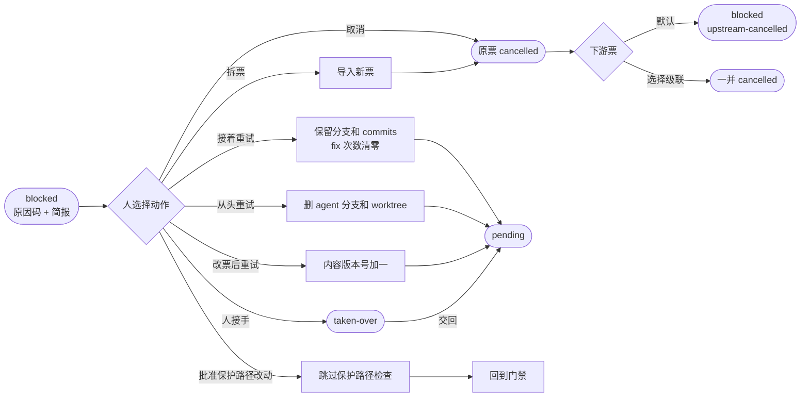

## 作业与恢复

一次 agent 运行要十几分钟到一小时，PoC 的电脑还会休眠。作业层要保证：同一阶段不会被两个进程同时执行，任何一步中断后重跑都得到同样的结果。

作业协议：

- **租约**：worker 用 `SELECT … FOR UPDATE SKIP LOCKED` 取作业，拿到 2 分钟租约，每 30 秒心跳续期。租约过期的作业回到队列，attempt 加一。
- **fencing**：worker 回传结果和推送集成分支前都带上 (job id, attempt)。API 只接受当前 attempt 的写入。所以电脑睡醒后，旧进程的写入会被拒绝，旧进程收到拒绝后自行退出。
- **幂等键**：每个阶段的幂等键是 `(ticket, 内容版本, 阶段, 序号)`。重跑时先查这个阶段有没有已记录的结果，有就跳过。合并阶段额外检查：agent 分支的 head 已经是集成分支的祖先，就当作已合并。
- **能力标签**：作业声明需要的能力（docker、能访问哪些仓库），worker 只拉自己能做的。
- **互斥键**：作业可带 `lock_key`，领取时 API 排除“同键已有未过期租约”的作业，持有期等于租约期，过期自动释放。僵尸 worker 的防护：推送集成分支前先调 API 校验 (作业号, attempt) 仍是当前持有者并续期；推送本身用 `--force-with-lease`；若僵尸抢先推送成功，新持有者靠“agent 分支的 head 已是集成分支的祖先”的幂等检查当作已合并。校验和推送之间有一个很窄的时间窗，由后两层兜住。
- **作业失败**：worker 自己跑不下去（沙箱起不来、推送一再被拒、门禁的 setup 失败）时报作业失败，同一阶段重排，三次都失败票才以 `job-failed` 等人处理。例外是 agent 的提供方拒绝一切工作（额度用完、密钥被拒，见 `isAgentProviderUnavailable`）：这次 Run 以 `provider-unavailable` 结束并和作业脱钩，作业原样回到队列，平台暂停所有 `agent-run` 作业（instance 表的 `agents_paused_at`），发一次通知，页面顶部显示原因和「恢复」按钮（也可以 `plat agents resume`）。暂停期间门禁、合并照常领取；票不进 blocked，也不计失败次数。
- 队列库用 graphile-worker、pg-boss，或者直接在 Postgres 表上自己实现都行，前提是满足上面的语义；选型时先确认租约续期和 attempt 是否可用。

作业类型：

| 作业            | 粒度        | 说明                                                                            |
| --------------- | ----------- | ------------------------------------------------------------------------------- |
| `ticket-stage`  | 票 × 阶段   | 单票执行流水线的各阶段；第 6–7 步的 `merge` 阶段带 `lock_key`，其余不带         |
| `update-branch` | spec × 仓库 | 把 main 合进集成分支，见「多需求并行」                                          |
| `finalize`      | spec × 仓库 | 整体 review、一次修复、门禁                                                     |
| `open-pr`       | spec × 仓库 | 开 PR、写描述                                                                   |
| `rework`        | spec × 仓库 | 处理 PR 评论                                                                    |
| `trial-merge`   | 仓库        | 检测在跑的集成分支之间的潜在冲突                                                |
| `host-sync`     | 项目        | 轮询或处理 webhook，同步 PR、CI、评论                                           |
| `spec-cleanup`  | spec        | spec 被取消或 merged 后，关掉还开着的 PR，删掉它的 `spec/*`、`agent/*` 远端分支 |
| `pr-ready`      | spec × 仓库 | 提供契约的仓库的 PR 合并后，把使用它的仓库的 draft PR 转成可合并                |

中断恢复：

- 中断发生在 agent 运行中，下一个作业回收这个僵尸槽位时按顺序做三件事：(1) 槽位里的 `agent/<ticket-id>` 比主 clone 多出 commit 时，先按「Git 操作规范」的取回规则取回（保留 commits）；(2) 把槽位里 `.sandcastle/worktrees/<分支名里的 / 换成 ->/` 的未提交改动存成 diff 文件，放在 worker 的 `<AFK_HOME>/salvage/job-<作业号>-attempt-<次数>.diff`（不写进运行日志；取不回 commits 的槽位 clone 也整个挪到 `salvage/clone-*`，不删）；(3) 整个槽位删掉重建。在这三步之前，先删掉仍然挂着这个槽位目录的沙箱容器：被 `SIGKILL` 的 worker 不会清理自己的沙箱，容器还在往旧目录写，重建出来的同名目录也挂不进新容器（M1 演练实测：docker 报 `error while creating mount source path`）。取回的 commits 留在 `agent/<ticket-id>` 上，implement 阶段重跑时 agent 看到的是带着它们的分支；agent 发现活已干完而没有新 commit 时，只要分支上已有 commit 就算 `done`（0 个 commit 且分支为空才是 `no-commits`），这些 commit 若还没有 `Run:` trailer，从分叉点起补上。这个阶段从头跑：新会话不知道半成品的意图，所以不接着用它。
- 中断发生在门禁或合并：这两步没有副作用，直接重跑。集成分支只在门禁通过后前移，而且是用 `--force-with-lease` 一次完成的，所以不会出现“分支前移了，状态却没写回”的情况；就算真的出现，幂等检查也会把它识别成已合并。
- 心跳被拒绝时，worker 用 `AbortSignal` 立刻中止本地运行。同一台机器上，槽位锁（见「Git 操作规范」）保证新旧进程不会同时用同一个槽位。Sandcastle 的 worktree 锁（ADR 0007）在 0.12.0 里没有发布，这把槽位锁取代它；新作业拿到别的空闲槽位，没有空闲槽位就退回队列稍后重试。

电脑休眠时租约和 fencing 怎么起作用：

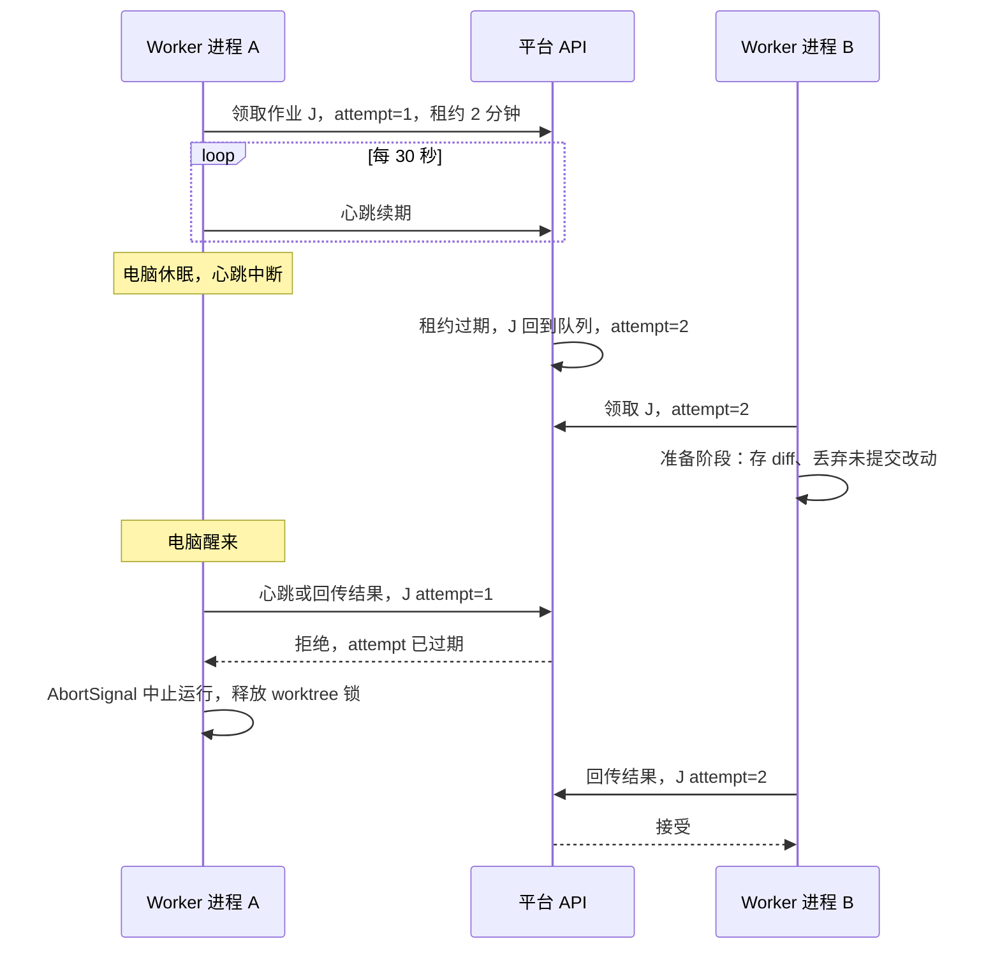

## Git 操作规范

| 项             | 规范                                                                                                                                                                                                                                                                                                                                                                                                                                                                                                                                                                                                                                                                                                                                                                                                                                                                                                                                                                                                                                                                                                                                                                                                                                                                                                                                                        |
| -------------- | ----------------------------------------------------------------------------------------------------------------------------------------------------------------------------------------------------------------------------------------------------------------------------------------------------------------------------------------------------------------------------------------------------------------------------------------------------------------------------------------------------------------------------------------------------------------------------------------------------------------------------------------------------------------------------------------------------------------------------------------------------------------------------------------------------------------------------------------------------------------------------------------------------------------------------------------------------------------------------------------------------------------------------------------------------------------------------------------------------------------------------------------------------------------------------------------------------------------------------------------------------------------------------------------------------------------------------------------------------------- |
| 本地布局       | 每台 worker 上每个仓库一个主 clone：`~/.afk/repos/<repo>/`，停在 main 的 detached HEAD，不 checkout 任何 spec 或 agent 分支。**主 clone 只给 worker 自己用，不挂进沙箱**；Sandcastle 的 worktree 建在槽位 clone 里，不建在主 clone 里                                                                                                                                                                                                                                                                                                                                                                                                                                                                                                                                                                                                                                                                                                                                                                                                                                                                                                                                                                                                                                                                                                                       |
| 槽位           | 槽位数等于这台 worker 的并发上限。槽位是 `~/.afk/slots/<槽位号>/<repo>/`，一个任务（一个 `ticket-stage` 作业，agent 运行和它后面的门禁都算）占一个槽位。**生命周期**：任务开始时 `git clone --no-hardlinks` 主 clone（不用硬链接，免得 agent 通过硬链接改到主 clone 的对象文件），按需把 `agent/<ticket-id>`、`gate/<ticket-id>` 建成槽位里的本地分支，用 Sandcastle 的 `cwd` 选项指向它；任务**成功**结束整个删掉，**失败**则保留，到下一个任务占用该槽位时再重建，方便事后看现场。**槽位锁**：槽位上用 `O_EXCL` 创建的锁文件，内容是 (作业号, attempt, 进程号)；进程已死，或 API 说这个 (作业号, attempt) 已过期，就算僵尸，按「作业与恢复」回收。同一张票同一时刻只有一个活跃作业由作业队列的幂等键保证，槽位锁只防同一台机器上的僵尸进程                                                                                                                                                                                                                                                                                                                                                                                                                                                                                                                                                                                                                |
| 取回结果       | agent 或门禁跑完后，worker 在宿主机上执行 `git -c transfer.fsckObjects=true fetch <槽位 clone> refs/heads/agent/<ticket-id>:refs/heads/agent/<ticket-id>`，**只接受这一个 ref**（review 运行不应产生 commit，有就当告警）。槽位里多出来的其他 ref 一律不取，写进 Run 日志。取回之后，补 trailer、门禁、`merge-tree`、前移集成分支都在主 clone 里做，不再碰槽位                                                                                                                                                                                                                                                                                                                                                                                                                                                                                                                                                                                                                                                                                                                                                                                                                                                                                                                                                                                              |
| 分支名         | 票号和 slug 只在一个数据库里唯一，两个数据库对着同一个仓库工作时会撞名，清理还会删到别的库的分支（#58）。所以每个数据库有一个随机的六位十六进制标识（`instance` 表，只有一行，建库的迁移里生成，之后不变），建 spec 时记在 `specs.branch_namespace`，从此这个 spec 的分支都带它：`spec/<id>/<slug>`、`agent/<id>/T-<n>`、`agent/<id>/S-<n>-final`。标识之前建的 spec 的 `branch_namespace` 为空，分支名保持原样（`spec/<slug>`、`agent/T-<n>`、`agent/S-<n>-final`）：它们已经推到远端、票在途，不改名。名字只由 API 生成（`packages/shared/src/branches.ts`），bundle 带 `agentBranch`，worker 不再自己拼；PR 的 head 和清理清单也用同一个函数。worker 只删 `isPlatformBranch` 认的名字（带标识或不带，别的一概不删），所以带标识的名字不会被别的库的清理碰到，反过来也一样。旧名字仍可能撞：旧 spec 的分支在两个库之间没有区分，这是历史。下文和图里的 `spec/<slug>`、`agent/<ticket-id>`、`spec/slug`、`agent/id` 是简写，实际名字带 `<id>`（旧 spec 除外）。API 和 worker 要一起升级：旧 worker 不认 bundle 里的 `agentBranch`，会按旧名字推送；新 worker 对旧 API 会因为缺这个字段拒收 bundle。标识来自建库时的随机数（二十四位），拷贝或还原出的库会带着同一个标识，两个这样的库要用的话得改 `instance.id`。同一个库里两个项目对同一个仓库用同一个 slug 仍会撞名：`specs` 的唯一约束是（项目，slug），M1 一个库只放一个试点项目，没有为这个另外加约束 |
| 集成分支       | `spec/<id>/<slug>` 从 main 切出（旧 spec 是 `spec/<slug>`）。只用 ref 操作（`git merge-tree --write-tree` 生成候选、`git commit-tree`、`git update-ref`），不 checkout，所以不会和 worktree 冲突。需要 git ≥ 2.38                                                                                                                                                                                                                                                                                                                                                                                                                                                                                                                                                                                                                                                                                                                                                                                                                                                                                                                                                                                                                                                                                                                                           |
| 集成分支锁     | 不用 Postgres advisory lock（session 级锁绑在数据库会话上，worker 不连库时只能让 API 长期占一条连接，API 重启锁就丢，PgBouncer 事务模式也不支持）。改成作业上的 `lock_key`（`integration:<仓库>:<spec/slug>`）：API 在 worker 领取作业的那条查询里，排除“同一个 `lock_key` 已有未过期租约”的作业。锁的持有期就是作业的租约期，租约过期锁自动释放，复用作业已有的心跳和 fencing。带键的作业：`merge` 阶段（票合并进集成分支，第 6–7 步和最后前移分支）、`update-branch`、`finalize` 里会改集成分支的部分、`rework` 合回集成分支那一步；不带键：implement、gate-fix、review、review-fix、merge-fix 这些 agent 运行，`open-pr`、`trial-merge`、`host-sync`。不同仓库、不同 spec 的键不同，可以并行；同一台 worker 的多个槽位也走同一套互斥。同键按入队顺序先进先出，不设优先级                                                                                                                                                                                                                                                                                                                                                                                                                                                                                                                                                                                 |
| 推送           | 集成分支用 `--force-with-lease=spec/<id>/<slug>:<预期旧 SHA>`，被拒绝就重新 fetch 后重来。票分支同样带 `--force-with-lease=<ref>:<本轮开工时远端 tip>`（远端没有该分支时期望为空）；被拒绝就是运行期间有人推了，记 `branch-moved`。Git 的 compare-and-swap 不叫租约（作业租约仍叫租约）。GitHub 和 GitLab 同一条推送路径                                                                                                                                                                                                                                                                                                                                                                                                                                                                                                                                                                                                                                                                                                                                                                                                                                                                                                                                                                                                                                  |
| 票分支         | `agent/<ticket-id>` 从集成分支切出（Sandcastle 的 `baseBranch`）。每个阶段开工前先对齐远端 tip：远端领先则快进；本地严格领先（中断后取回、没推上的）则本轮接着做、结束时一起推；两边分叉则以远端为准，本地那条留在主克隆的 `refs/afk/orphan/<branch>/<sha>`，不推到 origin，Run 事实和时间线上有它（不改状态、不通知、不进待处理）。从头重试除外：从集成分支起步，推送替换远端旧线。worker 主克隆跟进 `agent/*` 不再静默忽略非快进。门禁、审查、合并开工前本地 tip 必须等于远端 tip，不等于就先对齐再从远端 tip 验                                                                                                                                                                                                                                                                                                                                                                                                                                                                                                                                                                                                                                                                                                                                                                              |
| 候选门禁       | 在临时分支 `gate/<ticket-id>` 上起沙箱跑，跑完删除                                                                                                                                                                                                                                                                                                                                                                                                                                                                                                                                                                                                                                                                                                                                                                                                                                                                                                                                                                                                                                                                                                                                                                                                                                                                                                          |
| commit trailer | 每次 agent 运行后，worker 给**远端还没有的** commits 补上 `Spec: S-12`、`Ticket: T-123`、`Run: R-456`（M1 实现改用 plumbing：对 `before..分支` 中不属于集成分支的 commits 逐个 `commit-tree` 重写，保留树、作者和 merge 结构；最初的 M0 做法是 `git rebase --exec 'git commit --amend --no-edit --trailer …'`，但 `--rebase-merges` 重建 merge 时会丢掉冲突解决）。`before` 是本轮开工时的远端 tip（没有远端分支时仍是本地起点），远端已有的提交 SHA 不变。Link 记改写后的 SHA，不记 Sandcastle 返回的原始 SHA                                                                                                                                                                                                                                                                                                                                                                                                                                                                                                                                                                                                                                                                                                                                                                           |
| 清理           | 任务结束时按“槽位”一行处理槽位和 worktree；票 done 后分支保留；spec merged 或 cancelled 后，由带代码托管凭据的 worker 执行 `spec-cleanup` 作业：关掉还开着的 PR（先问托管上的当前状态，只关还开着的，不会动已合并的），删远端的 `spec/<id>/<slug>`、`agent/<id>/T-<n>`、`agent/<id>/S-<n>-final`（旧 spec 没有 `<id>` 这一段；只删这三种名字，已不存在的算删过，失败重试三次）。不需要新的 App 权限（关 PR 用 Pull requests 写，删分支用 Contents 写，本来就有）。取消触发的清理延后 150 秒（一个租约 120 秒加一次心跳 30 秒）才开始：取消时被停掉的作业可能还在沙箱里跑，但下一次心跳就被拒绝并中止，它的推送和结果也被围栏挡住，所以延后之后这个 spec 不会再有新分支。（没用 `lock_key` 做互斥：只有 merge 阶段带键，而且取消会立刻清掉被停作业的租约。）失败后隔 60 秒重试，三次为止；三次都失败就出现在 `plat blocked`，用 `plat spec cleanup S-n` 再排一次（这一次只试一次：再失败就马上回到 `plat blocked`，因为人正看着）。已知的边界：取消那一刻正在 `open-pr` 的作业不受围栏约束（开 PR 这一步本身没有围栏，只有拿任务时查过一次租约），可能开出一个没人记录的 PR，清理按库里记录的 PR 关，漏掉它；它的 head `spec/<id>/<slug>` 被清理删掉后 GitHub 会自动把它关闭，但这是 GitHub 的行为，不是平台保证的；取消时是否已有 PR 被合并，看的是上一次 host-sync 记下的状态（最多落后一分钟，这一分钟接受）；各 worker 主 clone 里的本地分支不删，但会删这些票分支在主克隆里的 `refs/afk/orphan/` 引用         |
| 凭据           | git token 只在 worker 进程里，沙箱里的仓库没有可用的推送凭据                                                                                                                                                                                                                                                                                                                                                                                                                                                                                                                                                                                                                                                                                                                                                                                                                                                                                                                                                                                                                                                                                                                                                                                                                                                                                                |

一个需求在一个仓库里的分支变化（T1、T2 是两张票，中途 main 被别的需求前移过一次）：

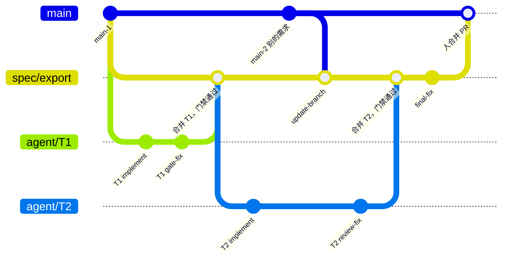

## 门禁

门禁回答一个问题：这次改动在不信任 agent 的前提下是否可接受。

- **配置位置**：仓库的 `.sandcastle/gates.yaml`，列出命令（typecheck、test、lint、e2e…）和每条命令输出 JUnit XML 的路径。M0 用的草案格式：`version`、`setup`（每次新沙箱先跑，如 `npm ci`）、`commands`（每条有 `name`、`run`、`timeoutSeconds`，输出 JUnit 的命令另有 `junit` 路径）。
- **配置从基准提交读**：单票门禁用 `merge-base(票分支, 集成分支)` 上的配置（`git show <base>:.sandcastle/gates.yaml`），候选门禁用集成分支当前 head 上的配置。agent 改了配置也不影响本次门禁。
- **门禁在全新沙箱里跑，不复用 agent 的沙箱**：agent 运行可能改过容器里的文件（全局包、`~/.npmrc` 等），影响门禁结果。命令用 `timeout` 包住，因为 `sandbox.exec` 没有超时。门禁结束后，JUnit 从宿主机上 worktree 的路径直接读取（bind mount，不需要拷贝）。
- **命令按顺序跑，第一个失败就停**：这时后面的命令没跑，也就没有 JUnit。失败命令输出的最后 200 行写进 `/context/failure/gate.log`，给 gate-fix 或 merge-fix 读。
- **保护路径**：项目配置列出保护路径，默认包括 `.sandcastle/**`、`.github/**`、`.gitlab-ci.yml`、测试框架配置（`vitest.config.*`、`jest.config.*`、`playwright.config.*`）、`tsconfig.json`、契约文件。改这些文件的票，在拆票时用 `protected_paths_ok` 标明具体路径，人在确认拆分时提前批准。判定分两层：
  - **第一道防线是 agent 自己**：`/context/run.json` 里的 `allowedProtectedPaths` 列出这张票已批准的保护路径，prompt 要求“保护路径一律不改，`allowedProtectedPaths` 里的除外”。没批准却必须改时，agent 输出 `cannot-proceed`（`blockedReason` 为 `contract-change-needed` 或 `agent-gave-up`）。M0 实测 agent 会照此拒绝。
  - **兜底是 worker 的检查**：`merge-base..HEAD` 的 diff 碰到的保护路径，减去 `allowedProtectedPaths`，非空就判 `protected-path-changed`，由人批准或驳回。M0 里这条兜底只在本机用造出来的 commit 验证过，没有在真实运行里被触发过。
- **跳过的测试**：从 JUnit XML 里取测试总数和跳过数。和基准提交的 GateResult 比，跳过数增加或总数减少都判失败。单票门禁的基准是票分支的起点（`merge-base`）那次门禁的计数，起点从没跑过门禁就不比；候选门禁的基准是集成分支最近一次合并的计数。别的票后来合进去的测试不在票分支上，不能拿来要求它。这同时覆盖了“缺 fixture 或 .env，测试悄悄跳过”的情况。**只在所有命令都跑完、拿到 JUnit 时才比较**；前面的命令已经失败时，只报告失败的那一条。
- **0 个 commit**：implement 和 fix 运行结束时没有新 commit，判失败。
- **结果存档和复用**：每次门禁按 commit SHA 存一条 GateResult，同时记下代码树 SHA 和 `gates.yaml` 的 blob SHA，后续的基线比较和验收包都用它。门禁结果只取决于代码树和门禁配置，所以同一仓库里树和配置都相同、命令全部通过并有 JUnit 的旧结果直接复用，不再开沙箱，只按这一次的基准重新比较测试数，并为新提交照常记一条 GateResult。典型情况是集成分支没动过时的合并候选（和票分支是同一棵树），以及 worker 重启或重试后同一提交再过门禁。
- **setup 失败不是改动的问题**：`setup`（装依赖、起数据库）失败时整次门禁当作作业失败，按作业失败重试（共三次），之后票以 `job-failed` 等人处理；不派 gate-fix，也不存 GateResult。worker 配置了 `AFK_NPM_REGISTRIES` 时，它作为环境变量进入每个沙箱，仓库的 setup 脚本按顺序换源安装（本仓库是 `scripts/install-deps.sh`）。
- **生成文件与再生成**：`gates.yaml` 可声明 `generated: [{ paths, run }]`。合并冲突只落在这些路径上时，worker 在门禁沙箱里取上游一侧的版本，先跑 `setup`，再按声明顺序跑各组的 `run`，由平台提交后照常跑合并后门禁，不派 merge-fix。跑 `run` 时沙箱带环境变量 `AFK_GENERATED_UPSTREAM_SHA`，值为**上游、不改号那一侧**的提交：票的 merge 阶段是集成分支，需求收尾的 update-branch 是仓库默认分支（main）；再生成脚本用它分辨哪边不动、哪边要改，而不是依赖 merge 提交的父提交顺序。

## 跨仓库需求

2026-10-30 按 M2 地图（#62）重写：仓库不再分前后端，契约属于提供接口的仓库，联调由平台在联调环境里验证。详细设计见 [M2 spec](specs/m2-platform.md)。

一个项目可以有任意几个仓库（一个前端、几个后端都行），仓库只有名字。一个需求可以改其中任意几个，每张票只往自己的仓库提交；需要参考别的仓库时只读挂载它的快照。仓库之间的接口靠契约：契约写在提供接口的仓库里，按契约先行拆票，使用方和提供方可以并行开发。

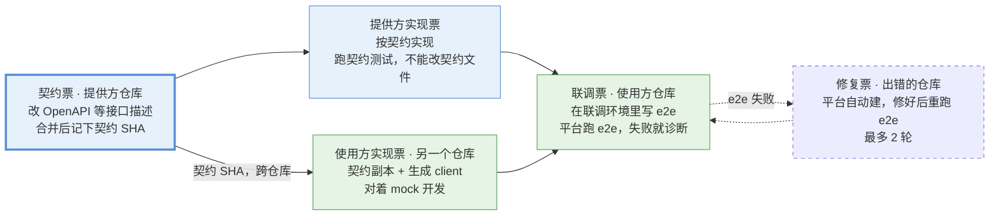

契约票是起点；它完成后各仓库的实现票同时开工，都完成才进入联调。

- **仓库**：只有名字（项目内唯一，导入文件里 `repo:`、`refs:`、`environment:` 都写它），不分前后端，没有「主仓库」。worker 的主 clone 按名字存放。
- **契约**：写在提供接口的仓库里，仓库配置里声明路径（每个仓库可有可无）。契约票合并进集成分支后，平台把当时集成分支的 head 记为契约 SHA。contract 边可以从任意仓库连到任意仓库；下游票只用契约 SHA 上的契约：worker 在提供方仓库的主 clone 里 `git show <SHA>:<path>`，导出到 `/context/contract/<仓库名>/`。一张票在同一个仓库有多张契约上游时，用依赖图里最下游那张的 SHA（导入时要求它们排成一条链）。
- **契约副本**：使用方仓库提交一份契约副本（试点前端是 `contract/openapi.yaml`），生成的 client 以它为准，门禁用生成器的 `--check` 保证生成物和副本一致。worker 在保护路径检查同一步逐字节核对：有 contract 入边的票，副本必须等于它的契约 SHA 上的契约；没有的票不许改副本；违反 → `contract-copy-mismatch`。
- **契约变更**：提供方实现票的门禁把契约文件列为保护路径。agent 认为契约要改时，输出 `cannot-proceed`，原因写 `contract-change-needed`，不自己改。人用**追加**（`plat tickets import --append`）加一张新契约票（`blocked_by` 旧契约票），把它设为原票和还没开工的使用方票的上游；原票停在 blocked，由人重试。**做完的票不重开**：已经按旧契约做完或正在做的票，追加时平台会列出来，人为它们追加适配票，挂在新契约票下面。
- **提供方票的验证**：在提供方仓库里跑契约测试（试点用 openapi-backend 校验真实响应），门禁另外校验契约本身合法（OpenAPI 3.1 元 schema）。
- **使用方票的验证**：用契约生成 client（试点用 openapi-typescript + openapi-fetch），mock 也受契约类型约束（MSW + openapi-msw），对着 mock 开发和测试。
- **参考另一个仓库**：票在导入文件里声明 `refs: [仓库名…]`。worker 用 `git archive <SHA>` 导出快照（先解到临时目录再改名，导出前用 `info/attributes` 关掉 `export-ignore` / `export-subst`；不导出子模块、不展开 LFS），只读挂到 `/refs/<仓库名>/`。SHA 由 API 在每次 agent 运行时定：这个仓库在本需求里有集成分支就用它的 head，没有就用 main 的 head；记在 Run 上。
- **联调环境**：联调票声明 `environment: [仓库名…]`。每个仓库提供一个 compose 片段 `.sandcastle/integration/compose.yaml`；worker 给每个仓库打快照（同上的 SHA 规则），片段里带 `build:` 的服务在它自己仓库的快照里 `docker build --pull=false`，再 `docker compose -p afk-<run-id> -f 片段… up --no-build --wait`，然后按顺序跑 `seed-<仓库名>`。不用 `compose build`：它会去远端解析基础镜像（Mac 上连不上 Docker Hub）。网络按 compose 的 label 找，建沙箱前确认网络存在。联调票所在仓库的沙箱通过 `docker({ network, env })` 加入网络，服务地址由 `env` 传入。compose 网络不能设成 `internal`，否则沙箱连不到模型 API。不把 docker socket 挂进沙箱，那等于交出宿主机 root 权限。
- **联调票**：implement 运行在联调环境里，agent 按验收标准写 e2e、对着真服务跑通再提交；照常走门禁（不含 e2e）、review、merge；merge 之后由 worker 自己新起一个环境跑 e2e，以 JUnit 为准（原则 7），通过才 done。
- **联调失败**：e2e 有失败时，agent 在同一个环境里诊断（只诊断不提交），输出 integration 结构化结果（`failingRepo`、证据、失败用例）。平台自动在 `failingRepo` 的仓库建修复票，挡在联调票前面；修复票 done 后联调票直接从 e2e 重跑。最多 2 轮，超过判 `integration-loop-exceeded`；`failingRepo` 是 `unknown` 时判 `integration-unknown-side`；环境起不来（三次）判 `integration-environment-failed`。
- **清理**：先结束沙箱，再 `compose down -v`，再按 label 查一次网络（沙箱还挂着时 `compose down` 返回 0 但网络会留下）。worker 被杀后按 compose 项目名 `afk-<run-id>` 找回环境；孤儿容器按 `docker ps -a` 回收（网络不存在时 Sandcastle 会留下 `Created` 状态的容器）。
- **合并顺序**：由 contract 边推出：提供契约的仓库先合，使用它的仓库的 PR 先开成 draft，前者合并后平台用 `pr-ready` 作业转成可合并，用这种方式在代码托管上体现顺序；没有契约关系的仓库之间没有顺序。提供方改动必须向后兼容，因为各仓库分开部署。破坏性变更拆成“先加新的、再迁移、最后删旧的”几个 spec，跨版本完成。
- **不支持**：一个仓库依赖另一个仓库**未发布的包**（共享库在集成分支之间流转需要发包和版本号，平台没有这套机制）。

契约 SHA 的流转，以及契约要改时怎么办：

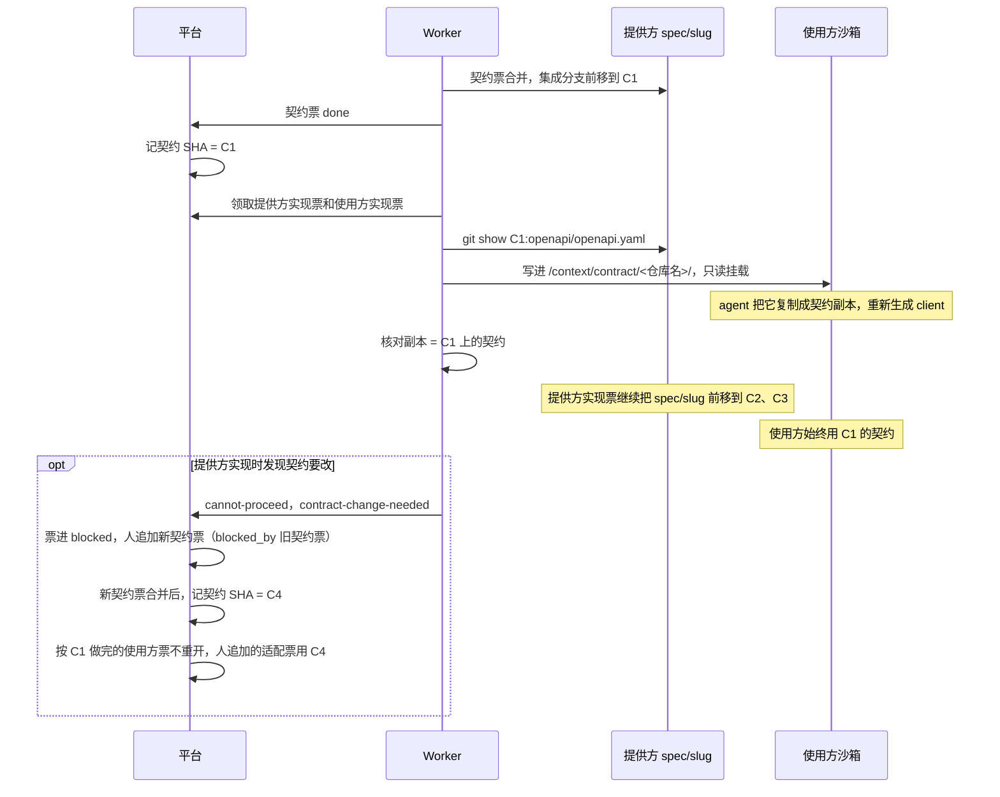

联调环境（试点：一个后端）：

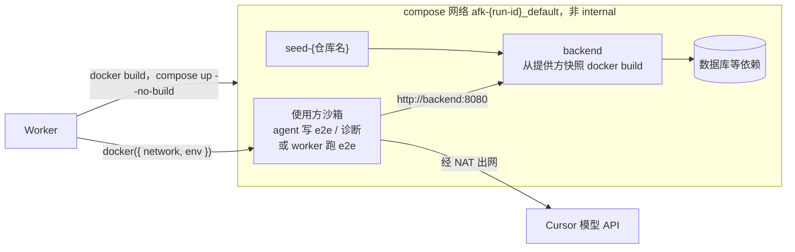

联调票的流水线和失败时的处理：

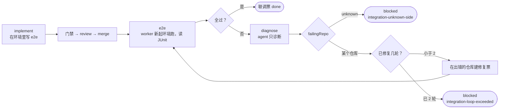

## 多需求并行

每个需求在它涉及的每个仓库里都有自己的集成分支，需求之间互不阻塞。

- **分支**：集成分支 `spec/<id>/<slug>` 从 main 切出；票分支 `agent/<id>/<ticket-id>` 从集成分支切出（`<id>` 是这个数据库的标识，见下）。细节见「Git 操作规范」。
- **同一需求内的冲突**：to-tickets 阶段给会改同一文件的票加依赖边；共享的名字在 spec 里写死。导入时平台做一次确定性检查：同一 spec、同一仓库里，模块 glob 有重叠、但依赖图里没有路径相连的票，给出告警，人在确认拆分时决定加边还是放行。合并冲突由流水线的 merge-fix 处理。
- **不同需求之间的冲突**：
  - 不同需求的票在各自的集成分支上跑，串行执行并不能避免冲突，所以不按模块串行。
  - 集成分支每前移一次，平台就对同一仓库里其他在跑的集成分支做一次试合并（`git merge-tree`），在页面上显示“潜在冲突”和冲突文件，不阻塞执行。冲突在先合进 main 的一方合并后，由另一方的 update-branch 处理。
  - main 前进由 host-sync 每分钟读默认分支头发现（不靠 webhook）。running 的需求不再每次都 update-branch，只在三种情况更新：(a) 用不跑门禁的 merge-tree 检查发现和默认分支会文本冲突；(b) 进入收尾前（落后 main 就先更新，现有行为）；(c) 落后超过 N 个提交或 T 小时，二者先到先触发，默认 15 个提交或 6 小时，项目设置里可改。排队期间 main 又动了就合成一次。awaiting-review / partially-merged 只在 PR / MR 与 main 冲突时更新。merge-tree 只能发现文本冲突；「合上之后门禁才挂」的语义冲突最迟在收尾前暴露。作业带集成分支的 `lock_key`，把 main 合进候选、跑候选门禁、通过才前移；有冲突或门禁不过，开一次 merge agent 运行（ticket 为空的 Run，阶段 `update-branch`）解决后再过门禁。仍失败则 spec 暂停（原因码 `update-branch-conflict` / `update-branch-gate-failed`）进待处理，不派新票、在跑的票跑完；人可以重试、放行或取消。细节见 [M3 spec](specs/m3-platform.md)。
- **合并到 main**：由人做，平台给出建议顺序；一个需求合并后，其他需求若会和默认分支冲突或已落后过阈值则 update-branch。
- **并发和预算**：全局、每项目、每仓库、每台 worker 各设并发上限。Cursor 不报 token 用量，PoC 先按运行时长和次数设上限。**项目并发**是同时跑 agent 的票数：只数 queued、running，merging 不计入。合并候选门禁、联调 e2e 和诊断都不占项目名额。**worker 槽位**是这台机器同时跑的作业数，agent 运行、门禁、合并、联调都占一格；合并和联调的开销由槽位兜底，不靠把 merging 算进项目名额来限。
- **名额在需求之间怎么分**（2026-11-08）：项目的名额由它的各个需求共用。任何事让一个需求跑了一次调度（票 done、blocked、失败、取消，需求取消或暂停），提交后同项目所有 running 的需求各再跑一次，因为释放出来的名额可能正是别的需求在等的；API 另外每分钟对所有 running 的需求跑一次，补上漏掉的触发。几个需求都有能开工的票时轮流拿：手上名额少的先拿，一样多时上次开工更早（或从没开过工）的先拿。已经在跑的票不会被抢走。
- **名额在项目之间怎么分**（2026-11-10）：多个项目共用一台 worker 时，领取作业按项目轮流：刚被领过的项目排到后面，一个项目大量的合并作业不会让别的项目一直领不到。只有一个项目有作业时，它仍能用满这台 worker 的槽位。

两个需求在同一个仓库里并行，A 先合进 main，B 随后 update-branch：

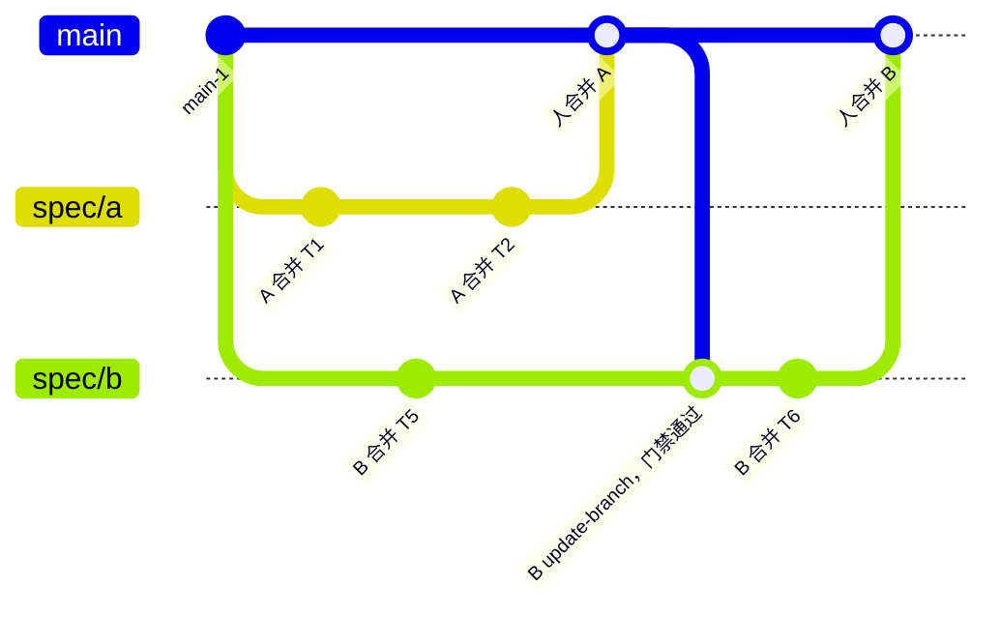

集成分支每前移一次就做一次试合并，提前发现潜在冲突，不阻塞执行：

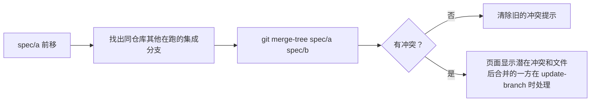

## 平台与代码托管的分工

平台管研发信息，代码托管管代码和 PR。两边通过适配器连接，先接 GitHub，再接 GitLab CE 17.3.1。

|        | 平台负责                                                                                                  | 代码托管负责                              |
| ------ | --------------------------------------------------------------------------------------------------------- | ----------------------------------------- |
| 内容   | spec、tickets、依赖图、运行记录和日志、agent 的 review 意见、验收结论、追溯链接                           | 代码、分支、PR/MR、人写的 review 评论、CI |
| 能看到 | 每个需求下：各仓库 PR 的状态（CI、review、是否已合并）、票的进度、运行日志、待处理的 blocked 票、潜在冲突 | 代码差异和评论                            |
| 能操作 | 确认拆分、编辑 / 重试 / 取消票、处理 blocked、触发最终 review、开 PR、跳转到 PR                           | 合并（由人做）                            |

适配器的差异：

|              | GitHub（PoC）                                                                                                                                                                                                                                                                                                                                                                                                                                                                                                                                                                                                                                                                                                                                                                                                                                                                                                                                                                                                                                                 | GitLab CE 17.3.1（生产）                                                              |
| ------------ | ------------------------------------------------------------------------------------------------------------------------------------------------------------------------------------------------------------------------------------------------------------------------------------------------------------------------------------------------------------------------------------------------------------------------------------------------------------------------------------------------------------------------------------------------------------------------------------------------------------------------------------------------------------------------------------------------------------------------------------------------------------------------------------------------------------------------------------------------------------------------------------------------------------------------------------------------------------------------------------------------------------------------------------------------------------- | ------------------------------------------------------------------------------------- |
| 变更请求     | PR                                                                                                                                                                                                                                                                                                                                                                                                                                                                                                                                                                                                                                                                                                                                                                                                                                                                                                                                                                                                                                                            | MR                                                                                    |
| 状态同步     | 轮询，每分钟一次，不用把本机暴露到公网                                                                                                                                                                                                                                                                                                                                                                                                                                                                                                                                                                                                                                                                                                                                                                                                                                                                                                                                                                                                                        | 轮询，每分钟一次（webhook 以后再做）                                                  |
| CI           | GitHub Actions                                                                                                                                                                                                                                                                                                                                                                                                                                                                                                                                                                                                                                                                                                                                                                                                                                                                                                                                                                                                                                                | GitLab CI                                                                             |
| bot 账号     | **GitHub App**，装在个人账号上，只勾选需要的仓库（PoC 先只装 `afk-pilot-backend`）。权限：Contents 读写、Pull requests 读写、Checks 只读、Commit statuses 只读；**不给** Workflows、Administration、Actions 写、Issues、Secrets。不订阅 webhook，状态靠轮询。PR 作者显示为 `<app>[bot]`，与你本人是不同身份。不用机器账号：仓库属于个人账号，fine-grained token 一个只能访问一个所有者的资源，不支持协作者身份，只能退到范围很大的 classic token。凭据（App ID、安装 ID、私钥 PEM）放 `~/.afk/secrets/github-app/`（权限 600，不放 `~/.afk/env`）；worker 用私钥换 installation token（每小时过期），换的时候限定本次任务需要的仓库和权限，缓存到过期前 5 分钟；推送仍通过 `http.extraHeader` 传，M0 用的个人 `GITHUB_TOKEN` 在 App 跑通后废掉。token 不能按分支限权，bot 只写 `agent/*`、`spec/*` 由平台保证                                                                                                                                                                                                                                                 | bot 用户 + PAT，Developer 角色，PAT 放 `~/.afk/secrets/gitlab/<主机>`                 |
| 强制由人合并 | **PoC（GitHub 免费个人账号，私有仓库）用不了 ruleset 和分支保护，也没有 bypass 名单**（2026-10-28 对试点仓库实测：接口返回 `Upgrade to GitHub Pro or make this repository public`）。所以改成三层，GitHub 不强制，平台自己保证，已知缺口：(1) worker 里所有 `git push` 走同一个函数，只放行 `refs/heads/agent/*` 和 `refs/heads/spec/*`，其余拒绝；平台代码里不调用任何合并 PR 的接口；两个测试：给这个函数传 `main` 必须报错，代码里搜不到合并接口的调用。(2) 每个仓库放一个检测用的 Actions 工作流，监听 `push` 到 `main`，用 `GET /commits/{sha}/pulls` 查这次提交有没有对应的已合并 PR，没有、或推送者是 bot，就失败并在仓库里开一个 issue；只做事后检测，不阻止，出事后人工回滚。免费个人账号的私有仓库每月 2000 分钟 Actions 额度，这个工作流每次几秒，用不到六分之一；额度用完又没绑支付方式时它会静默不跑，需留意邮件提醒。(3) App 不给 Workflows 权限，据说这样改不了 `.github/workflows/`，bot 出 bug 也关不掉第 2 层（待验证）。以后要 GitHub 真强制，升级 Pro 后加 ruleset：要求经 PR 合并且至少 1 个 approve，bot 不在 bypass 列表，前三层不用改 | 受保护分支：允许 push 设为“无”，允许合并设为 Maintainer。bot 只是 Developer，合不进去 |

GitLab 免费版的 MR 审批是可选的，没有审批也能合并；“必须几人审批”的规则是 Premium 功能。所以在 CE 上靠角色限制来保证由人合并（[受保护分支](https://docs.gitlab.com/user/project/repository/branches/protected/)、[MR 审批](https://docs.gitlab.com/user/project/merge_requests/approvals/)）。Developer 能写所有未受保护的分支，同样由平台保证只写 `agent/*`、`spec/*`。

PoC 阶段不依赖 GitHub 特有的东西，迁移到 GitLab 时才不痛：

- 不用 Actions 做编排，编排是平台调度器的事
- 不用 sub-issue 和原生依赖关系，票都在平台里
- 不依赖 `Closes #N` 自动关票

PR 上人写的评论可以拉回来返工：平台读取评论，spec 进入 reworking，在集成分支锁外开一次 rework 运行（分支 `rework/<slug>-<n>`，从集成分支切出），过门禁后按合并流程合回集成分支，spec 回到 awaiting-review。Sandcastle 自己的 `.sandcastle/agent-workflows/implement-pr` 就是这么做的（读 PR 评论、改代码、逐条回复），可以直接参考；回复评论由平台通过适配器发，不由 agent 发。

```mermaid
sequenceDiagram
    actor H as 人
    participant G as 代码托管
    participant A as 平台
    participant W as Worker
    participant S as 沙箱 agent

    H->>G: 在 PR 上写评论
    A->>G: 轮询或 webhook 拿到新评论
    A->>A: spec 进入 reworking，建 rework 作业
    W->>A: 领取作业
    W->>S: rework 运行，分支 rework/slug-n，读 /context/pr-comments.md
    S-->>W: commits 和结构化输出
    W->>W: 补 trailer、门禁
    W->>G: 持锁合回 spec/slug，PR 自动更新
    W->>A: 回传结果
    A->>G: 通过适配器逐条回复评论
    A->>A: spec 回到 awaiting-review
```

## 合并到 main 与信任阶梯

前期合并到 main 全部由人做，在代码托管上强制（见上一节）。平台用验收包缩短人的验收时间，用指标决定什么时候放权。

验收包在每个需求收尾时生成，人看完就能决定合不合：

- 各仓库的 PR 和合并顺序
- 每条验收标准对应哪个测试。来自 agent 的结构化输出，平台再对照 JUnit 结果核验：测试存在且通过的标“已验证”，否则标“未验证”
- agent review 提了什么意见、怎么处理的（Finding 及处理结果）
- agent 自己标出的不确定点
- 门禁和 CI 结果、耗时、被人批准过的保护路径改动

每个需求记录四个指标：人合并前又改了多少（返工率）、PR 上人提了多少意见、合并后 N 天内追溯到它的缺陷数、门禁失败率。合并策略按项目和 spec 类型可配，默认人工。

| 级别       | 谁合进 main                                                              | 进入条件                |
| ---------- | ------------------------------------------------------------------------ | ----------------------- |
| L0（现在） | 全部由人合并                                                             | 无                      |
| L1         | 低风险类型（文档、测试、门禁全过的小 bug 修复）由 agent 合并，人事后抽查 | 阈值待 PoC 跑出数据后定 |
| L2         | 指标长期达标的项目放开到 feature                                         | 阈值待定                |

升级到 L1 时 bot 需要 main 的合并权限。GitLab CE 只能按角色授权，没法按 PR 类型区分，所以"只合并低风险类型"这条限制只能靠平台的合并策略保证。

## 上下文沉淀与缺陷回流

平台存指针和索引，不复制仓库里已有的内容。目标是从任意一行代码都能确定地追溯到原需求和当时的决策，不靠向量检索去猜。

| 层       | 存什么                                                | 来源                         |
| -------- | ----------------------------------------------------- | ---------------------------- |
| 意图     | spec 正文、关键决策、明确不做的范围                   | to-spec                      |
| 计划     | tickets、依赖边、验收标准                             | to-tickets                   |
| 执行     | Run 记录、实时日志、门禁结果、review 意见、结构化输出 | worker                       |
| 结果     | commit ↔ ticket 映射、PR、验收意见                    | commit trailer、代码托管同步 |
| 复盘     | retro 产出、缺陷到原 spec 的“由谁引起”链接            | retro skill、人              |
| 领域知识 | GLOSSARY.md、ADR、契约（只建索引，原文留在仓库）      | domain-modeling skill        |

Cursor provider 不采集会话记录（`captureSessions: false`），所以执行层只有 Sandcastle 推出的实时日志（`onAgentStreamEvent`）。以后换成 Claude Code 等支持采集的 agent，再把会话记录存入对象存储。

**追溯链路**：

- 每个 agent commit 都带 `Spec`、`Ticket`、`Run` trailer（见「Git 操作规范」），追溯以 trailer 为准，不依赖 SHA。平台按正则从 commit 消息里取，不依赖 git 的 trailer 解析，所以 trailer 被挪到消息正文中间也能取到。
- 用 merge commit 或 rebase 合并时，每个 commit 和它的 trailer 都保留，git blame 能定位到票。
- 用 squash 合并时，一个 PR 的所有票被压成一个 commit，blame 只能定位到 spec。squash 提交消息要设成包含所有 commit 的消息（GitHub：PR 标题加 commit 详情；GitLab：squash 模板里用 `%{all_commits}`），这样至少能从 squash commit 列出它包含的票。PR 描述里也写上 `Spec: S-12` 和票列表。
- Link 表记录改写后的 SHA，供快速查询；trailer 是兜底。

从一行代码追溯到原需求，再进入新的修复流程：

```mermaid
flowchart LR
    bug["bug 报告 / 相关文件"] --> blame["git blame"]
    blame --> cm["commit"]
    cm --> tr["trailer<br/>Spec、Ticket、Run"]
    tr --> tk["Ticket<br/>验收标准、review 意见"]
    tr --> rn["Run<br/>日志、结构化输出、不确定点"]
    tk --> sp["Spec<br/>关键决策、不做的范围"]
    sp --> dk["ADR、GLOSSARY、契约<br/>只给指针"]
    sp --> ns["新 bug spec<br/>来源指向原 spec"]
    tk --> ns
    rn --> ns
    dk --> ns
    ns --> pipe["同一条执行流水线"]
```

**缺陷回流流程**：

1. 缺陷进来：人丢一份报错/堆栈给 `plat bug`，或自己指出文件后跑 `plat context --files`。
2. `plat bug` 先建一份 bug 类型的草稿 Spec，再跑 Locate（只读 agent，各仓库默认分支进同一个沙箱）。不是 Diagnosis，也不建 Fix ticket。
3. 定位成功则补上原 Spec 和指针（blame → trailer → Link）；定位不到则草稿进待处理。人照常 grill → to-tickets → confirm。
4. `plat context --files a.ts b.ts`：人的 checkout 上 git blame → commit → trailer → ticket → spec，返回相关的决策、ADR、当初明确不做的范围，全部以指针形式给出。网页按需求展示 Link，不做 blame。
5. 走同一条执行流水线。不自动拆票、不自动开工。
6. 平台级复盘（以后）：统计哪类 spec 缺陷多、哪类验收标准老是漏，反过来改 to-spec 和 to-tickets 的模板。

向量检索（pgvector）只做补充，回答“做过类似需求吗”“这个 bug 像哪个 spec”这类问题。

## Agent 与 skills 对接

PoC 的 AFK agent 是 Cursor Agent CLI。它在 Sandcastle 里有三个确定的限制，平台按“每次全新会话”设计来绕开（来源：Sandcastle `src/AgentProvider.ts` 的 cursor provider）。

| 限制                                | 影响                                                             | 对策                                                                                                                                                                                                     |
| ----------------------------------- | ---------------------------------------------------------------- | -------------------------------------------------------------------------------------------------------------------------------------------------------------------------------------------------------- |
| 不能 resume / fork 会话             | 门禁失败后接着改、带 PR 评论返工、从原会话 fork 修 bug，都做不了 | 每次新开一个运行，靠分支上已有的 commits 和 `/context` 里的文件接上。丢的只是对话，代码不丢                                                                                                              |
| prompt 通过命令行参数传，上限 120KB | 不能把整个 spec 塞进 prompt                                      | prompt 只放指针，票、spec、失败日志都在 `/context` 里                                                                                                                                                    |
| 不报 token 用量                     | 平台算不了成本                                                   | Run 先记运行时长和次数，token 用量字段留空。stream-json 的 `result` 事件里有 `duration_ms` 和 `duration_api_ms`，worker 从原始行里取出来记在 Run 上（Sandcastle 不解析，`IterationResult.usage` 总是空） |

Cursor CLI 无头模式在 2026 年 2 月被报告不加载 skills，Cursor 于 2026-03-09 推送修复，报告人 03-11 确认可用（[论坛帖](https://forum.cursor.com/t/cursor-cli-headless-mode-doesnt-load-skills-from-known-locations/152476)）。在你的环境里还没验证过，所以 prompt 仍然按路径读 SKILL.md 兜底。

**上下文注入**：worker 为每次运行渲染一个目录，只读挂到沙箱的 `/context`。沙箱不调 `plat`、不连平台 API。

| 路径                          | 内容                                                                                                                                                     | 何时有              |
| ----------------------------- | -------------------------------------------------------------------------------------------------------------------------------------------------------- | ------------------- |
| `/context/ticket.md`          | 这张票的文件：front matter（`id`、`version`、标题、仓库、模块…）加导入时的正文原文，与 `plat ticket view --md` 一致                                      | 总是                |
| `/context/spec.md`            | spec 正文，包括已确认的 seams 和共享名字                                                                                                                 | 总是                |
| `/context/run.json`           | 阶段、基准提交（fixed point）、分支名、集成分支名、上限、`allowedProtectedPaths`（这张票已批准可以改的保护路径，没有则为空数组）                         | 总是                |
| `/context/contract/<仓库名>/` | 固定 SHA 上的契约文件，按提供契约的仓库分开                                                                                                              | 有契约边时          |
| `/context/domain/`            | 规划提交上规划仓库的 `GLOSSARY.md` 和 `docs/adr/`，只读                                                                                                  | 非规划仓库的票      |
| `/context/note.md`            | 人对紧接着这一次 Run 的 Retry note                                                                                                                       | 这次重试带了说明    |
| `/context/failure/gate.log`   | 上一次门禁失败命令输出的最后 200 行，加门禁结论；merge-fix 时是 `merge-tree` 的冲突说明或候选门禁的失败日志                                              | gate-fix、merge-fix |
| `/context/review.json`        | review 的 mustFix 列表                                                                                                                                   | review-fix          |
| `/context/pr-comments.md`     | PR 上人写的评论                                                                                                                                          | rework              |
| `/refs/<仓库名>/`             | 另一个仓库的只读快照（SHA：本需求有集成分支用它的 head，否则 main，由 API 每次运行定）                                                                   | 跨仓库参考时        |
| `/home/agent/.cursor/skills/` | skills，只读。源是 [mattpocock/skills](https://github.com/mattpocock/skills) 固定 commit（`SKILLS_SHA`）的 `skills/engineering` 目录；Run 上记下这个 SHA | 总是                |

skills 挂在 Cursor CLI 的用户级 skills 目录（官方文档列出的自动发现位置），不再用 `/skills`。M0 实测：agent 不读文件就能列出挂进去的技能，按绝对路径读 `SKILL.md` 也能照做。prompt 里仍写明绝对路径作为兜底。

**结构化输出**：每次 agent 运行用 Sandcastle 顶层 `run()` 的 `Output.object` 要求 agent 最后输出一段 `<result>` 标签包着的 JSON，Sandcastle 取最后一个标签并用 zod 校验，不合法就判 `invalid-output`。这样每次 agent 运行用 `run()`，门禁另起新沙箱用 `sandbox.exec`，因为 `Output.object` 只有顶层 `run()` 支持，`sandbox.run()` 没有。M0 实测三种 prompt（implement、fix、review）都稳定拿到合法 JSON。备选：由 worker 自己从 `stdout` 取最后一个 `<result>` 再用 zod 校验（M0 也实测可用），只在 Sandcastle 以后行为变化时启用。注意：prompt 里必须原样出现 `<result>`；cursor provider 下不能设 `maxRetries`，格式错了不自动重试，直接 `invalid-output`。

| 运行                     | 字段                                                                                                                                                                                                                                            |
| ------------------------ | ----------------------------------------------------------------------------------------------------------------------------------------------------------------------------------------------------------------------------------------------- |
| implement / fix / rework | `status`（done / cannot-proceed）、`blockedReason`（cannot-proceed 时必填，枚举：`agent-gave-up` / `contract-change-needed`）、`detail`（cannot-proceed 时的说明，自由文本）、`summary`、`acceptance`（验收标准 → 测试名列表）、`uncertainties` |
| review / final-review    | `verdict`（pass / fix）、`mustFix`（文件、行、问题）、`suggestions`、`uncertainties`                                                                                                                                                            |
| integration（diagnose）  | `result`（pass / fail）、`failingRepo`（仓库名或 unknown）、`evidence`、`failingTests`                                                                                                                                                          |

`cannot-proceed` 给 agent 一个正当的出口：遇到需要人回答的问题时，输出原因然后结束，而不是停下来等提问被回答。

**AFK prompt 的写法**（ADR 0002）：agent 收到的 prompt 是两段拼成的一份：**公共覆盖层**（`packages/pipeline/prompts/overlay.md`，所有阶段一样）加**这个阶段的薄 prompt**。worker 把拼出的全文写进临时文件交给 Sandcastle，同一份全文记在 Run 的 `prompt` 上。阶段 prompt 只放指针和这个阶段特有的东西，不重写 skill 已经有的步骤，控制在 120KB 以内。

- 公共覆盖层写明：没有人回答问题，遇到小事自己决定并写进 `uncertainties`，必须由人决定的输出 `cannot-proceed`；`/context` 就是 tracker，不读 `docs/agents/issue-tracker.md`、不调 `plat`、不运行 setup；不 push、不切换或新建分支、不自己加 `Spec` / `Ticket` / `Run` trailer（worker 事后补）；保护路径一律不改，`/context/run.json` 的 `allowedProtectedPaths` 里列出的除外，没批准却必须改、或契约有问题时输出 `cannot-proceed`，`blockedReason` 写 `contract-change-needed`（契约票和普通票用同一份 prompt，靠 `allowedProtectedPaths` 区分）。有 `/context/note.md` 时读它，当成人对这一次 Run 的指示，不当成改票。
- 公共覆盖层把 skill 里每个"去问人"的地方写死成答案：implement 的"reference 不明确就问"，票就是 `/context/ticket.md`；tdd 的"和用户确认 seams"，spec 里的 seams 已经确认；code-review 的"问固定点"，是 `run.json` 的 `baseSha`，按 skill 原文用三点 diff；code-review 的"问 spec 在哪"，由阶段 prompt 给出。没列到的提问，能撤回的小事自己决定，需要人决定的输出 `cannot-proceed`。覆盖层第一行写明它对应的 skills SHA，守卫测试要求它等于固定的 `SKILLS_SHA` 和快照的 SHA；升级 SHA 时必须回头核对覆盖层。
- implement：按绝对路径读 `/home/agent/.cursor/skills/implement/SKILL.md` 照做（它是 `disable-model-invocation: true`，模型不会自己调用；agent 也没有 Skill 工具，所以按文件读），**跳过它最后调用 `code-review` 的那一步**，平台另有 review 阶段。tdd 只做红 → 绿，不在循环里重构；每条验收标准都要有测试，结果里带验收对照表。
- gate-fix、review-fix、final-fix：读 tdd，先写会失败的测试再修；review-fix 和 final-fix 把两个审查轴的 `mustFix` 一起修；不用 `diagnosing-bugs`。merge-fix 不读 skill，只用覆盖层。
- review、final-review：跑 `code-review`，固定点是 `baseSha`，diff 用三点 diff。skill 要求 Standards 和 Spec 两个轴用并行子 agent 互相隔离，平台不让 agent 自己开子 agent，而是按轴各开一次 agent 运行（各开新沙箱、各用一条自己的临时分支，各记一条 Run，Run 上标明审查轴 `axis`），每次运行扮演一个轴的子 agent，prompt 写“第 1–3 步已替你做完；你就是第 4 步里这一轴的子 agent”。**票级审查默认只跑 Spec 轴**（项目设置 `ticketReview: spec`）；`ticketReview: both` 时票级也两轴并行，和现在一样。Standards 轴照常在需求级 final-review 跑，那里看的是整份改动。worker 再按第 5 步把跑过的轴并排拼起来，不合并也不重排；没跑的那一轴不出现在拼好的结果和 review-fix 读到的 `review.json` 里。任一轴 invalid-output 或超时，整个阶段按这个结果处理，重试时把这次该跑的轴一起重跑；任一已跑的轴有 `mustFix` 就判 fix。Spec 轴在单票审查里对照 `/context/ticket.md` 和契约（`spec.md` 只是背景），在 final-review 里对照 `spec.md` 和 `tickets.md`。映射：`mustFix` 收文档写明的硬性违规、Spec 轴的缺失或做了一半、做错了；`suggestions` 收所有坏味道；Spec 轴的 scope creep 另记为 `scopeCreep`（意见 `scope-creep`），只进验收包并单独列出，从不触发修复。每条意见带它那次运行的审查轴；review-fix 和 final-fix 读到的 `review.json` 是已跑轴并排的结果加上带轴的全部 `mustFix`，一次处理完。
- 联调票的 implement 和诊断：只接公共覆盖层，不跑 skill，因为 e2e 是对着已经实现好的服务写的，套不上 tdd 的红 → 绿。
- **rework**（处理 PR 评论）平台还没有实现；实现时按 review-fix 的方式：读 tdd，先写会失败的测试再改，覆盖层照用。
- 结构化输出的 `<result>` 格式按阶段写在阶段 prompt 里。
- prompt 文件在 `packages/pipeline/prompts/`：`overlay.md`、`implement.md`、`integration-implement.md`、`gate-fix.md`、`review-fix.md`、`merge-fix.md`、`final-fix.md`、`review.md`、`final-review.md`、`afk-integration.md`（诊断）。

**密钥**：

- Cursor API key 放在 worker 的环境文件里，通过 `cursor(model, { env })` 注入沙箱。这是沙箱里唯一的密钥。
- GitHub / GitLab token 只在 worker 进程里，不进沙箱。
- 测试需要的 `.env` 和 fixture 放在 worker 本机的密钥目录，只放测试用的值，通过 `copyToWorktree` 带进去。

**skills 侧的对接**：

- 在后端仓库跑 `setup-matt-pocock-skills`，tracker 选“其他”。生成的 `docs/agents/issue-tracker.md` 里写清 `plat` 怎么用。
- 平台特有的规则也写进这份文档，不用 fork skills：to-tickets 输出 `plat tickets import` 的格式；每张票必须带目标仓库和模块 glob；跨仓库切片按契约先行拆；seams 和共享的名字要写死；会改保护路径的票要标明。
- `plat` CLI 装在本机，Cursor 的 agent 直接调用。
- 前端仓库不用装 tracker 文档，但需要自己的 AGENTS.md 和编码规范，给 AFK 运行时读。

以后换 agent（Claude Code、Codex、pi 等）只改项目配置。对支持会话续接的 agent，平台在 `result.resume` 存在时把它当优化用。

## `plat` CLI 与票的导入

`plat` 是人和 Cursor 里的 skills 操作平台的唯一入口，和页面共用同一套 REST API。

| 命令                                                                                                                             | 用途                                                                                                                                                                |
| -------------------------------------------------------------------------------------------------------------------------------- | ------------------------------------------------------------------------------------------------------------------------------------------------------------------- |
| `plat spec create --type feature --file spec.md`                                                                                 | 建 spec，返回 `S-12`                                                                                                                                                |
| `plat init [--with <路径>[=<名字>]]… [--project <id>] [--contract-path …] [--yes]`                                               | 在规划仓库里跑：从各仓库的 git 读出地址、托管类型、默认分支和契约路径，问一次后登记项目和仓库（已登记的按地址认出、不改），并写好规划仓库的 tracker 文档；不 commit |
| `plat repo add --name <名字> --url … [--host-kind github\|gitlab]` / `plat repo edit <名字> [--contract-path …] [--host-kind …]` | 登记仓库（只有名字，不分前后端）、设契约路径和代码托管类型（不写时按地址推断一次）                                                                                  |
| `plat tickets import S-12 <目录>`                                                                                                | 一次性导入整张依赖图（一张票一个 md 文件），校验通过才写入                                                                                                          |
| `plat tickets import S-12 <目录> --append`                                                                                       | 往已确认、还没收尾的 spec 里追加票和边，立即生效，给出「还在用旧契约」的告警                                                                                        |
| `plat spec confirm S-12`                                                                                                         | 确认拆分，spec 开始运行（页面上也能做）。在规划仓库里跑时把规划文档的改动作为补丁带上，平台先做规划提交、再派票；页面确认带不上本地改动                             |
| `plat spec retry-planning S-12` / `plat spec waive-planning S-12`                                                                | 规划文档合不进默认分支时：本地解决后重新发送，或放弃这些文档照常开工                                                                                                |
| `plat spec show S-12` / `plat ticket view T-123`                                                                                 | 查看                                                                                                                                                                |
| `plat ticket edit T-123 --file t.md`                                                                                             | 改 pending / blocked / taken-over 的票的内容，版本号加一并留快照（`plat ticket view --version n` 看旧版）                                                            |
| `plat ticket takeover T-123`                                                                                                     | 停掉该票作业，票进 taken-over                                                                                                                                       |
| `plat ticket handback T-123`                                                                                                     | 交回 taken-over 的票，回到 pending                                                                                                                                  |
| `plat ticket retry T-123 --mode continue\|restart`                                                                               | 处理 blocked；可选带 Retry note，只对下一次 Run 有效                                                                                                                |
| `plat ticket approve-protected T-123`                                                                                            | 批准保护路径改动                                                                                                                                                    |
| `plat ticket allow-path T-123 <path>...`                                                                                         | 给已阻塞的票追加批准的保护路径（再 retry）                                                                                                                          |
| `plat ticket cancel T-123 [--cascade]`                                                                                           | 取消 pending / blocked / taken-over 的票，可选一并取消下游                                                                                                          |
| `plat spec cancel S-12`                                                                                                          | 取消整个 spec（没做完的票、作业一并停掉，随后关 PR、删分支；有 PR 已合并的不能取消）                                                                                |
| `plat spec cleanup S-12`                                                                                                         | 再排一次已取消或已 merged 的 spec 的清理（关 PR、删分支）                                                                                                           |
| `plat blocked`                                                                                                                   | 列出待处理的 blocked 票、paused 的 spec，关闭未合并或读不出来的 PR，以及三次都没做完的清理                                                                          |
| `plat context --files a.ts b.ts`                                                                                                 | 缺陷回流时查上下文                                                                                                                                                  |

导入格式（to-tickets 产出，ADR 0001）：一个目录，一张票一个 markdown 文件。文件名（不含 `.md`）就是文件内的局部 key，导入后换成 T-xxx；to-tickets 按依赖顺序给文件编号（`01-contract.md`、`02-be-export.md`……），票按文件名顺序建。文件由 front matter 和正文两部分组成，正文是 to-tickets 的 issue 模板原文：

```markdown
---
title: 定义订单导出接口
repo: afk-pilot-backend
type: contract # contract / implementation / integration
modules: ["openapi/**"]
protected_paths_ok: ["openapi/openapi.yaml"]
contract: 01-contract # 可选：contract 类型的边，可以跨仓库；一个或一组 key
blocked_by: [01-contract] # 可选：blocks 类型的边，写文件名（key）；追加时可写已有票的 T-n
refs: [afk-pilot-backend] # 可选：只读参考的仓库，挂到 /refs/<仓库名>/
environment: [afk-pilot-backend] # 可选：联调票里起哪些仓库的服务
blocks: [T-5] # 只在追加时用：这张新票挡住已有的票
---

## Parent

S-12

## What to build

…

## Acceptance criteria

- [ ] openapi.yaml 中有 GET /orders/export，返回 CSV
```

- 正文就是 `---` 结束行之后的全部内容，存进库里的和文件里的一字不差；只有 CRLF 统一成 LF、末尾的空行压成一个换行。front matter 之后不写空行（有的话它就是正文的一部分）。
- 验收标准不单独写，从正文的 `## Acceptance criteria` 一节解析：每条必须是单行 `- [ ] 文字`；这一节缺失、为空或夹着别的内容，整个导入被拒绝，错误里写明哪张票的哪一行。节名取自快照里 to-tickets 的 issue 模板。
- `## Parent` 必须存在且等于被导入的 spec；正文里有 `## Blocked by` 就拒绝，依赖只写在 front matter。
- 代码块里的 `## ` 不算节标题。
- `front matter` 里不写 key，也不写 spec；`tickets.yaml` 不再接受，传它会得到明确的错误。
- 整个目录要么全成功，要么全不写；文件内容的错误（front matter、验收一节、Parent）一次列出，通过之后再做下面的图校验，图校验的错误也一次列出。

导入校验：

- 依赖图无环；`repo` 都属于这个项目；每张票都有验收标准和非空的模块 glob。
- contract 边的上游必须是契约类型的票，且它的仓库有契约路径；contract 边和 blocks 边都可以跨仓库。
- 一张票在同一个仓库的所有 contract 上游必须在依赖图里排成一条链；由 contract 边推出的仓库关系（X 的契约被 Y 使用）不能成环。
- `refs`、`environment` 里的名字必须是项目里的仓库；`environment` 只能写在联调票上，且不能包含票自己的仓库。
- 追加（`--append`）时：每条新边至少一端是新票；被新票挡住的已有票必须是 pending 或 blocked；校验在合并后的整张图上做。
- 同一仓库里，模块 glob 有重叠、但依赖图里没有路径相连的票：告警（不阻止导入），在确认拆分页面上显示。
- 跨 spec 的边：提示它要等上游 spec 合进 main 才满足。

## 扩展点与技术选型

核心只发事件，插件订阅事件，新增能力不改核心代码。事件包括 `spec.planned`、`ticket.ready`、`run.finished`、`ticket.blocked`、`spec.paused`、`spec.merged`、`bug.reported`。

| 扩展点                               | 例子                                                                                                                                    |
| ------------------------------------ | --------------------------------------------------------------------------------------------------------------------------------------- |
| 工作流（用代码定义，按 spec 类型选） | feature：implement → 门禁 → review；bug：复现 → 回归测试 → 修复；大重构：先加新的 → 分批迁移 → 删旧的                                   |
| 门禁                                 | typecheck、test、lint、e2e、安全扫描                                                                                                    |
| Agent、模型、沙箱                    | 直接用 Sandcastle 的 provider：agent 有 claudeCode / codex / pi / cursor / opencode / copilot，沙箱有 docker / podman / vercel / 自定义 |
| 代码托管                             | GitHub、GitLab 适配器                                                                                                                   |
| 外部 tracker 同步                    | 飞书项目、Jira、Linear                                                                                                                  |
| 通知                                 | 飞书、钉钉、企业微信、Slack                                                                                                             |
| 上下文来源                           | 仓库文档、线上日志、用户反馈的索引插件                                                                                                  |

技术选型：

- **语言**：全栈 TypeScript，和 Sandcastle 同语言，worker 直接 import 它当库用。
- **数据**：Postgres 一个库做业务数据、作业队列（集成分支锁也是作业上的 `lock_key`，不用 advisory lock），后期加 pgvector。队列的语义要求见「作业与恢复」。
- **Git**：worker 上 git ≥ 2.38（`merge-tree --write-tree`）。
- **文件**：运行日志由 API 写在本机磁盘（服务器上是 compose 具名卷），上下文目录在 worker 上现渲染；暂不上对象存储，需要时首选 SeaweedFS（MinIO 社区版已停止维护）。
- **接口**：REST + OpenAPI，CLI 和页面共用。M1 的具体选型（Hono、Drizzle、自己实现的作业队列、React Flow 等）和依据见 [`docs/m1-tech-stack.md`](m1-tech-stack.md)。
- **页面**：React，依赖图用 `@xyflow/react`（React Flow）画。
- **长任务**：一次 agent 运行要十几分钟到一小时，每一步都要能安全重跑（租约、fencing、幂等键）。MVP 用 Postgres 队列就够；等流程里出现跨天的人工审批等待，再考虑 Temporal 这类工作流引擎。

注意：Sandcastle 的隔离型沙箱（如 vercel）用 `format-patch` / `git am` 把 commits 带回宿主机，SHA 会变（ADR 0017）。docker 是 bind mount，不受影响；以后换隔离型沙箱时，追溯仍然靠 trailer，不受 SHA 变化影响。

为什么自建核心域：Plane 能当存储和 UI，但调度、执行、追溯链路都要自己做；Paperclip 偏“把 agent 组织成公司”，没有 spec → 依赖图 → 分支合并这套工程流程；Linear 和 Vibe Kanban 用的是自己的 agent 运行时，不走 skills 和 Sandcastle。依赖图、Run、追溯链接是差异点，所以自建。

## 部署：本机 PoC 到公司服务器

PoC 和生产跑同一套代码，迁移只改配置。M3、M4 仍在本机（加上 GitLab）；迁到公司服务器放在 M4 之后。

| 组件                  | PoC（你的机器）                                                       | 稳定期（公司服务器）                            |
| --------------------- | --------------------------------------------------------------------- | ----------------------------------------------- |
| API + 页面 + Postgres | docker compose 一起起，只监听 localhost                               | 单独一台服务器，加登录和权限                    |
| Worker                | 同一台机器                                                            | 一台或多台装 Docker 的构建机                    |
| 代码托管              | GitHub，状态轮询，单独的 bot 账号；M3 起加 GitLab CE 17.3.1，同样轮询 | 自建 GitLab CE 17.3.1，轮询（webhook 以后再做） |
| Agent                 | Cursor Agent CLI，走公网                                              | 按合规结论定                                    |
| 日志、上下文目录      | 本地目录                                                              | 服务器磁盘（具名卷）                            |
| 仓库缓存              | 本地 clone                                                            | 每台 worker 上各仓库一个镜像                    |
| 密钥                  | worker 的环境文件                                                     | 按公司方案定                                    |

```mermaid
flowchart LR
    subgraph poc["PoC · 你的机器"]
        direction TB
        p1["docker compose<br/>API + 页面 + Postgres<br/>只监听 localhost"]
        p2["Worker 进程"]
        p3["Docker 沙箱"]
        p4["本地目录<br/>日志、上下文"]
        p2 --> p1
        p2 --> p3
        p2 --> p4
    end
    gh["GitHub"]
    cur["Cursor API"]
    p2 -->|push、轮询| gh
    p3 -->|公网| cur

    subgraph prod["稳定期 · 公司内网"]
        direction TB
        s1["平台服务器<br/>API + 页面 + Postgres<br/>登录、权限"]
        s2["构建机 1..n<br/>Worker + Docker"]
        s3[("具名卷<br/>运行日志")]
        s2 -->|出站拉作业| s1
        s1 --> s3
    end
    gl["GitLab CE 17.3.1"]
    model["模型 API<br/>按合规结论定"]
    s2 -->|push| gl
    s1 -->|轮询| gl
    s2 -->|出网白名单| model

    poc -.->|同一套代码，只改配置| prod
```

- **Worker 主动拉取作业**，只需要出站连接，放在公司防火墙后面也能用。多台 worker 注册时带上能力标签（有没有 Docker、能访问哪些仓库）。
- **PoC 阶段电脑会休眠，运行会中断。** 靠租约过期重派、fencing 拒绝旧进程的写入、阶段幂等来恢复，见「作业与恢复」。

上服务器前的检查项：

- [ ] 公司代码能不能发到外部模型 API（合规确认）
- [ ] 服务器上用哪个 agent、怎么接入模型
- [ ] GitLab bot 账号最小权限：Developer 角色，只写 `agent/*`、`spec/*`（由平台保证）
- [ ] 每个仓库的 main 设为受保护分支：允许 push 为“无”，允许合并为 Maintainer
- [ ] 密钥怎么管（agent key、GitLab token），token 不进沙箱
- [ ] 沙箱出网白名单：只放行模型 API、npm 源、GitLab
- [ ] 容器加固：去掉多余 capability、限制进程数和内存（Sandcastle 0.12.0 的 docker 选项只有 `cpus`、`network`、`mounts`、`groups`、`devices`，其余要打补丁或换自定义 provider）
- [ ] 每个并发沙箱占多少磁盘和 CPU，定出每台 worker 的并发上限
- [ ] worker 上 git 版本 ≥ 2.38
- [ ] GitLab squash 提交消息模板包含 `%{all_commits}`（如果用 squash 合并）

## 已知风险和坑

下面的坑大多已经记录在 skills 和 Sandcastle 两个仓库的文档里，或者是评审时发现的，对策已经写进前面的设计。

| 坑                                                                                               | 对策                                                                                                                                                          |
| ------------------------------------------------------------------------------------------------ | ------------------------------------------------------------------------------------------------------------------------------------------------------------- |
| tdd 要求先和用户确认 seams，AFK 时没人回答，agent 卡在提问上，最后没有 commit                    | to-spec 里写清 seams；AFK prompt 声明“已确认，不要提问”，并给出 `cannot-proceed` 出口；0 个 commit 判失败                                                     |
| implement、triage 等 skill 只能由人调用                                                          | 步骤直接写进专用的 AFK prompt；triage 由人在 Cursor 里跑                                                                                                      |
| to-spec 给父 spec 也打了 `ready-for-agent`，按标签取活的 runner 会把整个 spec 当成一张票         | 平台里 spec 和票是不同实体，只调度票                                                                                                                          |
| 代码托管的 blocked_by 只在 blocker 关闭时更新，合并到集成分支时下游一直显示被挡                  | 平台自己记录哪些票已合并进集成分支，自己算                                                                                                                    |
| 缺“已实现、待验收”状态，做完的票被重新排队                                                       | 状态机里有 done 和 awaiting-review                                                                                                                            |
| 并行的票改同一个文件，或给同一个东西起两个名字（真实案例：`blockedSince` 和 `blockedOn`）        | to-tickets 时加依赖边；共享名字在 spec 里写死；导入时按模块 glob 重叠告警                                                                                     |
| 单票各自全绿，合在一起是红的；merge agent 解冲突的结果没人验证                                   | 合并后门禁：候选提交通过门禁才前移集成分支                                                                                                                    |
| worktree 里没有被 gitignore 的 fixture 或 .env，测试悄悄跳过还显示通过                           | 用 `copyToWorktree` 或 `mounts` 带进去；门禁按 JUnit 比较跳过数和测试总数                                                                                     |
| agent 改门禁配置、删测试、加 skip 让门禁通过                                                     | 门禁配置从基准提交读；保护路径检查；跳过数和总数不能比基线差                                                                                                  |
| 最后的 review → fix 循环失控（有用户跑了 4 小时）                                                | 每种 fix 只跑一次，review 不重跑，设墙钟上限                                                                                                                  |
| skills 用 symlink 装在本机，容器里是断链                                                         | skills 目录只读挂载进沙箱                                                                                                                                     |
| agent 卡死或跑飞                                                                                 | `idleTimeoutSeconds` 加 `AbortSignal` 墙钟上限；一张票失败不影响其他票                                                                                        |
| 电脑休眠后旧进程醒来，和重派的作业同时跑                                                         | 租约加 fencing token，API 拒绝旧 attempt 的写入                                                                                                               |
| 中断后 Sandcastle 带着未提交的改动复用 worktree（ADR 0003），而且不会替你丢弃                    | 回收僵尸槽位：先取回多出的 commits，再把未提交改动存成 diff，然后整个槽位重建                                                                                 |
| worktree 锁（ADR 0007）在 0.12.0 里没有发布，同一分支名的两个运行会悄悄共用一个 worktree         | 槽位锁取代它，一个任务独占一个槽位                                                                                                                            |
| 同一个 clone 上并发创建沙箱会互相删 worktree（上游 #849，起因是 `pruneStale()`）                 | 每个并发任务一个槽位 clone，不再共用                                                                                                                          |
| 多个作业同时写集成分支                                                                           | 每个集成分支一把锁，用 `--force-with-lease` 推送                                                                                                              |
| 沙箱连不到 localhost 上的平台 API；agent 用 `plat` 改了状态                                      | 沙箱不连平台，上下文渲染成文件只读挂载                                                                                                                        |
| 用自己账号的 token 开 PR，自己批不了                                                             | 单独的 bot 账号或 GitHub App                                                                                                                                  |
| squash 合并后 blame 定位不到票                                                                   | commit trailer；要按行定位到票就用 merge commit 或 rebase 合并                                                                                                |
| Cursor 无头模式不加载 skills（2026-03 已修复）                                                   | 已在 M0 实测：skills 挂到 `/home/agent/.cursor/skills` 后能被自动发现；prompt 里仍按绝对路径读 SKILL.md 兜底                                                  |
| Cursor 无头运行可能卡在工作区信任提示上                                                          | 已在 M0 实测：只带 Sandcastle 默认的 `--force` 就没被挡住；如果以后版本变化，在镜像里放一个 `agent` 包装脚本补 `--trust`                                      |
| 沙箱里挂进去的 `.git` 整个可写（M0 实测：能建分支、改 `config`、往 `hooks/` 写文件、改任意 ref） | 沙箱只挂一次性的槽位 clone，不挂主 clone；取回只接受 `agent/<ticket-id>` 一个 ref，开 `transfer.fsckObjects`；取回前比对槽位里多出的 ref，有异常写进 Run 日志 |

## 落地路线

分六个阶段：M0 不建平台，只验证单票链路；M1 和 M2 在本机完成 PoC；M2 之后、M3 之前补操作体验（控制塔、通知、规划提交），见 [操作体验 spec](specs/experience-platform.md)。M3 在本机接上 GitLab、多需求并行和基础度量；M4 仍在本机做飞书、加固和追溯。迁服务器在这之后。PoC 的真正验收在 M2：一个真实的前后端需求，人只在开头和结尾出现。

```mermaid
flowchart TB
    subgraph POC["PoC · 本机、GitHub"]
        direction LR
        M0["M0<br/>单票脚本，不建平台<br/>Sandcastle + Cursor<br/>跑完整条单票流水线"]
        G0{{"验收：一张真实的票<br/>自动走到合并进集成分支"}}
        M1["M1<br/>单仓库流水线<br/>最小平台 + plat CLI<br/>作业租约、门禁"]
        G1{{"验收：后端小需求<br/>无人值守跑完"}}
        M2["M2<br/>前端仓库、契约先行<br/>docker 网络联调<br/>PR 同步、验收包"]
        G2{{"PoC 验收：真实前后端需求<br/>人只在首尾出现"}}
        M0 --> G0 --> M1 --> G1 --> M2 --> G2
    end
    subgraph SRV["稳定期 · GitLab CE，M4 仍 Mac 本机"]
        direction LR
        M3["M3 · Mac 本机<br/>GitLab CE 适配器<br/>多需求并行、基础度量"]
        G3{{"验收：两个项目的需求<br/>同时跑完"}}
        M4["M4 · Mac 本机<br/>飞书、事件驱动通知<br/>容器加固、Link、plat bug"]
        G4{{"验收：群里能叫人回来<br/>加固下跑通门禁<br/>bug 定位到原需求"}}
        LATER["以后<br/>迁服务器、多 worker<br/>登录、出网白名单"]
        M5["M5<br/>事件与插件<br/>工作流按类型配置<br/>信任阶梯、权限"]
        G5{{"验收：加工作流<br/>不改核心代码"}}
        M3 --> G3 --> M4 --> G4 --> LATER --> M5 --> G5
    end
    POC --> SRV
    style G2 stroke:#2f6fd6,stroke-width:2px
```

每个阶段过了验收才进入下一个。

**M0 的范围**（一个 TypeScript 脚本，约 200 行，不建数据库和 API）：

- 输入：一张票的 markdown、后端仓库路径、集成分支名。
- 按「单票执行流水线」跑：准备 → implement → 补 trailer → 门禁（含保护路径和跳过数检查）→ review → 合并候选 → 合并后门禁 → 前移集成分支。
- 用 `Output.object` 拿结构化输出；用 `/context` 目录注入上下文。
- 跑通后，「单票执行流水线」「门禁」「上下文注入」三节按实测结果修订，再开始 M1。

M0 第一天先做这几个验证，任何一个不通都要先换方案：

- [x] Cursor 无头模式在 Sandcastle 的 docker 里能跑完并提交，不卡在信任提示上
- [x] agent 能加载或按路径读到 SKILL.md 并按它做
- [x] cursor provider 下 `Output.object` 能取到结构化输出
- [x] 门禁命令能在沙箱里跑，JUnit 结果能拿回来

**M2 的详细范围**见 [M2 spec](specs/m2-platform.md)：多仓库（只有名字）、契约属于提供方仓库、追加与改票、跨仓库上下文和只读快照、联调票与修复票、按契约关系的合并顺序和 `partially-merged`、按仓库的验收包。

**M3 的详细范围**见 [M3 spec](specs/m3-platform.md)：Mac 本机；GitLab CE 适配器（MR、每分钟轮询、接入自检）；update-branch、trial-merge 和需求暂停；事件表、失败归因、工期四段和度量页；日志保留和磁盘告警。

**M1 的详细范围**（本机、GitHub、Cursor agent、单人）：

| 部件        | 内容                                                                                                                |
| ----------- | ------------------------------------------------------------------------------------------------------------------- |
| 平台        | Postgres（docker）+ API（TypeScript）+ `plat` CLI + 一个页面：需求列表 → 票的状态和依赖图 → 运行日志 → blocked 队列 |
| 数据        | Project、Repo、Spec、Ticket、Edge、Run、Finding、Job、GateResult；第一周先交付建表迁移                              |
| skills 对接 | 后端仓库的 `docs/agents/issue-tracker.md` 指向 `plat`，写清导入格式                                                 |
| Worker      | 租约拉作业 → 把 M0 脚本拆成 `ticket-stage` 作业 → 回传结果（带 fencing）→ 推分支                                    |
| 收尾        | 全部票完成后跑 finalize，用 GitHub API（bot 账号）开 PR，轮询状态显示在页面上，由人合并                             |
| Prompts     | 公共覆盖层 `overlay.md` 加各阶段的薄 prompt，只放指针，按路径读 SKILL.md                                            |
| 中断测试    | 在 implement、门禁、合并三个阶段各手动杀一次 worker，确认重启后结果一致                                             |

## 待验证事项与开放问题

下面是设计里还没有实测过的假设，和需要再拍板的问题。

待验证（实测后勾掉）：

- [x] Cursor 无头模式在 Sandcastle docker 里不卡在信任提示上（M0）
- [x] Cursor CLI 在沙箱里能加载 skills，或按路径读 SKILL.md 有效（M0）
- [x] cursor provider 的 stream-json 输出能被 `Output.object` 正确提取（M0）
- [x] 容器内访问 Cursor 公网 API 稳定（M0）。实测可用（Docker Desktop、Apple Silicon）；“稳定”只跑了十几次，限流和断网时的行为没测
- [x] `git rebase --exec` 补 trailer 后 Sandcastle 复用 worktree 正常（M0）。注意 Sandcastle 对干净的 worktree 不是“复用”而是重建，见「单票执行流水线」的 worktree 语义
- [x] 没有 `workflows` 权限的 GitHub App 推不了对 `.github/workflows/` 的改动（M1 第一周用真实的 App 验证；方案“平台自己保证 + 事后检测”第 3 层的前提）
- [x] GitHub App 开的 PR，本人可以直接合并（免费版没有 approve 要求，预计没问题；M1 第一周验证）
- [x] 检测工作流能区分“经 PR 合并”和“直接推送”（M1 第一周验证）
- [x] 槽位方案可行（M1 已实现并在 #42、#47 的演练里实测）：用 Sandcastle 的 `cwd` 选项指向 `~/.afk/slots/<n>/<repo>` 跑通 agent 运行和门禁，`git fetch` 只取回一个 ref 并开 `transfer.fsckObjects`，`--no-hardlinks` 克隆的耗时可接受（M1 第一周在 M0 脚本里验证；M0 实测都是在主 clone 上跑的）
- [x] 选定的队列库支持租约续期和 attempt（M1）。调研结论：graphile-worker 不满足，pg-boss 基本满足，自己在 Postgres 表上实现完全满足；M1 选了自己实现（见 `docs/m1-tech-stack.md`）
- [x] 另一仓库只读快照挂载 + compose 网络联调的原型可行（M2，2026-10-30 在 Mac 上实测，原型分支 `prototype/m2-integration`：环境 4.5s 起好，真实 agent 联调 89s 判 pass，后端注入 bug 时 121s 判对出错的仓库）
- [ ] Cursor 侧能否拿到每次运行的 token 用量，用于成本统计（移出 M2，以后做成本统计时再看）。M0 结论：stream-json 里没有 token 字段，只有 `duration_ms` / `duration_api_ms`，先按时长记

开放问题：

- ~~契约文件的具体格式和路径，以及 client 生成器、mock server、契约测试工具选哪个~~：M2 定为 OpenAPI 3.1、放在提供方仓库（试点 `openapi/openapi.yaml`）；openapi-typescript + openapi-fetch、MSW + openapi-msw、openapi-backend 加 `validate-api`（见 M2 spec「试点仓库」）
- 信任阶梯各级的进入阈值（PoC 跑出数据后定）
- 生产环境用哪个 agent（取决于合规结论）
- 人合并时用 merge commit 还是 squash：追溯都靠 trailer，区别在于 squash 后 blame 只能定位到 spec
- 合并后门禁在集成分支锁内串行跑，单个 spec 的合并吞吐受门禁时长限制；是否需要像合并队列那样批量合并
- 保护路径的默认列表是否够用，各项目要不要加自己的路径

## 参考资料

skills 仓库固定在 `SKILLS_SHA`（`packages/shared/src/skills-sha.ts`）；Sandcastle 固定 `0.12.0`。

[mattpocock/skills](https://github.com/mattpocock/skills) @ `SKILLS_SHA`：

- `skills/engineering/to-spec/SKILL.md`、`to-tickets/SKILL.md`、`implement/SKILL.md`、`implement-spec/SKILL.md`、`tdd/SKILL.md`、`triage/SKILL.md`
- `skills/engineering/setup-matt-pocock-skills/issue-tracker-github.md`、`issue-tracker-gitlab.md`、`issue-tracker-local.md`
- `docs/engineering/implement-spec.md`、`implement.md`、`to-spec.md`、`triage.md`（已知问题和用户反馈）

[mattpocock/sandcastle](https://github.com/mattpocock/sandcastle)：

- `README.md`（`run`、`createSandbox`、`createWorktree`、分支策略、会话续接、结构化输出、`sandbox.exec`）
- `src/AgentProvider.ts`（cursor provider 的限制）、`src/createSandbox.ts`（`baseBranch`）、`src/MountConfig.ts`（只读挂载）、`src/DockerLifecycle.ts`（`network`）
- `src/templates/parallel-planner-with-review/`（并行规划模板）
- `.sandcastle/agent-workflows/implement/`、`implement-pr/`，`.github/workflows/agent-*.yml`（Sandcastle 自己的 AFK 工作流）
- `docs/agents/adding-an-issue-tracker.md`、`docs/adr/0002-cwd-option.md`、`docs/adr/0003-reuse-worktree-by-default.md`、`0004-abort-signal-on-run-and-interactive.md`、`0007-worktree-locking.md`、`0010-structured-output.md`、`0017-sandbox-owned-sync-base-ref.md`

M0 阶段的调研和原型（都在一次性分支上，不合并）：

- 调研：[Sandcastle 0.12.0 的 API](https://github.com/xxh171015/afk-platform/blob/research/sandcastle-0.12-api/docs/research/sandcastle-0.12-api.md)、[Cursor CLI 无头模式](https://github.com/xxh171015/afk-platform/blob/research/cursor-cli-headless/docs/research/cursor-cli-headless.md)、[Postgres 作业队列选型](https://github.com/xxh171015/afk-platform/blob/research/postgres-job-queue/docs/research/postgres-job-queue.md)
- 原型：[`prototype/m0-day-one`](https://github.com/xxh171015/afk-platform/tree/prototype/m0-day-one/m0)（第一天四项验证）、[`prototype/m0-pipeline`](https://github.com/xxh171015/afk-platform/tree/prototype/m0-pipeline/m0)（完整单票流水线，含 implement / fix / review 三份 prompt 初稿）
- 试点仓库：`xxh171015/afk-pilot-backend`（私有）

外部文档：

- [GitLab：受保护分支](https://docs.gitlab.com/user/project/repository/branches/protected/)
- [GitLab：MR 审批](https://docs.gitlab.com/user/project/merge_requests/approvals/)
- [Cursor 论坛：CLI 无头模式不加载 skills](https://forum.cursor.com/t/cursor-cli-headless-mode-doesnt-load-skills-from-known-locations/152476)
