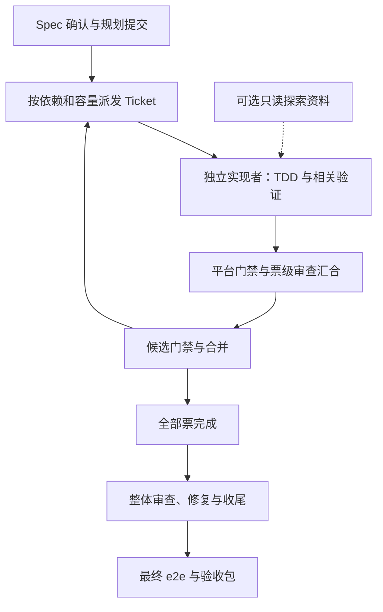

# 基于 implement-spec 的多 Ticket 执行优化方案

2026-11-25 · 提案，尚未实施。依据当前源码与仓库已有运行复盘，不包含本次新增的生产性能测量。

## 1. 目标与推荐决策

缩短票较多的 Spec 从确认到可验收的时间，同时保留按 Ticket 恢复、按 Run 追溯、跨仓库契约和联调能力。

推荐采用 `implement-spec` 的需求级执行思路，由 AFK 的确定性代码承担协调者：维护就绪票集合、派发独立实现者、合入集成分支、统一收尾。第一版继续使用现有 API 调度器和 worker，不增加一个常驻主 agent。优化按以下顺序交付：

1. 建立阶段耗时和排队基线，压缩单票运行的重复上下文。
2. 让实现者专注 TDD 和相关验证，把完整门禁交给平台。
3. 增加可复用的只读探索资料，按测量结果调整并发。
4. 有回放数据后，试验把部分票的审查移到需求收尾。
5. 只有合并排队成为主要瓶颈时，再设计批量候选门禁。

这份文档是优化提案，不改变 [总体设计](design.md)、[既有优化计划](optimization-plan.md) 或 ADR 的已定行为。涉及审查时机的变化单独形成 ADR 后实施。

## 2. 上游能力与 AFK 的对应关系

上游来源：[implement-spec 原文](https://github.com/mattpocock/skills/blob/main/skills/engineering/implement-spec/SKILL.md)。本次读取的是 2026-11-25 的 `main`，它不是 AFK 固定的 Skills SHA；实施前应以固定提交复核原文。

上游流程的重点是依赖图、独立实现者、上下文指针、可选共享探索、集成分支和需求末尾审查。平台映射如下：

| 上游职责 | AFK 当前实现 | 本方案处理 |
| --- | --- | --- |
| 识别可开工的票 | API scheduler 按依赖与容量选择票 | 保留，并展示等待原因 |
| 每张票使用新上下文的 implementer | worker 为阶段启动独立 agent Run | 保留，不以长会话串行做完整份需求 |
| 每张票独立 worktree 和分支 | 作业独立槽位 clone，Ticket 独立分支 | 保留 clone 隔离，生命周期仍按作业 |
| 用指针传递上下文 | 当前单票也收到全部票的实现描述和验收标准 | 改为索引加按需读取 |
| 可选探索者产出共享资料 | 当前缺少可复用的需求级探索产物 | 新增可选只读探索 Run |
| merger 合入集成分支 | 平台生成候选、门禁、带租约推送 | 保留确定性合并，仅失败时调用 agent |
| 整体 code-review 和一次修复 | 已有 final-review / final-fix 等收尾 | 保留；统一审查作为后续实验 |

本方案借鉴上游流程，不等同于在单票 prompt 中直接调用 `/implement-spec`。上游的子 agent 调度、建分支、合并和关闭工作，分别映射为 AFK 的作业、分支管理和状态机。

## 3. 已确认的现状与性能假设

| 项目 | 源码事实 | 对优化的含义 |
| --- | --- | --- |
| 并发 | `shared/src/limits.ts` 的项目、仓库默认并发均为 2；worker `AFK_SLOTS` 默认 2 | 先查部署覆盖值，不能只增加其中一项 |
| 关键路径 | scheduler 已按下游链长度排序 | 不重复实现这项优化；拆票时仍须避免过长串行链 |
| 单票检查 | implement prompt 要求提交前跑 gate 命令；之后还有平台 gate 和候选 gate | 可减少 agent 内完整检查，但保留平台验证 |
| 审查并行 | 首次 implement / gate-fix 后 gate 与 review 并行派发 | 不能把二者耗时相加当作单票墙钟时间 |
| 槽位 | gate、review、merge 等阶段都经 executor 获取槽位 | 就绪票不等于能立即开始，多个阶段竞争同一资源 |
| 合并 | 同一集成分支的 merge 租约覆盖候选生成、门禁和推送 | 增加实现并发后仍可能受合并吞吐限制 |
| 门禁复用 | `pipeline/src/gate.ts` 已按 tree SHA 和配置 blob 复用成功结果，再对当前基线判定 | 先观察命中率，不重复建设已有缓存 |
| 票上下文 | `pipeline/src/context.ts` 为每个单票渲染全部票的 What to build、验收标准、modules 和状态 | 多票场景可能产生大量重复输入 |
| 票级审查 | 默认 Spec 轴，`both` 才增加 Standards；final-review 仍两轴 | 不能把“去掉票级 Standards”再算作新增收益 |

现有 [优化计划](optimization-plan.md) 第 9 节已提出风险跳审应等待回放数据；第 10 节记录 S-51 的 12 张票中有 5 张票级审查判 fix。后者是仓库已有复盘，本次未重新查询运行库。因此本方案不以平台自身需求中审查拦截率低为依据，直接取消业务项目的票级审查。

单票执行的耗时假设要用数据验证：上下文膨胀、agent 内完整测试、共享代码重复探索、阶段排队和合并串行化，均可能是瓶颈，当前尚未确定各自占比。

## 4. 目标执行流程

图中省略现有 gate-fix、review-fix、merge-fix、Recheck、诊断和重试分支，它们继续由现有状态机处理。只有全部票满足当前完成条件才进入收尾；有联调票时继续遵守其 e2e 和修复票流程。

## 5. 第一阶段：上下文与重复验证

### 5.1 先建立可解释的基线

复用 Run、job 事件、gate records 和现有度量页的数据，补充一份按 Spec 展开的执行报告。第一版优先离线聚合，数据不足时才补字段或事件。

必须区分以下几种时间：

- 自动处理墙钟：从 Spec 确认到首次 `awaiting-review`；返工周期单独统计，不混入人工合并等待。
- 运行资源消耗：所有 agent Run 时长之和、门禁执行时长之和；并行时它们可超过墙钟时间。
- 作业排队：入队到领取；尚未入队的 pending 票另按依赖、项目容量、仓库容量和暂停原因统计。
- 合并等待：merge 入队到领取，以及持锁期间候选门禁时长。
- 重复成本：gate 复用命中、修复和自动重试次数、可获得的输入和缓存 token。

对于同一时刻的多种等待原因，保留全部原因并确定一个展示主因；不要把重叠区间重复计入总墙钟。历史事件不能还原的原因标为未知，不根据当前状态倒推。

### 5.2 用上下文指针替代其他票的完整描述

单票 implement、fix 和 review 采用以下结构，字段名是提案：

| 路径 | 内容 | 读取规则 |
| --- | --- | --- |
| `/context/ticket.md` | 本票完整内容 | 必读 |
| `/context/spec.md` | 完整 Spec，包含需求级规则 | 必读；第一版不摘要、不截断 |
| `/context/tickets.md` | 全部票的编号、仓库、标题、modules、状态和详情路径 | 必读的紧凑索引 |
| `/context/tickets/T-n.md` | 对应票的完整实现描述和验收标准 | 查看依赖、模块归属或 deferred 时按需读 |
| `/context/decisions.json` | 当前规则要求的决策日志 | 保持完整 |
| 契约、规划文档和参考仓库 | 现有钉住版本的资料 | 保持现有约束 |

渲染器从同一份 bundle 快照生成索引和详情，不能混用不同时间的票状态。详情文件必须实际挂载，不能只给无法访问的链接。所有票详情均可读取，不因按需加载而隐藏冲突或跨模块责任。

final-review、final-fix、final-tidy 及其 Recheck 第一版继续接收完整的 `tickets.md`，保持全需求审查范围。将来改为索引时，必须有逐票覆盖清单，不能沿用“其他票按需读”的单票规则。

收益来源是减少实现者和审查者主动读入模型的重复文字。文件仍在上下文目录里不等于 token 已消耗；验收必须检查实际读取和 token，而不是只比较文件大小。全部索引仍随票数线性增长，不宣称整体输入变成常数。

### 5.3 实现者只做相关验证，完整门禁由平台执行

普通实现票的快速验证策略下：

建议新增 `implementationChecks: full | focused`，默认 `full`，项目可配置，在 Spec 确认时冻结并传入 bundle；追加票沿用。第一批只对显式开启 `focused` 的项目试验，Run 记录实际采用的策略；仓库强制全量检查时记录回退为 `full` 的原因。

1. 保留红 → 绿和每条验收标准对应测试的要求。
2. 实现者运行新增与受影响测试，按仓库指令进行相关类型检查。
3. 不再由平台 prompt 额外要求实现者提交前逐条跑完整 gate；完整 typecheck、test、lint 仍由平台 gate 执行。
4. 测试失败按现有 gate-fix 处理，比较节省时间与新增修复成本。

这需要同时核对 `implement` 原文“结束时跑全量测试”的要求，覆盖层应明确平台 gate 承接这一步。不能仅删除阶段 prompt 的一句话，留下相反指令。

业务仓库 `AGENTS.md` 明确要求 agent 提交前全量检查时继续遵守；该仓库暂不能享受这项收益。契约票、联调票以及各类 fix 第一版保持现行完整检查，后续分别评估。联调 implement 继续使用专用流程，不强套普通票 TDD。

第一版不直接把普通实现票从 `implement` 改成只读 `tdd`：两者 prompt 长度差异不是主要收益。若后续精简为 `tdd`，必须证明实现、验证、提交和结构化输出职责均已完整承接。

## 6. 第二阶段：共享探索与有效并发

### 6.1 可选的需求级只读探索

同一仓库的多张票需要反复理解相同模块时，允许在该仓库启动一次只读探索 Run。第一批试点使用显式配置启用，默认关闭，不以票数自动推断收益。

探索输出包含：源码入口、现有测试位置、已确认的实现惯例、资料依据、读取的提交和路径；不重新制定接口、业务规则或拆票方案。它只是辅助资料，不高于 Spec、Ticket、契约、规划文档或仓库规范。

实现约束：

- API 创建作业，worker 经 pipeline 调用运行器；worker 不连数据库，API 不调用 Sandcastle。
- 每个仓库单独记录基准 SHA、Spec 内容摘要、票的内容版本集合、Skills SHA、契约及参考仓库 SHA。索引指向的源码必须可在该版本查到。
- 把有界的结构化输出和 Markdown 资料持久化为 Run 产物，由 API 在 bundle 中引用，worker 渲染为只读文件。不能依赖某台 worker 的 `/tmp` 目录供其他 worker 读取。
- 探索不持集成分支锁，也不成为全 Spec 的开工屏障。首批票可以与它并行；之后的 Run 在有有效资料时使用。
- 追加票、编辑内容、契约变化或相关代码路径变化后，相关资料失效；首次实现先保守按仓库 head 不同视为失效，后续有测量依据再按路径复用。
- 超时、缺结果或无有效资料时回退到现有自主探索，不阻断普通票；用户取消或失去租约时立即停止。其耗时和 token 计入 Spec 预算。

收益计算必须包含探索本身成本和首批票无法复用的部分；资料失效频繁时保持关闭。

### 6.2 调整并发，不重复增加调度层

沿用 scheduler 的依赖判定、关键路径排序和项目间公平性。先在容量足够的 worker 上联动测试 `AFK_SLOTS`、`projectConcurrency`、`repoConcurrency` 从 2 到 4 的配置；这只是实验配置，不直接修改全局默认值。

同时观察实际运行进程和容器数：一个 final-review 作业内部可能并行启动两个审查轴，槽位数不严格等于模型调用数。记录 OOM、CPU/内存压力、模型限流和合并排队，达到瓶颈则回退。

不为实现、审查、门禁分别增加互不计数的配额；任何后续资源池拆分都必须有统一的宿主机容量约束。`modules` 重叠继续作为规划告警，第一版不自动把所有重叠票串行化；已有复盘说明宽泛 glob 会误伤并行度。

## 7. 第三阶段：向需求级统一审查演进

这是最接近 `implement-spec` 的流程变化，也是必须先验证收益与质量的一步。

### 7.1 第一版先影子计算，再小范围试验

新增独立的审查时机配置，建议命名 `ticketReviewTiming: every-ticket | selective`，默认 `every-ticket`；现有 `ticketReview: spec | both` 继续只表达审查轴，不复用它表示“跳审”。配置按 Spec 确认时冻结，追加票沿用，Run 记录策略版本与判定理由。

影子阶段所有票照常审查，只记录哪些票按候选规则可以延后。回放时验证延后票的缺陷能否在 final-review 中被发现，同时评估缺陷流入依赖票后的返工；仅回放静态审查不能证明运行时返工成本。

选择性审查第一版只有满足全部条件的普通实现票可延后：

- 项目显式启用，且实际 changed paths 全部在项目配置的可延后路径内。
- 该票不提供其他票依赖的产物，即没有出边；契约票、联调票、修复票、人工交回的票均排除。
- 不涉及契约、保护路径、已有测试修改、测试或门禁配置、数据库迁移；项目认证、权限和其他业务关键路径也必须列入强制审查路径。
- 本票决策日志中的决定只包含 `choice`，或者没有决定；出现 `conflict`、`known-gap`、`deferred`、`workaround` 均立即审查。
- 解析不了变更、版本不一致、门禁失败、发生修复或合并冲突时，默认恢复逐票审查。

判定基于平台看到的真实 diff 和结构化输出，不能只依赖 agent 自报“低风险”，也不能只按票标题关键词决定。保守规则会限制收益，试验需要如实记录可延后比例。

### 7.2 延后审查的状态与收尾

门禁通过后，符合条件的票可进入现有 merge 流程；不得伪造一条 `review: pass`。单独记录“票级审查延后至需求级”、证据提交、规则版本和原因。合并成功后仍按现有语义记票 done，页面和验收包明确展示其尚未经过票级审查。

`reviewed` 当前还控制后续修复是否重新审查，不能简单设置为 true 来绕过。需引入明确的审查处置字段，与 gate∥review 汇合状态分开：发生 gate-fix、merge-fix、人工交回等情况时重新判定，第一版统一恢复票级审查。所有结论绑定实际提交，提交变化不能沿用旧判定。

final-review 必须据处置记录调整审查重点：目前 prompt 写着“单张票已经各自审过，重点看票与票之间”，选择性模式下这句话不成立。应提供本轮所有延后票、完整 What to build、验收标准和证据提交，要求同时检查这些票的完整实现及跨票行为，并返回逐票覆盖记录；漏覆盖视为无效结果。

保留需求级 Spec / Standards 双轴和一次 final-fix。保留现有 Ruling、未完成 deferred、疑点、Tidy、Recheck 和最终 e2e 规则，不能用优化绕过已有的 needs-human 展示。纯选择性模式原则上不延后有待判决定的票，但 final-review 仍要检查全需求决策日志。

返工追加后，从既有机制重新收尾，并重新审查新票及它们影响的旧票；不得把上轮覆盖记录当成本轮最终结论。已取消票不要求实现，但其留在集成分支中的实际改动仍属于整体审查范围。

暂不提供“所有票只做最终审查”的模式；待业务项目回放和试点证明可行后再扩展。

## 8. 后续选项：批量候选门禁

只有报告证明同一集成分支的候选门禁持续占据关键路径时启动此项，不与前几阶段捆绑。

思路是把已经通过各自平台门禁及必要审查的若干票，顺序合成一个候选，在分支锁内验证一次，再带租约前移。第一版排除契约票、联调票和相互依赖的票，避免提前满足依赖或改变 Contract SHA 语义。

若候选门禁失败，集成分支不动，按原顺序逐票回退验证以定位问题，不整批重新调用 implement。仅批次最终 head 的测试结果可复用，不能给未验证的中间 tree 伪造门禁记录。每票 merge 记录、trailer、基线、幂等与部分发布后的恢复都需独立设计。此项先形成专项 ADR 和 Spec。

不采用“实现者每次完成前无条件合并最新集成分支”的规则：平台已有候选合并和门禁，无条件同步可能引起额外测试、冲突和提交变化；仅在实际冲突处理等现有必要场景同步。

## 9. 实施拆分与验收

以下是建议 Ticket，不是已导入平台的票。每张实际 Ticket 只改一个 Repo；本次平台改动都在当前仓库内。

| 顺序 | 交付 | 主要改动位置 | 依赖 | 可验收结果 |
| --- | --- | --- | --- | --- |
| A | 执行基线报告与回放样本 | `api/src/metrics/`、job 事件、校准工具 | 无 | 可分开计算自动处理墙钟、资源消耗、依赖等待和合并等待；未知数据有标记 |
| B | 单票上下文索引与详情 | `pipeline/src/context.ts`、单票 prompts | A | 单票不再默认读入其他票全文；全文可按指针读取；收尾仍完整覆盖 |
| C | 实现者快速验证策略 | implement prompt、overlay、配置及 bundle | A | 平台 gate 仍完整运行；仓库强制指令优先；能比较新增 gate-fix 成本 |
| D | 可选共享探索 | shared schema、API 作业及 bundle、pipeline、worker | A、B | 多 worker 可复用；资料版本正确；失败回退；预算、取消和租约生效 |
| E | 并发配置实验与报告 | 部署配置、运行报告 | A；对 B/C 前后分别测量 | 2 与 4 并发有可比较结果，质量和资源消耗可见 |
| F | 延后审查影子判定与校准 | shared 策略函数、API 结果、校准工具 | A | 仍逐票审查；报告候选覆盖率、缺陷发现和业务样本结果 |
| G | 选择性审查与完整收尾覆盖 | `stage-flow.ts`、API results、finalize、prompts、页面和验收包 | F 通过质量门槛 | 不伪造 pass；修复恢复审查；普通执行、返工和收尾均有验证 |
| H | 批量候选专项设计 | 合并队列、worker merge、基线与恢复 | A 显示瓶颈 | 先完成 ADR、失败与恢复设计，再决定实现 |

涉及 shared schema、API 路由或数据库时分别更新公共导出、`pnpm gen:api` 和 Drizzle 迁移；不得让 worker 引用 API 或连接数据库。需要修改 Skills SHA、Sandcastle 依赖、镜像或门禁保护路径时，实施范围中明确列出，按仓库保护规则处理。本提案本身不需要修改这些路径。

行为实现先写公共接口测试，API 测试使用真 Postgres。覆盖以下关键场景：

- 上下文：本票、其他票详情、全局规则、契约、参考仓库、决策日志和收尾完整性。
- 探索：同一资料多 worker 读取、版本失效、追加/编辑、预算、失去租约和取消。
- 策略：真实 diff 强制审查、有出边、非 choice 决定、未知路径、人工交回和各类修复。
- 流水线：gate∥review 同提交汇合、延后记录、提交变化、失败回退、重复结果幂等。
- 收尾：未审票逐票覆盖、Ruling、final-fix、Tidy/Recheck、final-e2e、追加返工及取消。

实施完成运行仓库要求的 typecheck、全量 test 和 lint；文档提案阶段不假称已跑行为回归。

## 10. 效果评估与退出条件

以下百分比是试点目标，尚无测量结果支撑，不是性能承诺。按同一项目、同类需求、相近票数/依赖深度、相同模型、镜像和 skills 版本比较，避免只用一次运行判断。

| 优化 | 初始目标 | 继续推广条件 |
| --- | --- | --- |
| 上下文索引 | 可获得 token 数据的单票 Run，输入 token 中位数下降至少 20% | 需求完整性和跨票归属校准不下降；数据缺失时先报告读取量 |
| 实现者快速验证 | 同类票 implement 资源消耗中位数下降至少 15% | 包含新增 gate-fix 后仍净节省，且提交前仓库规范得到遵守 |
| 共享探索 | 重复探索较多的需求，总 agent 时间净下降 | 包含探索自身成本与失效重跑；资料无效时可回退 |
| 有效并发 | 就绪票积压时，自动处理墙钟下降 | OOM、限流、冲突与合并排队成本不抵消收益 |
| 选择性审查 | 试点多票需求自动处理墙钟中位数下降至少 20% | 校准必检缺陷全部命中；业务样本缺陷与人工返工无恶化证据 |

每项分开启用和回退。旧 Spec 默认沿用确认时策略；停止对新 Spec 启用，不撤销已合并票。确需中途收紧审查时，只把尚未合并的延后票转回逐票审查，保留历史记录；已合并的延后票必须进入最终覆盖清单。

模型调用缺少 token 时标为空，不能记为零。少量 Spec 只作为试点观察；历史复盘、静态回放和真实运行分别报告，不混称线上收益。

## 11. 首批实施范围

先实施 A、B、C，再按瓶颈选择 D 或 E；F 可在不改变现行审查行为的情况下开展。G 以业务项目校准和试点结果为前置，H 暂留专项设计。

第一批优化的核心是：保留已成熟的依赖图与恢复机制，让每次实现运行少读重复资料、少做重复检查，并让可并行的票及时开工。这样能够独立验证收益，也为后续采用上游的需求级统一审查提供依据。
